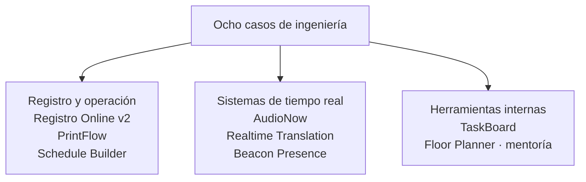

<a href="README.md">English version</a>

# Production Systems Case Studies

**Ocho casos profesionales de ingeniería: registro y pagos, audio multilingüe, impresión bajo demanda, presencia IoT y herramientas internas.**

Este archivo presenta mi trabajo de arquitectura, implementación, integración y mentoría técnica. Cada caso explica el problema, mi contribución, las decisiones de la solución y el alcance entregado.

Los repositorios originales son privados. Este archivo contiene documentación técnica, sin código fuente ni datos del cliente. Las fichas describen versiones y entregas históricas de 2026; no implican que actualmente opere los servicios.

## Empieza por aquí

- **[AudioNow](projects/audionow.es.md)** — audio WebRTC, integración de proveedores de traducción y ciclo de sesiones. Para profundizar en tiempo real e integración de IA.
- **[Registro Online v2](projects/online-registration.es.md)** — dos flujos de compra, reintentos de pago y convivencia con un sistema heredado. Para profundizar en producto full-stack e integración de datos.
- **[PrintFlow](projects/printflow.es.md)** — conciliación de datos, kiosco web e impresión de escritorio. Para profundizar en una entrega que conecta web, almacenamiento local y dispositivos físicos.

## Los ocho casos

| Caso | Mi contribución | Alcance entregado |
|---|---|---|
| [AudioNow](projects/audionow.es.md) | Integración de audio, sesiones, permisos y evolución de proveedores | Uso en sesiones reales documentado; proveedor principal y rama de validación OpenAI diferenciados |
| [Registro Online v2](projects/online-registration.es.md) | Descubrimiento, modelo de datos, autenticación, pagos e integración legacy | M1–M3 implementados; comprobaciones operativas e hitos posteriores delimitados |
| [PrintFlow](projects/printflow.es.md) | Generación de credenciales, conciliación, kiosco e integración de impresión | Entrega presencial documentada; operación offline condicionada al material preparado |
| [Beacon Presence](projects/ble-presence.es.md) | Procesamiento de señal, lógica de presencia y arquitectura IoT | MVP de software; la validación física seguía como siguiente hito |
| [Realtime Translation](projects/realtime-translation.es.md) | Abstracción de proveedores, orquestación de audio y observabilidad | PoC v1.0 y evolución v1.1; alcance de validación distinto por adaptador |
| [Schedule Builder](projects/schedule-builder.es.md) | Superficie de integración de lectura, normalización y generación PDF | Flujo PDF verificado en mayo de 2026; comprobaciones adicionales de paridad pendientes |
| [TaskBoard](projects/taskboard.es.md) | Peticiones, votos, permisos y actualizaciones en tiempo real | Herramienta interna implementada; activación del email pendiente en la última nota de entrega |
| [Floor Planner](projects/floor-planner.es.md) | Arquitectura inicial, orientación y revisión técnica | Proyecto de mentoría con editor 2D/3D, reservas e importación OCR; implementación del becario |

## Cómo leer los casos

Cada ficha distingue **mi papel**, **el alcance implementado** y **la evidencia de validación o entrega**. Una herramienta desplegada, un MVP de software, un experimento de proveedor y un proyecto de mentoría tienen propósitos y criterios de cierre distintos.

Los tres casos destacados ofrecen decisiones complementarias para una entrevista. Para puestos AWS/IoT, [Beacon Presence](projects/ble-presence.es.md) añade profundidad en infraestructura y procesamiento de señal. El [índice completo](projects/README.es.md) ofrece un recorrido breve por los ocho.

Mapa de áreas de ingeniería

Este es un mapa de clasificación. Sus flechas agrupan casos; no representan dependencias de ejecución ni una base de producción compartida. Cada ficha incluye su propio diagrama de arquitectura.

## Detalle técnico

- **[Stack y contribución](STACK.es.md)** — tecnologías enlazadas con el caso y la responsabilidad que las respaldan.
- **[Pruebas y validación](TESTING.es.md)** — comportamientos probados, resultados históricos fechados y sus límites.
- **[Metodología](METHODOLOGY.es.md)** — descubrimiento, planificación, implementación asistida por IA y revisión.

El énfasis está en las decisiones y la entrega. Los inventarios de implementación pertenecen al contexto de cada caso; archivos, commits y herramientas de prueba configuradas no sustituyen resultados medidos.

## Sobre mí

**Alejandro González López — desarrollador full-stack.** Mi trabajo combina integración de sistemas, aplicaciones web, medios en tiempo real y experiencias 3D. Estos casos distinguen implementación de mentoría técnica.

[Portfolio](https://aglwences.dev) · [LinkedIn](https://www.linkedin.com/in/alejandrogonzlopez/) · [GitHub](https://github.com/aleglope)
