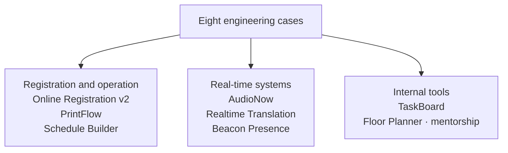

<a href="README.es.md">Versión en español</a>

# Production Systems Case Studies

**Eight professional engineering case studies: registration and payments, multilingual audio, on-demand printing, IoT presence and internal tools.**

This archive presents my work in architecture, implementation, integration and technical mentorship. Each case explains the problem, my contribution, the decisions behind the solution and the scope delivered.

The original repositories are private. This archive contains technical documentation, without source code or client data. Cases describe historical implementation and delivery records from 2026; they do not imply that I currently operate the services.

## Start here

- **[AudioNow](projects/audionow.md)** — WebRTC audio, translation-provider integration and session lifecycle. Read it for real-time systems and AI integration.
- **[Online Registration v2](projects/online-registration.md)** — two purchasing flows, payment retries and coexistence with a legacy system. Read it for full-stack product and data integration.
- **[PrintFlow](projects/printflow.md)** — data reconciliation, a web kiosk and desktop printing. Read it for delivery across web, local storage and physical devices.

## The eight cases

| Case | My contribution | Delivery scope |
|---|---|---|
| [AudioNow](projects/audionow.md) | Audio integration, sessions, permissions and provider evolution | Live-session use documented; main provider and OpenAI validation branch distinguished |
| [Online Registration v2](projects/online-registration.md) | Discovery, data model, authentication, payments and legacy integration | M1–M3 implemented; operational checks and later milestones identified separately |
| [PrintFlow](projects/printflow.md) | Credential generation, reconciliation, kiosk and print integration | In-person delivery documented; offline operation requires prepared material |
| [Beacon Presence](projects/ble-presence.md) | Signal processing, presence logic and IoT architecture | Software MVP; physical validation remained the next milestone |
| [Realtime Translation](projects/realtime-translation.md) | Provider abstraction, audio orchestration and observability | PoC v1.0 and v1.1 evolution; validation scope differs by adapter |
| [Schedule Builder](projects/schedule-builder.md) | Read-only integration surface, normalization and PDF generation | PDF workflow verified in May 2026; additional data-parity checks remained |
| [TaskBoard](projects/taskboard.md) | Requests, voting, permissions and real-time updates | Internal tool implemented; email activation was pending in the last delivery note |
| [Floor Planner](projects/floor-planner.md) | Initial architecture, guidance and technical review | Mentorship project with a 2D/3D editor, reservations and OCR import; implementation by the intern |

## How to read the cases

Each case separates **my role**, **the implemented scope** and **the validation or delivery evidence**. A deployed tool, a software MVP, a provider experiment and a mentorship project have different purposes and completion criteria.

The three featured cases offer complementary decisions to discuss in an interview. For AWS/IoT roles, [Beacon Presence](projects/ble-presence.md) adds infrastructure and signal-processing depth. The [full index](projects/README.md) provides a short route through all eight.

Map of engineering areas

This is a classification map. Its arrows group cases; they do not describe runtime dependencies or a shared production database. Each case has its own architecture diagram.

## Technical detail

- **[Stack and contribution](STACK.md)** — technologies linked to the case and responsibility that support them.
- **[Testing and validation](TESTING.md)** — behaviors tested, dated historical results and their limits.
- **[Methodology](METHODOLOGY.md)** — discovery, planning, AI-assisted implementation and review.

The emphasis is on decisions and delivery. Implementation inventories belong in the case context; file counts, commits and configured test tools are not substitutes for measured results.

## About me

**Alejandro González López — full-stack developer.** My work combines system integration, web applications, real-time media and 3D experiences. These case studies distinguish implementation work from technical mentorship.

[Portfolio](https://aglwences.dev) · [LinkedIn](https://www.linkedin.com/in/alejandrogonzlopez/) · [GitHub](https://github.com/aleglope)
