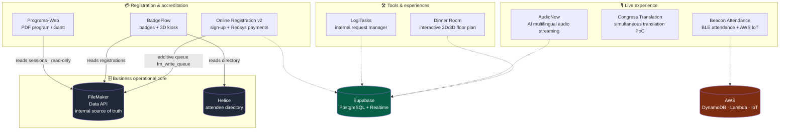

<a href="README.es.md">🇪🇸 Versión en español</a>

# Congress Tech Systems

### A software ecosystem for end-to-end medical congress management

**8 production systems, designed and built solo** across 2025–2026, with an AI-augmented development workflow (Claude Code + phase-based planning methodology).

---

## 📖 What this repository is

This repository **contains no source code**. It is an **archive of technical case studies** covering the work I did as the **sole developer** of the software stack at a Spanish medical-congress management company.

The original repositories are **private and proprietary**. What you will find here is the **architecture documentation, technical decisions, solved challenges and outcomes** of each system — the material that usually only surfaces in a technical interview, compiled so that a recruiter or lead developer can assess the real scope of the work.

> **Why this format.** With proprietary projects you can't publish the code, but you *can* demonstrate how you think: system design, justified decisions, and production impact. This is the standard practice for showcasing work that can't be open-sourced.

---

## 🗺️ The ecosystem at a glance

The entire ecosystem revolved around **FileMaker** as the business's operational source of truth (what the internal team used daily), with modern web systems built around it — some **read** from it, some **write to it additively**, and others run on their own synchronized database.

---

## 📂 The 8 systems

| System | What it solves | Core stack | Status |
|---|---|---|---|
| **[Online Registration v2](projects/inscripcion-online.md)** | Multi-event online registration and payments for medical congresses | Next.js 16 · Supabase · Drizzle · Redsys · FileMaker · OTP | 🟢 Core in production |
| **[BadgeFlow](projects/badgeflow.md)** | Badge generation and printing with a 3D self-service kiosk | NestJS · Next.js 16 · Puppeteer · R3F · PWA · FileMaker | 🟢 Production (real congress) |
| **[AudioNow](projects/audionow.md)** | Real-time multilingual audio streaming with AI translation | Next.js · NestJS · LiveKit · Palabra.ai · Supabase | 🟢 Production (real events) |
| **[Beacon Attendance](projects/beacon-attendance.md)** | Automatic attendance tracking via BLE beacons | AWS CDK · IoT Core · Lambda · DynamoDB · Kinesis | 🟢 Working MVP deployed |
| **[Congress Translation](projects/congress-translation.md)** | Simultaneous voice translation for conference talks | LiveKit · Azure Speech · OpenAI Realtime · NestJS | 🟢 PoC v1.0 delivered |
| **[Programa-Web](projects/programa-web.md)** | Congress program generator (Gantt → PDF) | Next.js 15 · FileMaker Data API · Upstash Redis | 🟢 Production |
| **[LogiTasks](projects/logitasks.md)** | Internal request manager prioritized by team voting | Next.js 16 · Supabase Realtime · Resend | 🟢 Production (internal) |
| **[Dinner Room](projects/sala-cenas.md)** | Interactive 2D/3D table-reservation floor plan | Next.js · Three.js · Konva · Supabase · GPT-4.1 | 🟡 Intern mentorship |

---

## 🧩 Cross-cutting capabilities demonstrated

Beyond each individual project, the ecosystem as a whole demonstrates command of:

- **Legacy system integration** — FileMaker as the operational source of truth: strict read-only access (Programa-Web), **additive, never-destructive** synchronization through a write queue (Online Registration), and multi-source reconciliation of Helice + FileMaker (BadgeFlow).
- **Real-time** — WebRTC SFU with LiveKit (AudioNow, Congress Translation), Supabase Realtime (LogiTasks, Dinner Room), sub-500 ms IoT pipelines (Beacon Attendance).
- **AI integrations in production** — speech-to-speech translation with Palabra.ai, Azure Live Interpreter and OpenAI Realtime; floor-plan import with vision (GPT-4.1 + OpenCV + OCR).
- **Payments** — Redsys payment gateway with HMAC-SHA256 signing, server-to-server webhooks and payment-attempt idempotency.
- **PWA & offline-first** — Service Workers with Serwist, asset caching and IndexedDB to keep operating with no network at the venue itself.
- **3D on the web** — React Three Fiber + Rapier (badge-lanyard physics in the kiosk), Three.js + drei (room editor).
- **Infrastructure** — multi-stage Docker, AWS CDK (IaC), Vercel + Railway deployments, external workers.
- **Security** — PostgreSQL RLS, `SECURITY DEFINER` RPCs, role hierarchies, `iron-session` sessions, rate limiting.

See the full breakdown in **[STACK.md](STACK.md)**.

---

## 🤖 Methodology: AI-augmented development with engineering discipline

This entire ecosystem was built by **one person** in a matter of months. That was possible by combining AI tooling (Claude Code) with a **phase-based planning methodology** that leaves a verifiable trail in every repository:

- **Plan before code** — every milestone is broken into phases with `PLAN`, `RESEARCH`, `CONTEXT` and `REQUIREMENTS` documents before writing code.
- **Per-phase verification** — every phase closes with a `VERIFICATION.md` that checks the goal was achieved (not just that tasks "got done").
- **Explicit conventions** — `CLAUDE.md` / `AGENTS.md` files codify each project's rules (e.g. "this Next.js 16 version has breaking changes: read the docs before touching anything").
- **Decision traceability** — decision IDs (`D-XX`), numbered pitfalls and plan references embedded in code comments.

> The result is not vibe coding: it's one person's speed with a team's process rigor. AI accelerates execution; architecture, decisions and verification remain the developer's responsibility.

**By the numbers (verified in the repos):** 37 planned phases · 30 verification documents · ~56 design specs/plans · 2 custom reusable AI agents · **~314 test files**.

📄 Full detail in **[METHODOLOGY.md](METHODOLOGY.md)** (AI-augmented process) and **[TESTING.md](TESTING.md)** (per-project test suites).

---

## 👤 About the author

**Alejandro González López** — Full-stack developer.

Solely responsible for the company's software stack: architecture, development, integrations, deployments and operation of the 8 systems in this repository. Also responsible for mentoring an intern (see [Dinner Room](projects/sala-cenas.md)).

- 🌐 Portfolio: [aglwences.dev](https://aglwences.dev)
- 💼 LinkedIn: [alejandrogonzlopez](https://www.linkedin.com/in/alejandrogonzlopez/)
- 🐙 GitHub: [@aleglope](https://github.com/aleglope)

---

*Client names and sensitive data have been anonymized. This repository documents architecture and decisions — it contains no proprietary code.*

