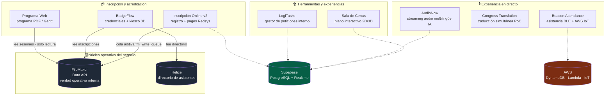

# Congress Tech Systems

### Ecosistema de software para la gestión integral de congresos médicos

**8 sistemas en producción, diseñados y construidos en solitario** a lo largo de varios meses de 2026, con un flujo de desarrollo *AI-augmented* (Claude Code + metodología de planificación por fases).

---

## 📖 Qué es este repositorio

Este repositorio **no contiene código fuente**. Es un **archivo de casos de estudio técnicos** del trabajo que realicé como **único desarrollador** del stack de software de una empresa española de organización de congresos médicos.

Los repositorios originales son **privados y propietarios**. Lo que encontrarás aquí es la **documentación de arquitectura, decisiones técnicas, retos resueltos y resultados** de cada sistema — el material que normalmente solo se ve en una entrevista técnica, recopilado de forma que un reclutador o un *lead developer* pueda evaluar el alcance real del trabajo.

> **Por qué este formato.** En proyectos propietarios no se publica el código, pero sí se puede demostrar *cómo se piensa*: el diseño de sistemas, las decisiones justificadas, y el impacto en producción. Es la práctica estándar para mostrar trabajo que no se puede abrir.

---

## 🗺️ El ecosistema de un vistazo

Todo el ecosistema giraba en torno a **FileMaker** como sistema operativo de verdad del negocio (lo que usaba el equipo interno), con sistemas web modernos construidos alrededor — unos lo **leen**, otros le **escriben de forma aditiva**, y otros operan sobre su propia base de datos sincronizada.

---

## 📂 Los 8 sistemas

| Sistema | Qué resuelve | Stack principal | Estado |
|---|---|---|---|
| **[Inscripción Online v2](projects/inscripcion-online.md)** | Inscripción y pago online multi-evento para congresos médicos | Next.js 16 · Supabase · Drizzle · Redsys · FileMaker · OTP | 🟢 Núcleo en producción |
| **[BadgeFlow](projects/badgeflow.md)** | Generación e impresión de credenciales con kiosco 3D | NestJS · Next.js 16 · Puppeteer · R3F · PWA · FileMaker | 🟢 Producción (congreso real) |
| **[AudioNow](projects/audionow.md)** | Streaming de audio multilingüe en tiempo real con IA | Next.js · NestJS · LiveKit · Palabra.ai · Supabase | 🟢 Producción (eventos reales) |
| **[Beacon Attendance](projects/beacon-attendance.md)** | Asistencia automática por *beacons* BLE | AWS CDK · IoT Core · Lambda · DynamoDB · Kinesis | 🟢 MVP funcional desplegado |
| **[Congress Translation](projects/congress-translation.md)** | Traducción de voz simultánea para ponencias | LiveKit · Azure Speech · OpenAI Realtime · NestJS | 🟢 PoC v1.0 entregado |
| **[Programa-Web](projects/programa-web.md)** | Generador del programa del congreso (Gantt → PDF) | Next.js 15 · FileMaker Data API · Upstash Redis | 🟢 Producción |
| **[LogiTasks](projects/logitasks.md)** | Gestor interno de peticiones priorizadas por votación | Next.js 16 · Supabase Realtime · Resend | 🟢 Producción (interno) |
| **[Sala de Cenas](projects/sala-cenas.md)** | Plano interactivo 2D/3D de reservas de mesa | Next.js · Three.js · Konva · Supabase · GPT-4.1 | 🟡 Mentoría a becario |

---

## 🧩 Capacidades transversales demostradas

Más allá de cada proyecto, el ecosistema completo demuestra dominio de:

- **Integración de sistemas legacy** — FileMaker como fuente de verdad operativa: lectura estricta (Programa-Web), sincronización **aditiva y nunca destructiva** mediante cola encolada (Inscripción Online), y conciliación multi-fuente Helice + FileMaker (BadgeFlow).
- **Tiempo real** — WebRTC SFU con LiveKit (AudioNow, Congress Translation), Supabase Realtime (LogiTasks, Sala de Cenas), pipelines IoT sub-500 ms (Beacon Attendance).
- **Integraciones de IA en producción** — traducción *speech-to-speech* con Palabra.ai, Azure Live Interpreter y OpenAI Realtime; importación de planos con visión (GPT-4.1 + OpenCV + OCR).
- **Pagos** — TPV Redsys con firma HMAC-SHA256, webhooks server-to-server e idempotencia de intentos de pago.
- **PWA y *offline-first*** — Service Workers con Serwist, cache de assets e IndexedDB para operar sin red en el propio congreso.
- **3D en la web** — React Three Fiber + Rapier (física de *lanyard* en kiosco), Three.js + drei (editor de salas).
- **Infraestructura** — Docker multi-stage, AWS CDK (IaC), despliegue en Vercel + Railway, *workers* externos.
- **Seguridad** — RLS en PostgreSQL, RPC `SECURITY DEFINER`, jerarquías de roles, sesiones `iron-session`, rate limiting.

Ver el desglose completo en **[STACK.md](STACK.md)**.

---

## 🤖 Metodología: desarrollo *AI-augmented* con disciplina de ingeniería

Todo este ecosistema lo construyó **una sola persona** en cuestión de meses. Eso fue posible combinando herramientas de IA (Claude Code) con una **metodología de planificación por fases** que deja rastro verificable en cada repositorio:

- **Planificación previa** — cada *milestone* se descompone en fases con documentos `PLAN`, `RESEARCH`, `CONTEXT` y `REQUIREMENTS` antes de escribir código.
- **Verificación por fase** — cada fase cierra con un documento `VERIFICATION.md` que comprueba que el objetivo se cumplió (no solo que las tareas "se hicieron").
- **Convenciones explícitas** — ficheros `CLAUDE.md` / `AGENTS.md` codifican las reglas del proyecto (p. ej. "esta versión de Next.js 16 tiene *breaking changes*: consulta los docs antes de tocar").
- **Trazabilidad de decisiones** — IDs de decisión (`D-XX`), *pitfalls* numerados y referencias a planes embebidos en los comentarios del código.

> El resultado no es *vibe coding*: es velocidad de una persona con el rigor de proceso de un equipo. La IA acelera la ejecución; la arquitectura, las decisiones y la verificación son responsabilidad del desarrollador.

**En números (verificado en los repos):** 37 fases planificadas · 30 documentos de verificación · ~56 specs/planes de diseño · 2 agentes de IA reutilizables propios · **~314 archivos de test**.

📄 Detalle completo en **[METHODOLOGY.md](METHODOLOGY.md)** (proceso *AI-augmented*) y **[TESTING.md](TESTING.md)** (batería de pruebas por proyecto).

---

## 👤 Sobre el autor

**Alejandro González López** — Desarrollador full-stack.

Único responsable del stack de software de la empresa: arquitectura, desarrollo, integraciones, despliegues y operación de los 8 sistemas de este repositorio. También responsable de mentorizar a un becario (ver [Sala de Cenas](projects/sala-cenas.md)).

- 🌐 Portfolio: *(pendiente de enlazar — `three-js-portfolio`)*
- 💼 LinkedIn: *(añadir)*
- 🐙 GitHub: [@aleglope](https://github.com/aleglope)

---

*Los nombres de clientes y datos sensibles han sido anonimizados. Este repositorio documenta arquitectura y decisiones, no contiene código propietario.*

