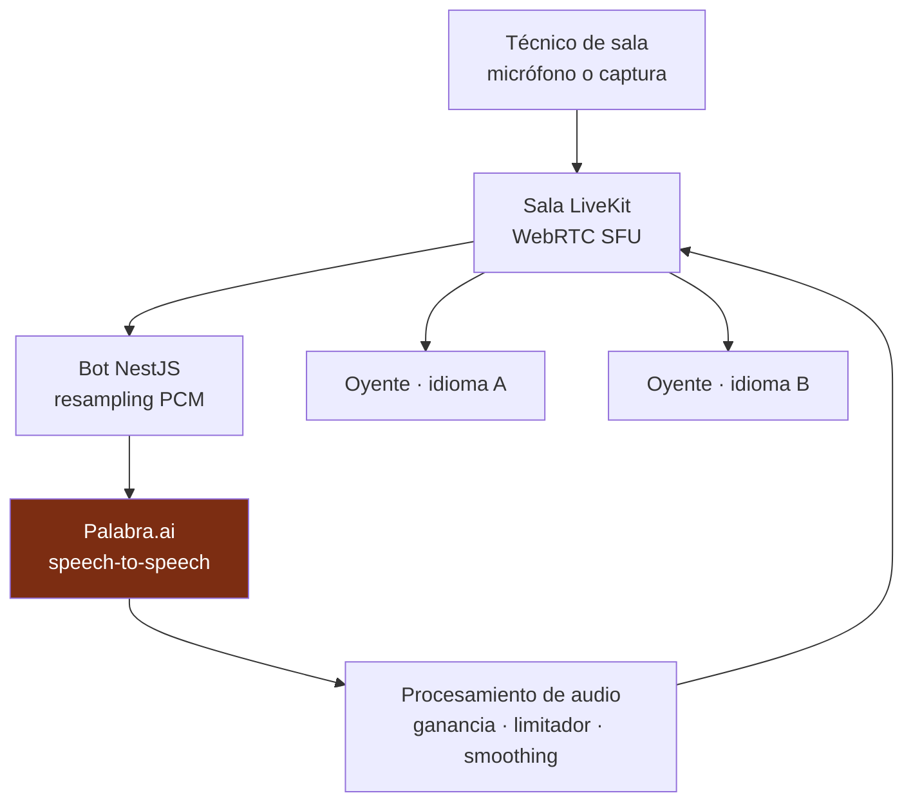
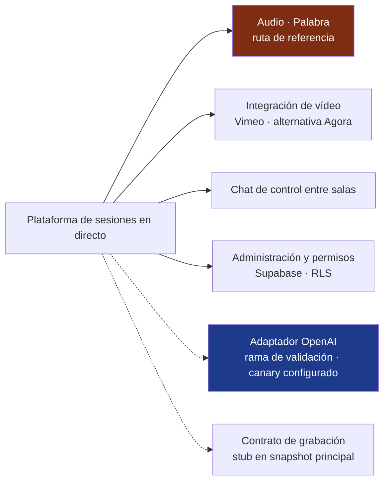

<a href="audionow.md">🇬🇧 English version</a>

# AudioNow

> Audio multilingüe para sesiones en directo: un bot de servidor traduce el audio de la sala y lo distribuye por WebRTC a los oyentes, desde su propio navegador.

## Mi contribución y alcance entregado

| Aspecto | Alcance |
|---|---|
| Mi contribución | Arquitectura e integración del flujo de audio, ciclo de vida de las sesiones de traducción, permisos y extensión de proveedores |
| Versión descrita | Plataforma principal a 21 de mayo de 2026; rama separada de integración OpenAI a 19 de mayo de 2026 |
| Alcance entregado | Plataforma basada en Palabra con uso en sesiones reales documentado en los registros del proyecto |
| Evolución de proveedor | Adaptador OpenAI implementado con pruebas unitarias y entorno canary configurado; la validación con tráfico real y la promoción son hitos separados |

## Contexto y problema

Los oyentes necesitaban recibir el audio de una sala en su idioma, desde el móvil, sin instalar una aplicación ni crear una cuenta. El sistema debía conectar técnicos de sala, servicios de traducción y reproducción en el navegador, controlando el retraso, los artefactos de audio y el ciclo de vida de las sesiones de traducción facturables.

Una pista compartida por idioma permite organizar las sesiones de traducción por sala e idioma, en lugar de crear una por cada oyente. La infraestructura, el transporte de audio y la traducción siguen teniendo sus propios costes.

## Solución y arquitectura

El audio del técnico entra en una sala **LiveKit**. Un bot **NestJS** se suscribe, adapta el PCM para **Palabra.ai**, recibe el audio traducido y publica una pista por idioma. Los oyentes acceden por una URL pública y eligen su idioma.

**Alcance del diagrama:** recorrido lógico del audio en la variante Palabra descrita en mayo de 2026. Las flechas representan audio; los permisos y la administración se explican por separado más abajo.

## Capacidades de la plataforma y evolución de proveedores

La plataforma también incluía chat de control entre salas, integraciones de vídeo y una capa de administración:

- **Chat de control entre salas** con vistas de gestión, monitorización y participante para coordinar a la organización y los técnicos.
- **Integración de vídeo** con un proxy HLS para Vimeo y una alternativa Agora junto al audio traducido.
- **Permisos** mediante Supabase, RLS de PostgreSQL y una jerarquía de tres roles para separar administración y operación de sala.
- **Extensión de proveedor** con un adaptador OpenAI Realtime en una rama de integración separada. El proveedor se seleccionaba **por sala**; cambiarlo exigía detener primero el audio en directo.
- **Grabación** como contrato con implementación stub en el snapshot principal del 21 de mayo.

**Alcance del diagrama:** mapa de capacidades, no secuencia de llamadas en ejecución. Las ramas discontinuas identifican la vía de validación OpenAI y el stub de grabación; las etiquetas distinguen su madurez de la ruta de audio de referencia.

## Decisiones técnicas y costes

| Decisión | Implementación y motivo | Coste o límite |
|---|---|---|
| **SFU LiveKit + bot de servidor** | Publicar una pista traducida compartida por idioma y distribuirla a los oyentes | Las sesiones de traducción se desacoplan del número de oyentes; la infraestructura de audio sigue necesitando gestión de capacidad y costes |
| **Un cliente por sala/idioma** | Serializar altas concurrentes de idiomas y gestionar el ciclo de cada cliente de traducción | Aísla idiomas y reduce el riesgo de sesiones huérfanas; exige cierre y reconexión explícitos |
| **Limitador soft-knee y smoothing** | Comprimir picos PCM con `tanh` en vez de recortarlos y suavizar límites de chunks por dirección de traducción | Reduce artefactos de clipping; la ganancia y el procesamiento siguen necesitando comprobaciones de escucha |
| **Jerarquía de roles y RPC protegidas** | Centralizar cambios de estado del streaming mediante comprobaciones de permisos, RLS, RPC y guardas de actualización | Ofrece una vía controlada para técnicos y administradores; las políticas SQL y la aplicación deben evolucionar juntas |
| **Acceso anónimo de oyentes** | Lectura de salas/eventos públicos mediante RLS | Elimina el registro del oyente manteniendo la gestión tras una autorización separada |
| **Selección de proveedor por sala** | Rechazar el cambio de proveedor mientras el audio de la sala está en directo | Protege el flujo activo; cambiar exige una operación deliberada de parar/cambiar/arrancar |
| **Resampling específico por proveedor** | Palabra usa 16 kHz; la rama OpenAI convierte la entrada LiveKit de 48 a 24 kHz con filtro FIR anti-aliasing antes de la decimación 2:1 | Una interfaz común sigue necesitando adaptación explícita del formato de audio |

## Ciclo de sesiones y tratamiento del audio

Dos peticiones concurrentes de alta de idioma podían crear un cliente de traducción huérfano. El mecanismo de exclusión por sala/idioma serializa esa operación para mantener un responsable controlado de su ciclo de vida.

Un watchdog de silencio y backoff exponencial inician la reconexión cuando el flujo del proveedor se bloquea. Los perfiles de playout ajustan el buffer a distintas necesidades de retraso. Estos controles atienden fallos distintos: conexiones detenidas, audio acumulado y discontinuidades entre chunks.

La extensión OpenAI mantuvo las diferencias del proveedor tras una interfaz y expuso una configuración por sala a los operadores. Añadió otra vía de integración sin implicar que un stream activo pudiera cambiar de motor de forma transparente.

## Resultado y límites

Los registros del proyecto de mayo de 2026 documentan uso en sesiones reales y una actualización de permisos en producción. Esto sitúa la entrega en un contexto operativo histórico, sin asignar un aforo no registrado ni un estado actual del servicio.

La API mantenía sesiones en memoria y utilizaba **una sola réplica** en la arquitectura beta. Escalar horizontalmente requeriría externalizar ese estado, por ejemplo a Redis. Fue una decisión explícita de alcance, no una promesa de capacidad ilimitada.

El resultado documentado de OpenAI era un adaptador implementado, pruebas unitarias y configuración canary. Esta vía de integración estaba separada del uso operativo registrado de la plataforma Palabra.

Un aprendizaje útil fue que compartir una interfaz de proveedor solo resuelve parte de la integración: formato de audio, responsabilidad de la sala, cierre y recuperación siguen siendo responsabilidades explícitas.

El alcance de las pruebas y la validación histórica se resumen en [Pruebas](../TESTING.es.md); las prácticas transversales se describen en [Metodología](../METHODOLOGY.es.md).

## Competencias demostradas

`LiveKit / WebRTC` · `resampling PCM` · `limitación y smoothing de audio` · `Palabra.ai` · `integración OpenAI Realtime` · `NestJS` · `Next.js` · `Supabase RLS / RPC` · `permisos por roles` · `ciclo de sesiones y concurrencia` · `integración de vídeo` · `Vercel / Railway`

[Volver a los casos de estudio](README.es.md)
