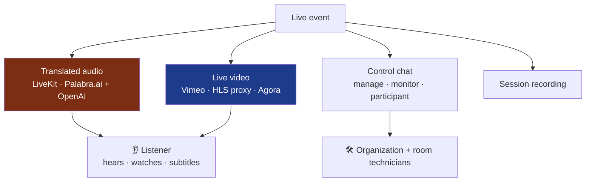

<a href="audionow.es.md">🇪🇸 Versión en español</a>

# AudioNow

> Real-time multilingual audio streaming platform for professional events: it captures the room technician's audio, **translates it with AI** speech-to-speech and distributes it over WebRTC to listeners in any language. In production serving real events.

---

## Context & problem

At a congress with simultaneous interpretation, translated audio must reach **dozens or hundreds of listeners** in their language, on their own phone, **with nothing to install and no sign-up**. The technical challenge isn't just translating: it's doing it with **low latency, no distortion, for N languages at once**, and at a cost that doesn't explode with the listener count.

---

## Solution & architecture

The technician's audio enters a **LiveKit** room (WebRTC SFU); a server-side bot subscribes, forwards the PCM to **Palabra.ai** for speech-to-speech translation, and republishes the translated audio as one track per language. Listeners join through a public URL and pick their language; the SFU fans out to all of them from a single track (cost is per translation session, not per listener).

---

## Beyond audio: a full event platform

Translation is the core, but AudioNow is the **event's operations platform**. Several subsystems already live on the same foundation (NestJS + Supabase + LiveKit):

- **Cross-room control chat** — messaging between the organization and each room with three views: *management* (`ChatManageView`), global *monitoring* (`ChatMonitorView`) and per-room *participant* (`ChatParticipantView`). It coordinates room technicians live, with in-app notifications.
- **Live event video** — streaming through two paths: **Vimeo** (with a custom *HLS proxy*, `vimeo-hls-proxy`, that serves the stream without exposing credentials) and **Agora** as an alternative. A listener can **watch the talk while hearing the translated audio**.
- **Session recording** — a `recording` module to capture event sessions.
- **Decoupled translation-provider architecture, with two real engines** — an interface (`TranslationProviderInterface`) abstracts the translation engine. **Palabra.ai** runs in production; **OpenAI Realtime** is implemented as a complete second provider (`openai-realtime` module with unit tests), with **per-event switching** already modeled in data (`chat_events.translation_provider` + RPC + admin panel + session log) and **deployed as a canary release** (`audionow-canary` project) to validate in **production with controlled real traffic** before promoting it to default provider. The exploration of even more engines (Azure, Gemini, Grok…) lives in the sister project **[Congress Translation](congress-translation.md)**.

> Diagram — subsystems coexisting on the same platform.

---

## Stack & technical decisions

| Technology | Decision | Why |
|---|---|---|
| **LiveKit (SFU) + server-side bot** | One `@livekit/rtc-node` bot per room publishing the translated tracks | The SFU fans out to N listeners for free; Palabra charges per session, not per listener |
| **Soft-knee limiter (tanh)** | Replace the hard clamp with asymptotic `tanh` compression (threshold ~27000) | Applying 2.5× gain to the TTS introduced audible clipping; the soft knee is C¹-continuous and doesn't distort |
| **One client per (room, language)** | Independent translation sessions per language | Parallelizes N-language translation and isolates failures; an anti-zombie mutex prevents orphaned billable sessions |
| **3-tier permissions + `SECURITY DEFINER` RPC** | `super_admin / admin / technician`; streaming state changes only through the RPC, with a `BEFORE UPDATE` trigger blocking direct updates | A single auditable path to start/stop audio; replaces a hardcoded `is_admin` boolean |
| **RLS `TO public` for listeners** | Anonymous read-only access to public events/rooms | Listeners never sign up; they join via public URL |
| **Per-direction chunk smoothing** | Ramp from each direction's last sample | In bidirectional mode (ES↔EN) it kills clicks when concatenating chunks from concurrent streams |

---

## Solved technical challenges

- **Distortion-free audio** under aggressive gain, with a soft-knee limiter that leaves nominal samples untouched and only compresses peaks.
- **Anti-zombie translation sessions.** Two concurrent `addLanguage` calls could leave an orphaned client billing forever; a per-`(room, language)` mutex prevents it.
- **Robust AI reconnection.** A 10 s silence watchdog + exponential backoff automatically reconnect if the translation WebSocket stalls.
- **Playout profiles** (`balanced` / `low-latency` / `passthrough`) tuning the jitter buffer per use case (recording vs. live interpretation).
- **A real role-hierarchy security model** materialized in SQL: roles table + RLS + `SECURITY DEFINER` RPC + column-guard trigger.
- **Two AI engines with different sample rates behind one interface** — Palabra (16 kHz) and OpenAI Realtime (24 kHz); the latter required resampling with an **anti-aliasing FIR low-pass filter** before 2:1 decimation, plus per-event provider switching without restarting the room.

---

## Outcome & impact

- **In production serving real client events** (national medical congresses in several specialties, plus corporate events).
- **Metrics:** 20 tables · 77 PostgreSQL functions/triggers · 76 migrations · 3-tier permission hierarchy · embeddable widgets for external sites · deployed on **Vercel** (web) + **Railway** (single-replica API) + **Supabase**.
- **An honest scaling decision:** the API keeps session state in memory and runs as a single replica; horizontal scaling would require externalizing sessions to Redis — documented as out of scope for the beta.

---

## Skills demonstrated

`LiveKit (WebRTC SFU)` · `audio processing (PCM, limiter, smoothing)` · `Palabra.ai` · `NestJS` · `Next.js` · `Supabase (RLS, RPCs, triggers)` · `role-based security` · `real-time` · `Vercel + Railway` · `Turborepo monorepo` · `real-time chat` · `video streaming (Vimeo HLS proxy · Agora)` · `session recording` · `decoupled provider architecture`
