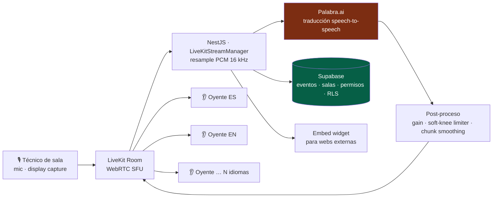
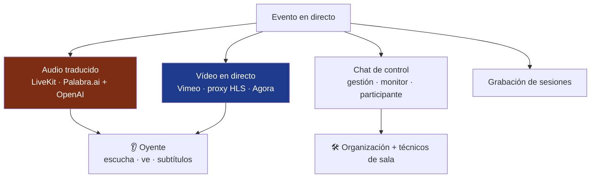

# AudioNow

> Plataforma de transmisión de audio multilingüe en tiempo real para eventos profesionales: captura el audio del técnico de sala, lo **traduce con IA** *speech-to-speech* y lo distribuye por WebRTC a oyentes en cualquier idioma. En producción sirviendo eventos reales.

---

## Contexto y problema

En un congreso con interpretación simultánea, el audio traducido debe llegar a **decenas o cientos de oyentes** en su idioma, en su propio móvil, **sin instalar nada y sin registrarse**. El reto técnico no es solo traducir: es hacerlo con **baja latencia, sin distorsión, para N idiomas a la vez**, y con un coste que no se dispare con el número de oyentes.

---

## Solución y arquitectura

El audio del técnico entra en una sala **LiveKit** (WebRTC SFU); un *bot* server-side se suscribe, reenvía el PCM a **Palabra.ai** para traducción *speech-to-speech*, y republica el audio traducido como una pista por idioma. Los oyentes acceden por una URL pública y eligen su idioma; el SFU hace el *fan-out* a todos ellos desde una sola pista (el coste es por sesión de traducción, no por oyente).

---

## Más allá del audio: plataforma de evento completa

La traducción es el núcleo, pero AudioNow es la **plataforma operativa del evento**. Sobre la misma base (NestJS + Supabase + LiveKit) conviven varios subsistemas ya programados:

- **Chat de control entre salas** — mensajería entre la organización y cada sala con tres vistas: *gestión* (`ChatManageView`), *monitorización* global (`ChatMonitorView`) y *participante* por sala (`ChatParticipantView`). Coordina a los técnicos de cada sala en directo, con notificaciones in-app.
- **Vídeo del evento en directo** — streaming con dos vías: **Vimeo** (con un *proxy HLS* propio, `vimeo-hls-proxy`, que sirve el stream sin exponer credenciales) y **Agora** como alternativa. El oyente puede **ver la ponencia mientras escucha el audio traducido**.
- **Grabación de sesiones** — módulo `recording` para registrar las sesiones del evento.
- **Arquitectura de proveedor de traducción desacoplada, con dos motores reales** — una interfaz (`TranslationProviderInterface`) abstrae el motor de traducción. **Palabra.ai** corre en producción; **OpenAI Realtime** está implementado como segundo proveedor completo (módulo `openai-realtime` con tests unitarios), con **conmutación por evento** ya modelada en datos (`chat_events.translation_provider` + RPC + panel admin + *session log*) y **desplegado como *release* canary** (proyecto `audionow-canary`) para validarse en **producción con tráfico real controlado** antes de promoverlo a proveedor por defecto. La exploración de aún más motores (Azure, Gemini, Grok…) vive en el proyecto hermano **[Congress Translation](congress-translation.md)**.

> Diagrama — subsistemas que conviven sobre la misma plataforma.

---

## Stack y decisiones técnicas

| Tecnología | Decisión | Por qué |
|---|---|---|
| **LiveKit (SFU) + bot server-side** | Un *bot* `@livekit/rtc-node` por sala que publica las pistas traducidas | El *fan-out* a N oyentes lo hace el SFU gratis; Palabra cobra por sesión, no por oyente |
| **Soft-knee limiter (tanh)** | Sustituir el *clamp* duro por compresión asintótica `tanh` (umbral ~27000) | Aplicar ganancia 2,5× al TTS introducía *clipping* audible; el *soft-knee* es C¹-continuo y no distorsiona |
| **Un cliente por (sala, idioma)** | Sesiones de traducción independientes por idioma | Paraleliza la traducción de N idiomas y aísla fallos; *mutex* anti-zombie evita sesiones huérfanas facturables |
| **Permisos 3-tier + RPC `SECURITY DEFINER`** | `super_admin / admin / technician`; el estado de streaming solo se cambia vía RPC, con trigger `BEFORE UPDATE` que bloquea *updates* directos | Único camino auditable para arrancar/parar audio; reemplaza un `is_admin` booleano hardcodeado |
| **RLS `TO public` para oyentes** | Acceso anónimo de solo lectura a eventos/salas públicas | Los oyentes no se registran; entran por URL pública |
| **Chunk smoothing por dirección** | *Ramp* desde el último *sample* por cada dirección de traducción | En modo bidireccional (ES↔EN) evita *clicks* al concatenar *chunks* de streams concurrentes |

---

## Retos técnicos resueltos

- **Calidad de audio sin distorsión** bajo ganancia agresiva, con limitador *soft-knee* que deja intactas las muestras nominales y solo comprime los picos.
- **Anti-zombie en sesiones de traducción.** Dos `addLanguage` concurrentes podían dejar un cliente huérfano facturándose para siempre; un *mutex* por `(sala, idioma)` lo impide.
- **Reconexión robusta a la IA.** *Watchdog* de silencio (10 s) + *backoff* exponencial reconectan automáticamente si el WebSocket de traducción se queda colgado.
- **Perfiles de *playout*** (`balanced` / `low-latency` / `passthrough`) que ajustan el *jitter buffer* según el caso de uso (grabación vs. interpretación en vivo).
- **Modelo de seguridad con jerarquía real** materializado en SQL: tabla de roles + RLS + RPC `SECURITY DEFINER` + trigger guardián de columnas.
- **Dos motores de IA de distinto *sample rate* tras una sola interfaz** — Palabra (16 kHz) y OpenAI Realtime (24 kHz); el segundo exigió un *resampling* con filtro **FIR low-pass anti-aliasing** antes de la decimación 2:1, más conmutación de proveedor por evento sin reiniciar la sala.

---

## Resultado e impacto

- **En producción sirviendo eventos reales** de clientes a lo largo de 2025–2026 (congresos médicos nacionales de varias especialidades, y eventos corporativos).
- **Métricas:** 20 tablas · 77 funciones/triggers PostgreSQL · 76 migraciones · jerarquía de permisos 3-tier · *embed widgets* integrables en webs externas · despliegue **Vercel** (web) + **Railway** (API single-replica) + **Supabase**.
- **Decisión de escala honesta:** la API mantiene el estado de sesiones en memoria y corre como réplica única; escalar horizontalmente requeriría externalizar sesiones a Redis — documentado como fuera del alcance del beta.

---

## Competencias demostradas

`LiveKit (WebRTC SFU)` · `procesamiento de audio (PCM, limiter, smoothing)` · `Palabra.ai` · `NestJS` · `Next.js` · `Supabase (RLS, RPC, triggers)` · `seguridad por roles` · `tiempo real` · `Vercel + Railway` · `monorepo Turborepo` · `chat en tiempo real` · `streaming de vídeo (Vimeo HLS proxy · Agora)` · `grabación de sesiones` · `arquitectura de proveedor desacoplada`
