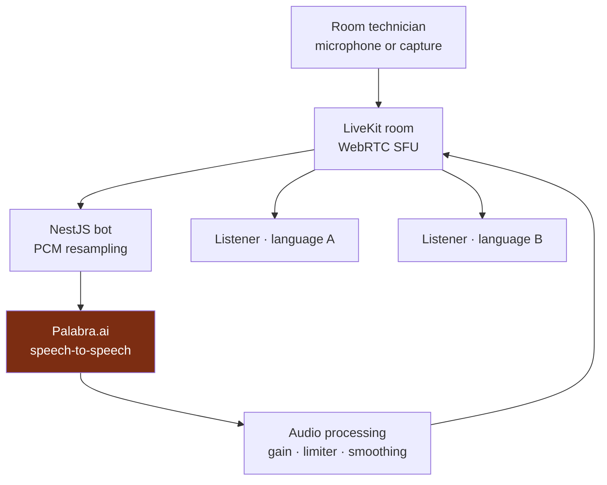
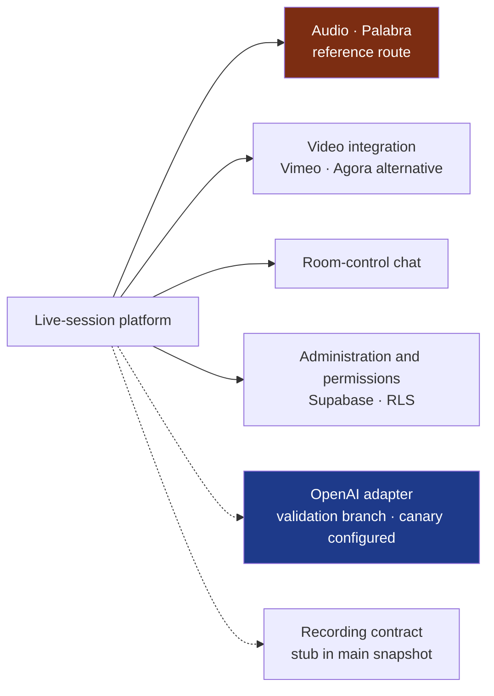

<a href="audionow.es.md">🇪🇸 Versión en español</a>

# AudioNow

> Multilingual audio for live sessions: room audio is translated through a server-side bot and distributed to listeners over WebRTC, from their own browser.

## My contribution and delivery scope

| Aspect | Scope |
|---|---|
| My contribution | Architecture and integration of the audio pipeline, translation-session lifecycle, permissions and provider extension |
| Version described | Main platform as of 21 May 2026; separate OpenAI integration branch as of 19 May 2026 |
| Delivered scope | Palabra-based platform with use in real sessions documented in the project records |
| Provider evolution | OpenAI adapter implemented with unit tests and a canary environment configured; live-traffic validation and promotion are separate milestones |

## Context & problem

Listeners needed to receive a room's audio in their chosen language, on their phones, without installing an app or creating an account. The system had to connect room technicians, translation services and browser playback while controlling delay, audio artifacts and the lifecycle of billable translation sessions.

A shared audio track per language lets translation sessions be organized by room and language rather than creating a translation session for every listener. Infrastructure, media transport and translation still have their own costs.

## Solution & architecture

The technician's audio enters a **LiveKit** room. A **NestJS** bot subscribes, resamples the PCM for **Palabra.ai**, receives the translated audio and republishes a track for each language. Listeners join through a public URL and select a language.

**Diagram scope:** logical audio path of the Palabra variant described in May 2026. Arrows represent audio flow; permissions and administration are covered separately below.

## Platform capabilities and provider evolution

The platform also included room-control chat, video integrations and an administration layer:

- **Room-control chat** provided management, monitoring and participant views for coordination between the organization and room technicians.
- **Video integration** included a Vimeo HLS proxy and an Agora alternative alongside translated audio.
- **Permissions** used Supabase, PostgreSQL RLS and a three-level role hierarchy to separate administration from room operation.
- **Provider extension** introduced an OpenAI Realtime adapter in a separate integration branch. The provider was selected **per room**; changing it required stopping the room's live audio first.
- **Recording** had a contract with a stub implementation in the main snapshot of 21 May.

**Diagram scope:** capability map, not a sequence of runtime calls. Dashed branches identify the OpenAI validation track and recording stub; their labels distinguish their maturity from the reference audio route.

## Technical decisions and trade-offs

| Decision | Implementation and reason | Trade-off |
|---|---|---|
| **LiveKit SFU + server-side bot** | Publish a shared translated track per language and distribute it to listeners | Translation sessions are decoupled from listener count; media infrastructure still needs capacity and cost management |
| **One client per room/language** | Serialize concurrent language additions and manage each translation client's lifecycle | Isolates languages and reduces the risk of orphaned sessions; requires explicit cleanup and reconnection |
| **Soft-knee limiter and smoothing** | Compress PCM peaks with `tanh` rather than a hard clamp, and smooth chunk boundaries per translation direction | Reduces clipping artifacts; gain and processing choices still need listening checks |
| **Role hierarchy and guarded RPCs** | Centralize streaming-state changes through permission checks, RLS, RPCs and update guards | Provides a controlled path for technicians and admins; SQL policies and application behavior must evolve together |
| **Anonymous listener access** | Read-only access to public rooms/events through RLS | Removes listener sign-up while keeping management operations behind separate authorization |
| **Per-room provider selection** | Reject provider changes while the room's audio is live | Protects the active audio path; switching requires a deliberate stop/change/start operation |
| **Provider-specific resampling** | Palabra uses 16 kHz; the OpenAI branch converts LiveKit input from 48 to 24 kHz with an anti-aliasing FIR filter before 2:1 decimation | A common provider interface still needs explicit audio-format adaptation |

## Session lifecycle and audio handling

Two concurrent language-addition requests could create an orphaned translation client. The room/language exclusion mechanism serializes that operation so the lifecycle has a controlled owner.

A silence watchdog and exponential backoff initiate reconnection when the provider stream stalls. Playout profiles adjust buffering for different delay requirements. These controls address distinct failure modes: stalled connections, queued audio and discontinuities between chunks.

The OpenAI extension kept provider differences behind an interface while exposing a room-level setting to operators. It added another integration path without implying that an active stream could switch engines transparently.

## Outcome and limits

Project records from May 2026 document use in real sessions and an update to production permissions. This establishes a historical operational context without assigning an unrecorded audience size or current service status.

The API stored session state in memory and used a **single replica** for the beta architecture. Horizontal scaling would require externalizing that state, for example to Redis. This was an explicit scope decision rather than a claim of unlimited capacity.

The documented OpenAI result was an implemented adapter, unit tests and canary configuration. This integration track was separate from the Palabra platform's recorded operational use.

A useful lesson was that sharing a provider interface only solves part of the integration: audio format, room ownership, shutdown and recovery remain explicit responsibilities.

Testing scope and historical validation are summarized in [Testing](../TESTING.md); cross-project practices are described in [Methodology](../METHODOLOGY.md).

## Skills demonstrated

`LiveKit / WebRTC` · `PCM resampling` · `audio limiting and smoothing` · `Palabra.ai` · `OpenAI Realtime integration` · `NestJS` · `Next.js` · `Supabase RLS / RPCs` · `role-based permissions` · `session lifecycle and concurrency` · `video integration` · `Vercel / Railway`

[Back to case studies](README.md)
