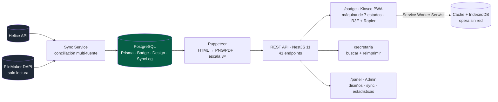

# BadgeFlow

> Sistema completo para generar, gestionar e imprimir credenciales personalizadas de asistentes a congresos, con un **kiosco 3D** de autoservicio y modo **offline-first**. En producción en un congreso médico real.

---

## Contexto y problema

En un congreso, la acreditación es el primer cuello de botella: cientos de asistentes llegan a la vez y necesitan su credencial física impresa **al instante**. El proceso manual genera colas y errores.

Además, los datos de los asistentes viven en **dos fuentes distintas** según el evento — un directorio externo (Helice) y la base FileMaker interna — y cada congreso usa convenciones de campo diferentes (p. ej. qué columna contiene el DNI/pasaporte). El sistema tenía que **unificar ambas fuentes** y funcionar **aunque se cayera internet** en el recinto.

---

## Solución y arquitectura

Un asistente escanea su QR en el kiosco → aparece una **animación 3D de bienvenida** con su nombre → su credencial se **imprime automáticamente**. Sin colas, sin esperas.

El **kiosco** es una máquina de estados (`IDLE → QR escaneado → bienvenida → transición 3D/vídeo → preview → impresión`) renderizada con **React Three Fiber + Rapier**, con la credencial colgando de un *lanyard* con física real. La **PWA** precarga con Serwist los PNG y vídeos en *cache*, y guarda en IndexedDB una cola de acciones (marcar como impreso) que sincroniza cuando vuelve la conexión.

---

## Stack y decisiones técnicas

| Tecnología | Decisión | Por qué |
|---|---|---|
| **Puppeteer 24** | *Singleton* de navegador con recuperación de *zombies* y *batch* de concurrencia configurable (default 1) | Railway limita a 1 GB de RAM: un solo Chrome headless a la vez, con *health-check* que reinicia si queda inconsistente |
| **Generación a escala 3×** | Renderizar HTML → PNG/PDF a triple resolución | Calidad de impresión física nítida partiendo de plantillas HTML/CSS |
| **FileMaker solo lectura + multi-tenant** | Campo DNI configurable por diseño (`fmDniFieldName`) | Cada congreso usa un campo distinto; se cambia sin tocar código |
| **Conciliación Helice ↔ FileMaker** | 3 índices (`byEmail`, `byQrtoken`, `byInscripcion`) sobre el mismo *mapping* | El origen del dato del QR varía según configuración; recomputar no resetea credenciales ya generadas |
| **Serwist 9 (PWA)** | *Offline-first* con cache de assets + cola en IndexedDB | El kiosco debe seguir imprimiendo si se cae la red del recinto |
| **App de escritorio Windows** | Instalador publicado vía GitHub Actions para impresión silenciosa | La impresión automática sin diálogos requiere un *host* nativo en el PC del kiosco |

---

## Retos técnicos resueltos

- ***Self-heal* de almacenamiento.** Railway usa contenedores efímeros: cada *redeploy* borra `/storage`. Si una petición de PNG no encuentra el archivo, **se regenera bajo demanda** y se vuelve a cachear.
- **Generación masiva con progreso y cancelación.** Generar ~2000 credenciales tarda más de una hora: un `Map` de progreso + *endpoint* de *polling* + flag de cancelación que cada *worker* comprueba dan *feedback* real y permiten abortar.
- **Validación sin dependencias.** Lectura de dimensiones de imagen leyendo cabeceras PNG/JPEG (rechaza fondos < 600 px) y *sniffing* de *magic bytes* en *uploads* de vídeo (MP4/WebM) para no fiarse del `Content-Type`.
- **Sincronización de estado offline.** El kiosco imprime sin red y, al reconectar, concilia qué credenciales quedaron marcadas como impresas.

---

## Personalización sin código y app de escritorio

Dos piezas convierten BadgeFlow en una herramienta que **el equipo opera de forma autónoma**, sin tocar código:

### Editor visual de diseños
Desde `/panel/designs` el equipo crea y edita cada modelo de credencial:
- **Origen de datos por diseño** — selecciona la base FileMaker (`fm-database-select`) y el campo de documento (DNI/pasaporte) de cada congreso.
- **Maquetación física** — colores, fondos, títulos y textos de la credencial, posicionados en coordenadas reales (mm) para una impresión exacta.
- **Editor del kiosco** (`kiosk-editor`, por diseño) — configura toda la experiencia de autoservicio: **vídeos** de bienvenida y de transición, **tema** (colores y fondo), títulos y textos, el tipo de **transición 3D** y el propio **lanyard**. El equipo cambia el "tema" de cada congreso **sin desplegar nada**.

### Experiencia 3D del kiosco
La animación combina varias librerías y componentes propios:
- **`badge-lanyard-3d`** — la credencial cuelga de un cordón con **física real** (React Three Fiber + Rapier).
- **`ripple-grid`** — fondo animado por *shader*.
- **`scan-transition-3d`** — transición 3D al escanear el QR.
- **`scene-3d-fallback`** — degradación elegante si el equipo del congreso no dispone de WebGL.

### App de escritorio — impresión silenciosa
Un cliente **Electron para Windows** (carpeta `desktop/`) ejecuta el kiosco a pantalla completa e imprime **sin los diálogos del navegador**: el asistente escanea y la credencial sale directa a la impresora predeterminada. Se empaqueta con **`electron-builder`** como instalador **portable + NSIS** (`pack:win`), con la URL de la app incrustada en el build. Modo kiosco y URL configurables (`BADGEFLOW_DESKTOP_APP_URL`, `BADGEFLOW_KIOSK`).

---

## Resultado e impacto

- **En producción en un congreso médico nacional real** (especialidad de cardiología): generación de credenciales, conciliación multi-fuente, experiencia 3D en kiosco e impresión física, con 1 kiosco + 2 PCs de secretaría.
- **Métricas:** 41 *endpoints* REST · 3 modelos Prisma · arquitectura *backend* (NestJS) + *frontend* (Next.js 16) en monorepo · despliegue **Vercel** (web) + **Railway** (API en Docker con Chromium) + PostgreSQL gestionado.
- Ciclo de mejora post-evento gestionado como *backlog* priorizado de peticiones del cliente.

---

## Competencias demostradas

`NestJS 11` · `Next.js 16` · `Puppeteer` · `React Three Fiber + Rapier` · `PWA / Serwist` · `IndexedDB offline` · `Prisma` · `PostgreSQL` · `FileMaker Data API` · `Helice API` · `Docker + Railway` · `GitHub Actions (desktop release)` · `impresión física` · `Electron (app de escritorio)` · `electron-builder (instalador Windows)` · `editor visual no-code` · `shaders / GLSL`
