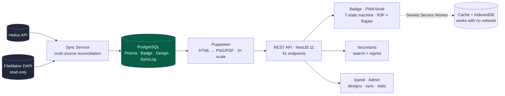

<a href="badgeflow.es.md">🇪🇸 Versión en español</a>

# BadgeFlow

> End-to-end system to generate, manage and print personalized attendee badges for congresses, with a self-service **3D kiosk** and an **offline-first** mode. In production at a real medical congress.

---

## Context & problem

At a congress, accreditation is the first bottleneck: hundreds of attendees arrive at once and need their physical badge printed **instantly**. The manual process creates queues and errors.

On top of that, attendee data lives in **two different sources** depending on the event — an external directory (Helice) and the internal FileMaker database — and every congress uses different field conventions (e.g. which column holds the ID/passport). The system had to **unify both sources** and keep working **even if the venue's internet went down**.

---

## Solution & architecture

An attendee scans their QR at the kiosk → a **3D welcome animation** appears with their name → their badge **prints automatically**. No queues, no waiting.

The **kiosk** is a state machine (`IDLE → QR scanned → welcome → 3D/video transition → preview → printing`) rendered with **React Three Fiber + Rapier**, the badge hanging from a lanyard with real physics. The **PWA** pre-caches PNGs and videos with Serwist, and stores an action queue in IndexedDB (mark-as-printed) that syncs back when the connection returns.

---

## Stack & technical decisions

| Technology | Decision | Why |
|---|---|---|
| **Puppeteer 24** | Browser singleton with zombie recovery and configurable batch concurrency (default 1) | Railway caps RAM at 1 GB: a single headless Chrome at a time, with a health check that restarts it if it goes inconsistent |
| **3× scale generation** | Render HTML → PNG/PDF at triple resolution | Crisp physical print quality from HTML/CSS templates |
| **Read-only FileMaker + multi-tenant** | Per-design configurable ID field (`fmDniFieldName`) | Every congress uses a different field; it changes without touching code |
| **Helice ↔ FileMaker reconciliation** | 3 indexes (`byEmail`, `byQrtoken`, `byInscripcion`) over the same mapping | The QR data source varies by configuration; recomputing never resets already-generated badges |
| **Serwist 9 (PWA)** | Offline-first with asset cache + IndexedDB queue | The kiosk must keep printing if the venue's network drops |
| **Windows desktop app** | Installer published via GitHub Actions for silent printing | Dialog-free automatic printing requires a native host on the kiosk PC |

---

## Solved technical challenges

- **Storage self-healing.** Railway uses ephemeral containers: every redeploy wipes `/storage`. If a PNG request misses the file, it is **regenerated on demand** and re-cached.
- **Mass generation with progress and cancellation.** Generating ~2,000 badges takes over an hour: a progress `Map` + a polling endpoint + a cancellation flag checked by every worker give real feedback and allow aborting.
- **Dependency-free validation.** Image dimensions are read straight from PNG/JPEG headers (backgrounds under 600 px are rejected) and video uploads are magic-byte sniffed (MP4/WebM) instead of trusting `Content-Type`.
- **Offline state synchronization.** The kiosk prints with no network and, on reconnect, reconciles which badges were marked as printed.

---

## No-code customization and the desktop app

Two pieces turn BadgeFlow into a tool **the team operates autonomously**, without touching code:

### Visual design editor
From `/panel/designs` the team creates and edits every badge model:
- **Per-design data source** — selects the FileMaker database (`fm-database-select`) and the document field (ID/passport) for each congress.
- **Physical layout** — colors, backgrounds, titles and badge text, positioned in real-world coordinates (mm) for exact printing.
- **Kiosk editor** (`kiosk-editor`, per design) — configures the entire self-service experience: welcome and transition **videos**, **theme** (colors and background), titles and copy, the **3D transition** type and the lanyard itself. The team re-themes each congress **without deploying anything**.

### The kiosk's 3D experience
The animation combines several libraries and custom components:
- **`badge-lanyard-3d`** — the badge hangs from a lanyard with **real physics** (React Three Fiber + Rapier).
- **`ripple-grid`** — shader-animated background.
- **`scan-transition-3d`** — 3D transition on QR scan.
- **`scene-3d-fallback`** — graceful degradation when the congress hardware lacks WebGL.

### Desktop app — silent printing
An **Electron client for Windows** (`desktop/` folder) runs the kiosk full-screen and prints **without browser dialogs**: the attendee scans and the badge goes straight to the default printer. It is packaged with **`electron-builder`** as a **portable + NSIS** installer (`pack:win`), with the app URL embedded at build time. Kiosk mode and URL are configurable (`BADGEFLOW_DESKTOP_APP_URL`, `BADGEFLOW_KIOSK`).

---

## Outcome & impact

- **In production at a real national medical congress** (cardiology specialty): badge generation, multi-source reconciliation, 3D kiosk experience and physical printing, with 1 kiosk + 2 secretary PCs.
- **Metrics:** 41 REST endpoints · 3 Prisma models · backend (NestJS) + frontend (Next.js 16) monorepo · deployed on **Vercel** (web) + **Railway** (Dockerized API with Chromium) + managed PostgreSQL.
- Post-event improvement cycle managed as a prioritized client-request backlog.

---

## Skills demonstrated

`NestJS 11` · `Next.js 16` · `Puppeteer` · `React Three Fiber + Rapier` · `PWA / Serwist` · `offline IndexedDB` · `Prisma` · `PostgreSQL` · `FileMaker Data API` · `Helice API` · `Docker + Railway` · `GitHub Actions (desktop release)` · `physical printing` · `Electron (desktop app)` · `electron-builder (Windows installer)` · `no-code visual editor` · `shaders / GLSL`
