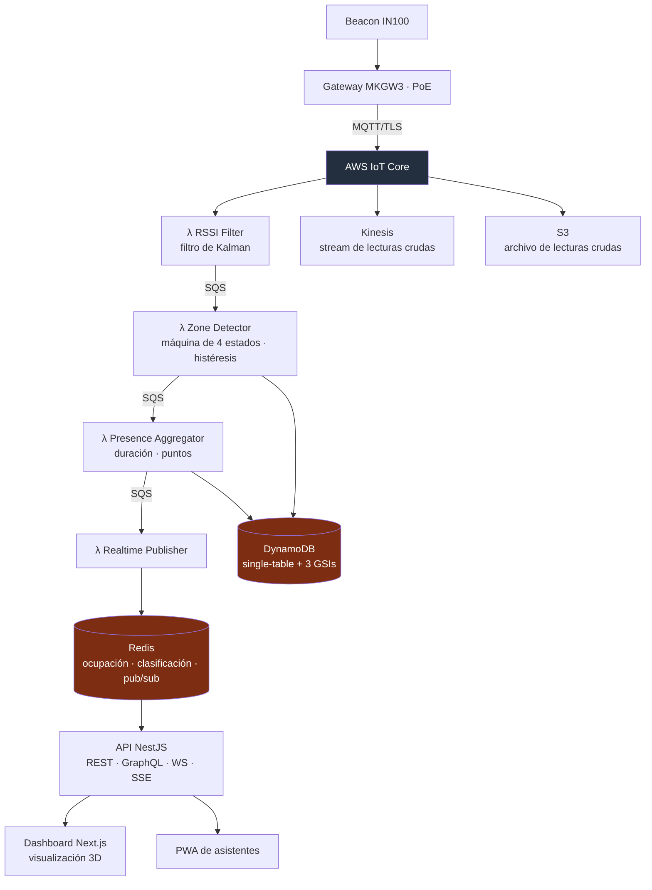

<a href="ble-presence.md">🇬🇧 English version</a>

# Beacon Presence

> MVP de software para detectar presencia por sala mediante beacons BLE: filtrado de señal, estado de asistencia, duración y gamificación, con API NestJS y dashboard/PWA. La infraestructura AWS está definida en código; la detección física quedó como un hito de validación separado.

## Mi contribución y alcance entregado

- **Mi contribución:** arquitectura e implementación de la pipeline de presencia, integración del backend y desarrollo de interfaces e infraestructura de apoyo.
- **Alcance entregado:** cuatro etapas Lambda, estado en DynamoDB/Redis, API NestJS, dashboard y PWA de asistentes, infraestructura CDK y un harness local de validación.
- **Estado histórico — 29 de mayo de 2026:** el MVP de software estaba implementado; el hito de validación con hardware seguía en curso, con un checkpoint manual del harness pendiente. El último registro operacional describía la infraestructura AWS desmontada y los despliegues Vercel inactivos.

---

## Contexto y problema

Saber **quién asistió a cada sala y durante cuánto tiempo** permite emitir certificados y analizar ocupación. Los escaneos manuales requieren personal y una acción explícita en cada entrada. El proyecto exploró la detección pasiva mediante beacons BLE y gateways de sala.

El problema central de ingeniería era **convertir un RSSI ruidoso en decisiones de presencia**. Un pico de señal no debería contar inmediatamente como una entrada, ni una pérdida breve debería eliminar a un asistente. Por eso hay filtrado, ventanas de confirmación e histéresis entre la lectura de radio y el evento de asistencia.

---

## Solución y arquitectura

Los beacons IN100 y gateways MKGW3 definen el recorrido de hardware hacia AWS IoT Core por MQTT/TLS. La arquitectura CDK invoca directamente la Lambda de filtrado RSSI y escribe las lecturas crudas en Kinesis y S3 en paralelo. **SQS conecta las siguientes etapas de procesamiento**; Kinesis no sustituye esas colas.

*Arquitectura declarada en CDK, incluido el recorrido de hardware previsto. El diagrama describe el diseño del sistema, sin afirmar que exista un despliegue cloud activo.*

---

## Stack y decisiones técnicas

| Tecnología | Decisión | Por qué |
|---|---|---|
| **Filtrado de Kalman** | Persistir el estado del filtro en Redis entre invocaciones | Proporciona una señal filtrada al detector de presencia; ajustar parámetros sigue requiriendo medidas físicas |
| **Máquina de estados con histéresis** | `OUTSIDE → ENTERING → PRESENT → EXITING`, con umbrales −70/−80 dBm, confirmación de 5 s y gracia de salida de 30 s | Separa la presencia sostenida de lecturas breves y pérdidas temporales de señal |
| **DynamoDB single-table** | Patrones de acceso PK/SK, tres GSIs y TTL para histórico | Hace explícitas las consultas de asistencia y la retención dentro de un modelo de datos |
| **SQS entre etapas** | Consumidores Lambda independientes con reintentos y colas de mensajes fallidos | Separa responsabilidades de procesamiento y gestión de fallos |
| **AWS CDK** | Infraestructura TypeScript configurada por entorno | Permite revisar los cambios de infraestructura y reproducir despliegues |
| **Reutilización de clientes** | Reutilizar clientes Redis, SQS y DynamoDB entre invocaciones | Evita inicializaciones repetidas de clientes |

---

## Retos técnicos abordados

- **De señal a evento:** el filtrado y una máquina de cuatro estados generan eventos `ENTER`/`EXIT` con periodos explícitos de confirmación y gracia.
- **Actualización en vivo:** Redis pub/sub alimenta las rutas SSE/WebSocket de la API, separando la entrega al dashboard del estado persistente de asistencia.
- **Reglas de gamificación:** puntos por duración, multiplicadores de sala, bonus de sesión y un tope por hora implementados en una etapa de agregación separada.
- **Validación reproducible:** un harness local encadena los handlers y captura los datos necesarios para comparar lecturas crudas, valores filtrados y transiciones de estado.

---

## Resultado y validación

El resultado fue un **MVP de software implementado y su definición de infraestructura**, seguido de trabajo sobre validación física. El resumen del harness del 27 de mayo de 2026 registró 36 pruebas del harness y 135 pruebas de regresión de tres etapas de la pipeline. Son resultados históricos de verificación, no medidas del rendimiento de detección en sala.

La configuración Artillery incluye una fase de pico de **200 llegadas/s**; es una carga de ensayo configurada, no una capacidad demostrada. **Latencia inferior a 500 ms y precisión de detección superior al 95 % eran objetivos de diseño**, pendientes de ensayos end-to-end con hardware real. El siguiente hito era reconciliar los parámetros del filtro con la especificación y validar emisión, recepción y tránsitos físicos entre salas.

---

## Competencias demostradas

`AWS CDK (IaC)` · `IoT Core / MQTT` · `Lambda` · `SQS` · `DynamoDB single-table` · `Kinesis / S3` · `ElastiCache Redis` · `filtrado de Kalman` · `máquinas de estados` · `NestJS (GraphQL/WS/SSE)` · `Next.js + React Three Fiber` · `PWA` · `diseño de pruebas de carga` · `sistemas distribuidos`
