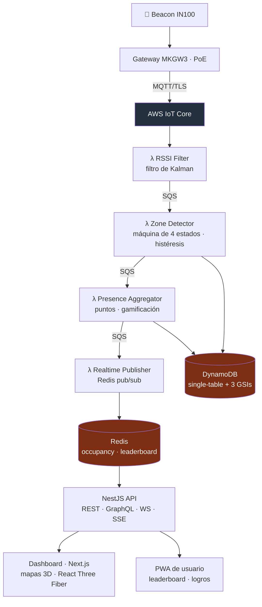

<a href="ble-presence.md">🇬🇧 English version</a>

# Beacon Presence

> Sistema de monitorización de presencia en tiempo real mediante *beacons* BLE: detecta automáticamente quién está en cada sala, calcula duración, otorga puntos de gamificación y lo muestra en *dashboards* con visualización 3D. Construido como **infraestructura como código** sobre AWS.

---

## Contexto y problema

Saber **quién estuvo, en qué sala y cuánto tiempo** es valioso para certificados de asistencia, informes de cumplimiento y analítica de ocupación — pero hacerlo a mano (con personal escaneando QR en cada puerta) no escala. La solución: que el edificio **detecte la presencia solo**, de forma pasiva, fiable y a escala de miles de personas.

El reto real es de **señal y sistemas distribuidos**: la potencia BLE (RSSI) es ruidosa y rebota; hay que filtrarla, decidir con histéresis cuándo alguien "entra" o "sale" de verdad, y procesarlo todo con latencia sub-segundo sin reescribir la arquitectura cuando se pasa de 100 a 10.000 personas.

---

## Solución y arquitectura

*Beacons* IN100 emiten; *gateways* MKGW3 los recogen y publican por MQTT/TLS a AWS IoT Core, que alimenta una **pipeline de 4 Lambdas** desacopladas por colas. El estado vive en DynamoDB (*single-table*) + Redis; los *dashboards* y la PWA leen vía una API NestJS en tiempo real.

---

## Stack y decisiones técnicas

| Tecnología | Decisión | Por qué |
|---|---|---|
| **Filtro de Kalman** (RSSI) | Suavizar la señal antes de decidir presencia (Q=0.1, R=2.0), estado en Redis entre invocaciones | El RSSI crudo es ruidoso; el filtro reduce ~27 % el ruido y estabiliza la detección |
| **Máquina de estados con histéresis** | 4 estados (`OUTSIDE → ENTERING → PRESENT → EXITING`), umbrales -70/-80 dBm, 5 s de confirmación y 30 s de gracia | Evita falsos positivos por rebotes; alguien que pasa por la puerta no cuenta como "presente" |
| **DynamoDB *single-table*** | PK/SK + 3 GSIs, *pay-per-request*, TTL para histórico | Escala de 100 a 10.000+ personas sin cambios de arquitectura ni coste fijo |
| **Pipeline desacoplada por SQS** | Cada etapa es una Lambda independiente | Aísla fallos, permite reintentos y escala cada etapa por separado |
| **AWS CDK (IaC)** | Toda la infra (VPC, DynamoDB, ElastiCache, SQS, Lambda, ECS, Cognito, WAF) en TypeScript, *environment-aware* | Despliegue reproducible dev/staging/prod; nada *click-ops* |
| **Reutilización de clientes** | *Clients* de Redis/SQS/DynamoDB reutilizados entre invocaciones | Reduce *cold start* de las Lambdas |

---

## Retos técnicos resueltos

- **De señal ruidosa a presencia fiable.** La combinación Kalman + histéresis + ventanas de confirmación/gracia convierte lecturas BLE caóticas en eventos `ENTER`/`EXIT` limpios (objetivo de precisión > 95 %).
- **Latencia sub-500 ms** de *beacon* a *dashboard*, gracias a la pipeline SQS→Lambda y a Redis pub/sub empujando a SSE/WebSocket.
- **Gamificación con anti-abuso:** 1 pt/min base, multiplicadores (2× salas principales, 1,5× salas secundarias), bonus (sesión completa, *early bird*, racha) y **tope por hora** para evitar acumulación artificial.
- **IaC multi-entorno** con *secrets* desde Parameter Store y un *stack* WAF separado en `us-east-1`.

---

## Resultado e impacto

- **MVP funcional y desplegable** — no es un diseño sobre papel: las 4 Lambdas están implementadas y testeadas (decenas de tests por etapa), la pipeline corre, el *stack* CDK define infraestructura real, y los dos *frontends* (dashboard + PWA) están desplegados en Vercel.
- **Métricas:** 4 Lambdas (pipeline completa) · *stack* CDK con 9 *constructs* · DynamoDB *single-table* + 3 GSIs · tests de carga Artillery (hasta 200 rps) · CI/CD con GitHub Actions (lint, typecheck, unit, E2E Playwright, carga, CDK synth).
- **Objetivos de diseño:** < 500 ms de latencia, > 95 % de precisión, 99,5 % de *uptime*, ~$15/día para 500 usuarios monitorizados.

---

## Competencias demostradas

`AWS CDK (IaC)` · `IoT Core / MQTT` · `Lambda` · `DynamoDB single-table` · `Kinesis` · `ElastiCache Redis` · `filtro de Kalman` · `máquinas de estados` · `NestJS (GraphQL/WS/SSE)` · `Next.js + React Three Fiber` · `PWA` · `Cognito` · `tests de carga (Artillery)` · `sistemas distribuidos`