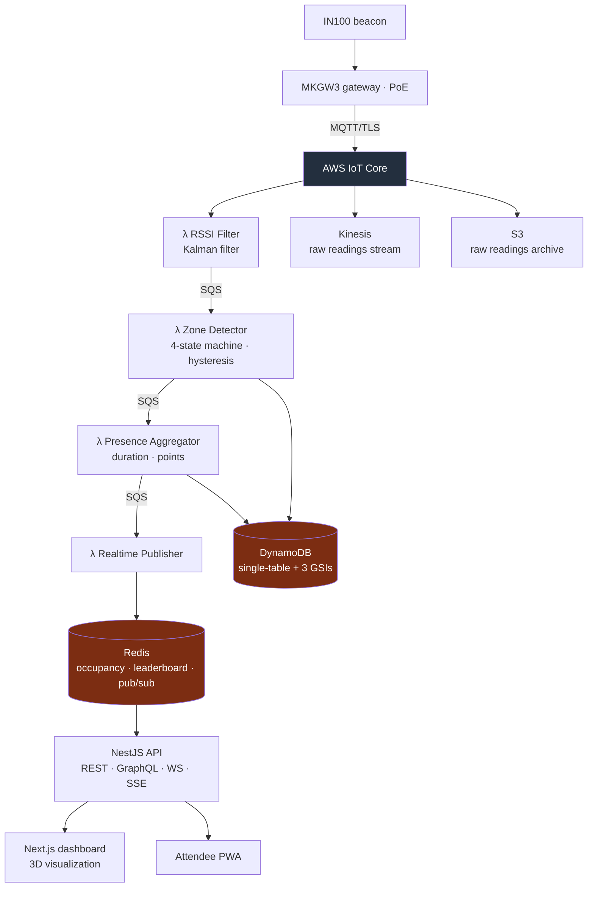

<a href="ble-presence.es.md">🇪🇸 Versión en español</a>

# Beacon Presence

> A software MVP for room-level presence using BLE beacons: signal filtering, attendance state, duration and gamification, with a NestJS API and dashboard/PWA. AWS infrastructure is defined in code; physical detection remained a separate validation milestone.

## My contribution & delivered scope

- **My contribution:** architecture and implementation of the presence pipeline, backend integration and supporting interfaces and infrastructure.
- **Delivered scope:** four Lambda stages, DynamoDB/Redis state, a NestJS API, dashboard and attendee PWA, CDK infrastructure and a local validation harness.
- **Historical stage — 29 May 2026:** the software MVP had been implemented; the hardware-validation milestone was in progress, with a manual harness checkpoint pending. The last operational record described AWS infrastructure as dismantled and Vercel deployments as idle.

---

## Context & problem

Knowing **who attended each room and for how long** supports attendance certificates and occupancy analysis. Manual scans require staff and an explicit action at each entrance. The project explored passive detection through BLE beacons and room gateways.

The central engineering problem was **turning noisy RSSI into presence decisions**. A signal spike should not immediately count as an arrival, and a brief signal loss should not remove an attendee. Filtering, confirmation windows and hysteresis therefore sit between a radio reading and an attendance event.

---

## Solution & architecture

IN100 beacons and MKGW3 gateways define the hardware path into AWS IoT Core over MQTT/TLS. The CDK architecture invokes the RSSI-filter Lambda directly and writes raw readings to Kinesis and S3 in parallel. **SQS connects the subsequent processing stages**; Kinesis does not replace those queues.

*Architecture declared in CDK, including the intended hardware path. This diagram describes the system design, rather than an active cloud deployment.*

---

## Stack & technical decisions

| Technology | Decision | Why |
|---|---|---|
| **Kalman filtering** | Persist filter state in Redis between invocations | Gives the presence detector a filtered signal; parameter tuning still requires physical measurements |
| **State machine with hysteresis** | `OUTSIDE → ENTERING → PRESENT → EXITING`, with −70/−80 dBm thresholds, 5 s confirmation and 30 s exit grace | Separates sustained presence from brief readings and temporary signal loss |
| **DynamoDB single-table** | PK/SK access patterns, three GSIs and TTL for history | Keeps attendance queries and retention explicit within one data model |
| **SQS between stages** | Independent Lambda consumers with retry and dead-letter queues | Separates processing responsibilities and failure handling |
| **AWS CDK** | Environment-aware infrastructure in TypeScript | Makes infrastructure changes reviewable and deployments reproducible |
| **Client reuse** | Reuse Redis, SQS and DynamoDB clients across invocations | Avoids repeated client initialization |

---

## Technical challenges addressed

- **Signal-to-event processing:** filtering and a four-state machine produce `ENTER`/`EXIT` events with explicit confirmation and grace periods.
- **Live updates:** Redis pub/sub feeds the API's SSE/WebSocket paths, separating dashboard delivery from durable attendance state.
- **Gamification rules:** duration-based points, room multipliers, session bonuses and an hourly cap are implemented as a separate aggregation stage.
- **Reproducible validation:** a local harness chains the handlers and captures the data needed to compare raw readings, filtered values and state transitions.

---

## Outcome & validation

The result was an **implemented software MVP and infrastructure definition**, followed by work on physical validation. The 27 May 2026 harness summary recorded 36 harness tests and 135 regression tests across three pipeline stages. These are historical verification results, not measurements of room-detection performance.

The Artillery configuration includes a peak phase at **200 arrivals/s**; that is a configured workload, not a demonstrated capacity result. **Latency below 500 ms and room-detection accuracy above 95% were design targets**, still requiring end-to-end trials with real hardware. The next milestone was to reconcile filter parameters with the specification and validate emission, reception and physical room transitions.

---

## Skills demonstrated

`AWS CDK (IaC)` · `IoT Core / MQTT` · `Lambda` · `SQS` · `DynamoDB single-table` · `Kinesis / S3` · `ElastiCache Redis` · `Kalman filtering` · `state machines` · `NestJS (GraphQL/WS/SSE)` · `Next.js + React Three Fiber` · `PWA` · `load-test design` · `distributed systems`
