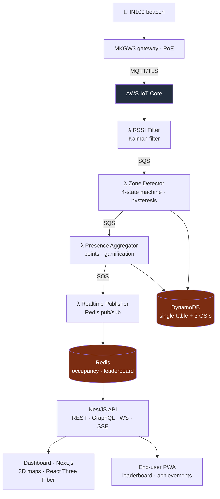

<a href="ble-presence.es.md">🇪🇸 Versión en español</a>

# Beacon Presence

> Real-time presence monitoring using BLE beacons: it automatically detects who is in each room, computes duration, awards gamification points and surfaces everything on dashboards with 3D visualization. Built as **infrastructure as code** on AWS.

---

## Context & problem

Knowing **who was in a room and for how long** is valuable for attendance certificates, compliance reporting and occupancy analytics — but doing it manually (staff scanning QR codes at every door) doesn't scale. The solution: have the building **detect presence by itself**, passively, reliably and at a scale of thousands of people.

The real challenge is one of **signal and distributed systems**: BLE signal strength (RSSI) is noisy and bounces; it must be filtered, hysteresis must decide when someone has truly "entered" or "left", and it all has to process at sub-second latency without re-architecting when growing from 100 to 10,000 people.

---

## Solution & architecture

IN100 beacons broadcast; MKGW3 gateways pick them up and publish over MQTT/TLS to AWS IoT Core, which feeds a **4-Lambda pipeline** decoupled by queues. State lives in DynamoDB (single-table) + Redis; dashboards and the PWA read through a real-time NestJS API.

---

## Stack & technical decisions

| Technology | Decision | Why |
|---|---|---|
| **Kalman filter** (RSSI) | Smooth the signal before deciding presence (Q=0.1, R=2.0), state persisted in Redis across invocations | Raw RSSI is noisy; the filter cuts ~27% of the noise and stabilizes detection |
| **State machine with hysteresis** | 4 states (`OUTSIDE → ENTERING → PRESENT → EXITING`), -70/-80 dBm thresholds, 5 s confirmation and 30 s grace | Prevents false positives from signal bounces; someone walking past the door doesn't count as "present" |
| **DynamoDB single-table** | PK/SK + 3 GSIs, pay-per-request, TTL for history | Scales from 100 to 10,000+ people with no architecture changes and no fixed cost |
| **SQS-decoupled pipeline** | Each stage is an independent Lambda | Isolates failures, enables retries and scales each stage separately |
| **AWS CDK (IaC)** | All infra (VPC, DynamoDB, ElastiCache, SQS, Lambda, ECS, Cognito, WAF) in TypeScript, environment-aware | Reproducible dev/staging/prod deployments; zero click-ops |
| **Client reuse** | Redis/SQS/DynamoDB clients reused across invocations | Cuts Lambda cold starts |

---

## Solved technical challenges

- **From noisy signal to reliable presence.** The Kalman + hysteresis + confirmation/grace-window combination turns chaotic BLE readings into clean `ENTER`/`EXIT` events (target accuracy > 95%).
- **Sub-500 ms latency** from beacon to dashboard, thanks to the SQS→Lambda pipeline and Redis pub/sub pushing into SSE/WebSocket.
- **Gamification with anti-abuse:** 1 pt/min base, multipliers (2× main rooms, 1.5× secondary rooms), bonuses (full session, early bird, streak) and an **hourly cap** to prevent artificial accumulation.
- **Multi-environment IaC** with secrets from Parameter Store and a separate WAF stack in `us-east-1`.

---

## Outcome & impact

- **A working, deployable MVP** — not a paper design: all 4 Lambdas are implemented and tested (dozens of tests per stage), the pipeline runs, the CDK stack defines real infrastructure, and both frontends (dashboard + PWA) are deployed on Vercel.
- **Metrics:** 4 Lambdas (full pipeline) · CDK stack with 9 constructs · DynamoDB single-table + 3 GSIs · Artillery load tests (up to 200 rps) · CI/CD on GitHub Actions (lint, typecheck, unit, Playwright E2E, load, CDK synth).
- **Design targets:** < 500 ms latency, > 95% accuracy, 99.5% uptime, ~$15/day for 500 tracked users.

---

## Skills demonstrated

`AWS CDK (IaC)` · `IoT Core / MQTT` · `Lambda` · `DynamoDB single-table` · `Kinesis` · `ElastiCache Redis` · `Kalman filter` · `state machines` · `NestJS (GraphQL/WS/SSE)` · `Next.js + React Three Fiber` · `PWA` · `Cognito` · `load testing (Artillery)` · `distributed systems`
