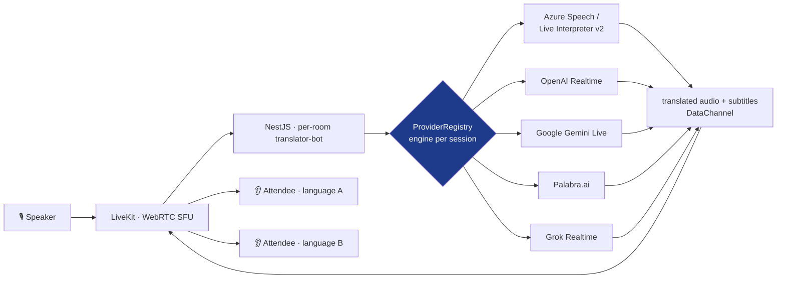

<a href="congress-translation.es.md">🇪🇸 Versión en español</a>

# Congress Translation

> **Simultaneous voice translation** for conference talks: one speaker talks and 20+ attendees receive the translation in their language in real time. A **multi-AI-provider** architecture with transparent switching across 7 translation engines.

---

## Context & problem

Human simultaneous interpretation is expensive and doesn't scale to several languages at once. This system explores doing it with AI: **1 speaker → N attendees**, each picking their language, with low latency and quality good enough for a medical talk.

Because the real-time voice-AI market moves extremely fast (Azure, OpenAI, Google, Palabra, Grok… each with different latency/quality/cost trade-offs), the key decision was **not to marry a provider** but to build an architecture where the translation engine is **swappable per session**.

---

## Solution & architecture

The frontend (Next.js 14) has **speaker** and **attendee** modes. The backend (NestJS) mints LiveKit tokens and provider credentials **server-side** (no API key ever reaches the browser), and a registry-based `ProviderRegistryService` routes each session to the chosen engine via `POST /api/translation/start { provider }`. **Zod** DTO validation is shared between frontend and backend (type-safe end to end).

---

## Stack & technical decisions

| Technology | Decision | Why |
|---|---|---|
| **Provider registry (NestJS DI)** | Inject a provider array via token; map-based lookup | Adding an engine = create a module and register it; zero `if/else` in the controller |
| **Server-side tokens** | The backend issues LiveKit tokens + provider credentials; rate-limited | API keys are never exposed to the client |
| **Shared Zod** (`@repo/schemas`) | Common `Language` / `TranslationProvider` enums and DTOs | Identical validation on both sides, full type safety |
| **Single bot per room** (`translator-bot-{roomId}`) | Fixed bot identity per room | Prevents double bots and synthesis conflicts; one room = max 1 active translator |
| **Language ref-counting** | Per-language counter + 30 s grace before teardown | Fast reconnection without restarting the session; optimizes cost |
| **Subtitles over DataChannel** | JSON `{ text, isFinal }` on topic `translation:{lang}` | Partial and final subtitles synchronized with the audio |

---

## Provider status

The architecture lets engines be plugged in, but not all are at the same maturity level. Actual status:

| Provider | Type | Status |
|---|---|---|
| **Palabra.ai** | generative speech-to-speech | ✅ Finished and tested |
| **OpenAI Realtime** | generative audio-to-audio | ✅ Finished and tested |
| **Azure Speech / Live Interpreter v2** | deterministic + zero-shot *Personal Voice* | ✅ Integrated and tested |
| Google Gemini Live · Google Cloud · Grok Realtime | various | 🟡 Integrated, under validation |

---

## Solved technical challenges

- **Provider switching without rewriting the flow** — the same session can use deterministic Azure or generative OpenAI Realtime as needed.
- **Robustness against unpredictable LLMs** — 8 s watchdog, proactive session renewal (OpenAI ~60 min, Gemini ~15 min), output validation and TTL-based anti-repetition dedup against hallucinations.
- **Latency under load** — an `AdaptivePlayoutController` dynamically adjusts synthesis speed based on queue depth to keep lag bounded with 20+ listeners.
- **Zero-shot voice cloning** — Azure Live Interpreter v2 integration with *Personal Voice* and a fallback chain (Personal Voice → Neural HD → standard Neural).
- **Browser autoplay policy and reconnection** handled client-side (mandatory user gesture, reconnect with backoff).

---

## Outcome & impact

- **PoC v1.0 delivered** (LLM stability + P50/P95 latency observability), with a v1.1 in progress focused on matching a premium provider's quality with a ~10× cheaper alternative.
- **Metrics:** 7 switchable AI providers · 14 languages in the schema (6 validated for voice) · ~21,700 LoC of API · 45 test files · models for rooms, sessions, voice profiles and recordings.
- It served as the **proving ground** for the real-time translation domain that later materialized, in its production version focused on rooms and technicians, in [AudioNow](audionow.md).

> The two projects are sibling efforts within the same domain (live voice translation) with independent codebases: this one explores engine switching; AudioNow takes the use case to production with a focus on room operations.

---

## Skills demonstrated

`LiveKit` · `OpenAI Realtime API` · `Azure Speech / Live Interpreter v2` · `Google Gemini Live` · `Palabra.ai` · `NestJS (DI, registry pattern)` · `Zod (type-safe full-stack)` · `Next.js 14` · `Prisma` · `LLM system robustness` · `swappable architecture`
