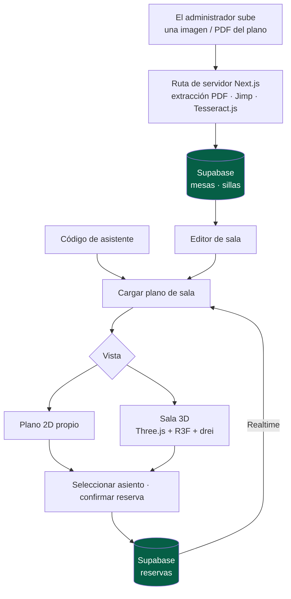

<a href="floor-planner.md">🇬🇧 English version</a>

# Floor Planner

> Proyecto de mentoría de **planificación de salas 2D/3D y reserva de plazas**, con estado de asientos en vivo e importación de planos. Un desarrollador en prácticas implementó la aplicación bajo mi dirección técnica.

## Mi contribución y alcance entregado

- **Mi contribución:** mentoría técnica, arquitectura inicial, introducción a librerías 2D/3D, enseñanza del uso disciplinado de asistencia de IA y revisión de la evolución del proyecto. **Fui el mentor, no el autor del código.**
- **Alcance entregado:** identificación de asistentes por código, reservas con Supabase Realtime, vistas 2D/3D conmutables, edición de salas e importación de archivos mediante extracción PDF y OCR.
- **Estado histórico — 30 de abril de 2026:** el proyecto de aprendizaje había evolucionado desde un plano 2D inicial al editor e importador descritos aquí. La preparación del despliegue estaba documentada por separado como la siguiente etapa.

---

## Contexto y problema

Asignar mesas y asientos requiere una vista compartida del aforo y las reservas. El proyecto ofrece a los asistentes un **plano visual** donde identificarse, distinguir asientos libres, ocupados y seleccionados, y confirmar una reserva.

También era un proyecto práctico de aprendizaje. Mi papel fue ayudar a un desarrollador en prácticas a convertir una sucesión de funciones en una aplicación con límites claros entre modelo de sala, renderizado, reservas y herramientas administrativas. La implementación sigue siendo su aportación.

---

## Solución y arquitectura

La primera implementación 2D utilizó `react-konva`. La versión descrita aquí combina una **vista 2D propia con Three.js/React Three Fiber**, apoyada en reservas Supabase y actualizaciones Realtime.

El importador administrativo procesa archivos mediante una **ruta de servidor Next.js**. Combina extracción de texto y posiciones de PDF con preprocesamiento Jimp y OCR Tesseract.js; después crea las mesas y sillas que utiliza el editor.

*Recorridos de reserva e importación implementados en la aplicación de abril de 2026.*

---

## Stack y decisiones técnicas

| Tecnología | Decisión | Por qué |
|---|---|---|
| **Supabase Realtime** | Suscribirse a cambios de reservas | Permite que los clientes conectados refresquen el estado compartido de los asientos |
| **2D + Three.js/R3F/drei** | Ofrecer vistas conmutables y mantener 2D cuando 3D no sea adecuado | Conserva la selección de asientos en distintos dispositivos y permite edición espacial |
| **Extracción PDF + OCR** | Leer primero texto/posiciones digitales y usar OCR para contenido basado en imágenes | Admite distintas entradas sin tratar todos los documentos como imágenes |
| **Jimp + Tesseract.js** | Preprocesar imágenes y reconocer texto en la ruta de importación del servidor Next.js | Mantiene importación y persistencia en una aplicación; los requisitos de ejecución del OCR siguen formando parte de la preparación del despliegue |
| **Modelo de sala compartido** | Importar mesas y cantidades de sillas al layout utilizado por editor y reservas | Conecta la interpretación del documento con datos de sala editables |

---

## Retos técnicos abordados por el desarrollador en prácticas, con mentoría

- **Del plano 2D al editor 3D:** evolución del renderizado y la interacción conservando el modelo de sala y reservas.
- **Selección de asiento entre vistas:** coordinación de estados seleccionado, ocupado y asignado al asistente en 2D y 3D.
- **Importación de planos:** combinación de extracción de texto/posiciones PDF, OCR y posiciones de layout de fallback en mesas y sillas estructuradas.
- **Estado compartido de reservas:** conexión de los cambios de base de datos con la interfaz del asistente mediante Realtime.

---

## Resultado y aprendizaje

El desarrollador en prácticas entregó una aplicación que pasó de un plano 2D básico a **vistas de sala 2D/3D, flujos de reserva, edición y herramientas de importación basadas en OCR**. Este caso describe esa versión de abril de 2026 y sus entregas de aprendizaje.

Mi aportación fue la **dirección técnica y transferencia de conocimiento** que acompañó ese aprendizaje: establecer la arquitectura inicial, introducir herramientas y librerías y revisar cómo encajaban las partes. Este caso muestra mentoría junto al trabajo de implementación e integración descrito en las demás fichas.

---

## Competencias demostradas

`Mentoría técnica` · `revisión de arquitectura` · `guía de desarrollo asistido por IA` · `Three.js + R3F + drei` · `Konva (versión inicial)` · `Supabase Realtime` · `extracción PDF` · `Jimp / Tesseract.js` · `transferencia de conocimiento`
