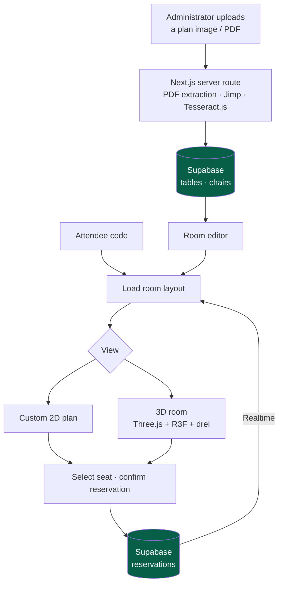

<a href="floor-planner.es.md">🇪🇸 Versión en español</a>

# Floor Planner

> A mentorship project for **2D/3D room planning and seat reservations**, with live seat state and floor-plan import. An intern implemented the application under my technical direction.

## My contribution & delivered scope

- **My contribution:** technical mentorship, initial architecture, introducing 2D/3D libraries, teaching disciplined use of AI assistance and reviewing the project's evolution. **I was the mentor, not the code author.**
- **Delivered scope:** attendee identification by code, reservations with Supabase Realtime, switchable 2D/3D views, room editing and file import using PDF extraction and OCR.
- **Historical stage — 30 April 2026:** the learning project had expanded from an initial 2D plan to the editor and importer described here. Deployment preparation was documented separately as the next stage.

---

## Context & problem

Assigning tables and seats requires a shared view of room capacity and reservations. The project gives attendees a **visual floor plan** where they can identify themselves, distinguish free, occupied and selected seats, and confirm a reservation.

It was also a practical learning project. My role was to help an intern turn a sequence of features into an application with clear boundaries between the room model, rendering, reservations and administrative tools. The intern's implementation remains their contribution.

---

## Solution & architecture

The first 2D implementation used `react-konva`. The version described here combines a **custom 2D view with Three.js/React Three Fiber**, backed by Supabase reservations and Realtime updates.

The administrative importer processes files through a **Next.js server route**. It combines text and positional extraction from PDFs with Jimp preprocessing and Tesseract.js OCR, then creates the tables and chairs used by the editor.

*Implemented reservation and import paths in the April 2026 application.*

---

## Stack & technical decisions

| Technology | Decision | Why |
|---|---|---|
| **Supabase Realtime** | Subscribe to reservation changes | Lets connected clients refresh the shared seat state |
| **2D + Three.js/R3F/drei** | Offer switchable views, with 2D available when 3D is unsuitable | Keeps seat selection accessible across devices while allowing spatial editing |
| **PDF extraction + OCR** | Read digital text/positions first and use OCR for image-based content | Handles different kinds of input without treating every document as an image |
| **Jimp + Tesseract.js** | Preprocess images and recognize text in the Next.js server import path | Keeps import and persistence in one application; OCR runtime requirements remain part of deployment planning |
| **Shared room model** | Import tables and chair counts into the layout used by the editor and reservations | Connects document interpretation to editable room data |

---

## Technical challenges addressed by the intern, under mentorship

- **From a 2D plan to a 3D editor:** evolving rendering and interaction while retaining the room and reservation model.
- **Seat selection across views:** coordinating selected, occupied and attendee-assigned states in 2D and 3D.
- **Floor-plan import:** combining PDF text/position extraction, OCR and fallback layout positions into structured tables and chairs.
- **Shared reservation state:** connecting database changes to the attendee interface through Realtime.

---

## Outcome & learning

The intern delivered an application that grew from a basic 2D seating plan into **2D/3D room views, reservation flows, editing and OCR-based import tools**. This case study follows that April 2026 version and its learning deliverables.

My contribution was the **technical direction and knowledge transfer** behind that learning process: establishing the starting architecture, introducing tools and libraries, and reviewing how the parts fitted together. This case demonstrates mentorship alongside the implementation and integration work described in the other case studies.

---

## Skills demonstrated

`Technical mentorship` · `architecture review` · `AI-assisted development guidance` · `Three.js + R3F + drei` · `Konva (initial version)` · `Supabase Realtime` · `PDF extraction` · `Jimp / Tesseract.js` · `knowledge transfer`
