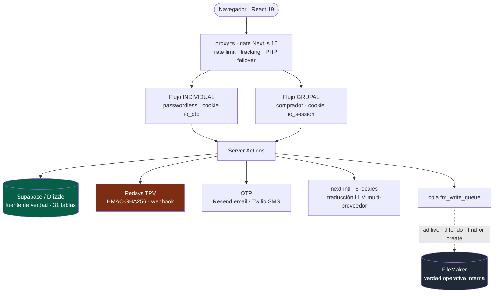

# Inscripción Online v2

> Plataforma multi-evento de inscripción y pago online para congresos médicos, con dos flujos de inscripción distintos y sincronización **aditiva y no destructiva** hacia un FileMaker compartido.

---

## Contexto y problema

La empresa organiza congresos para múltiples asociaciones médicas (cardiología, dermatología, etc.). La plataforma de inscripción **v1** era un sistema PHP heredado: un formulario único, acoplado a FileMaker, difícil de evolucionar y sin separación entre tipos de comprador.

El **v2** nace para resolver tres problemas reales:

1. **Dos públicos muy distintos** comparten el mismo evento: el **profesional sanitario (HCP)** que se autoinscribe, y el **comprador grupal** (una clínica, agencia o laboratorio) que inscribe a varios HCP y necesita una única factura.
2. **FileMaker no se puede tocar a la ligera.** Es la verdad operativa del equipo interno y la base es compartida entre desarrollo y producción. Cualquier escritura tenía que ser **aditiva y reversible**, nunca destructiva.
3. **Migración sin big-bang.** El v1 PHP debía seguir vivo para eventos en curso mientras el v2 se desplegaba evento a evento.

---

## Discovery: entender FileMaker antes de reemplazarlo

El v2 no empezó por el código, sino por **entender cómo trabaja realmente el equipo**. El v1 PHP operaba alrededor de FileMaker con flujos y reglas tácitas que solo existían en la cabeza de quienes lo usaban a diario. Reemplazarlo a ciegas habría roto la operación del negocio.

El proceso de descubrimiento incluyó:

- **Sesiones de trabajo grabadas con el equipo interno** (abril 2026) para observar, paso a paso, cómo inscriben, facturan y gestionan asistentes en FileMaker — capturando los **casos límite y las reglas tácitas** que ningún documento recogía. Las grabaciones se transcribieron y se convirtieron en requisitos.
- **Ingeniería inversa del FileMaker existente** — análisis del esquema real y de los *scripts* de negocio (`*_FindOrCreate.xml`) para replicar su lógica sin romper la base compartida dev+prod.
- **Recogida de requisitos de dirección** — qué quería la empresa de la nueva web: facturación única patrocinada por laboratorios, *data sharing* controlado con *sponsors* (GDPR Art. 14), reasignación de plazas y un plazo de salida a producción de **~mes y medio**.
- **Investigación de arquitectura previa al código** — notas de análisis (`auth-tracking-architecture-analysis`, `event-user-architecture-research`) y un **PRD v2.1** formal antes de escribir una línea, para converger en un sistema **fuerte y rápido de llevar a producción**.
- **Cumplimiento normativo como requisito de primera clase** — alta de *Sender ID* de SMS ante la **CNMC**, factura rectificativa **AEAT** y GDPR.

> Observar, transcribir, modelar y acordar con dirección **antes** de construir es lo que permitió que el rediseño avanzara rápido sin tumbar la operación del negocio. Es trabajo de producto, no solo de programación.

---

## Solución y arquitectura

El rediseño invierte la fuente de verdad: **Supabase (PostgreSQL) pasa a ser la verdad de los datos web nuevos**, y FileMaker se sincroniza de forma **aditiva y diferida** mediante una cola encolada. Nada se borra ni se *mergea* automáticamente en FileMaker.

### Los dos flujos (el núcleo del v2)

**1. Individual — passwordless.** El HCP se identifica por **DNI** y verifica con **OTP** (email vía Resend por defecto; SMS vía Twilio Verify como *fallback*). Tras verificar, una cookie `io_otp` (`iron-session`, 1 h *sliding* + tope absoluto de 24 h, *scoped* a `id_persona/id_evento/id_asociacion`) habilita un wizard de 4 pasos (datos → tarifas filtradas por perfil → facturación → pago Redsys) y la inscripción **multi-paciente** sin repetir OTP.

**2. Grupal — comprador.** Quien inscribe a varios HCP crea una cuenta (usuario + contraseña, o acceso alternativo por OTP-email), y desde un *dashboard* "Mis Inscripciones" añade N asistentes por DNI o nombre. **"Pagar todo"** emite **1 factura con N líneas**, donde cada `LineaFactura.id_persona` es el HCP correspondiente. Incluye **reasignación de plaza** dentro de un plazo configurable (cambia el HCP, registra `audit_log`, regenera el justificante y notifica a saliente y entrante) sin factura rectificativa.

Los dos flujos usan **contratos de privacidad opuestos a propósito**: el individual oculta los datos hasta un OTP correcto (anti-suplantación); el grupal muestra solo nombre/apellidos/DNI en la búsqueda — **nunca empresa ni NIF** — porque el comprador ya está autenticado.

---

## Stack y decisiones técnicas

| Tecnología | Decisión | Por qué |
|---|---|---|
| **Next.js 16 + `proxy.ts`** | Usar el nuevo `proxy.ts` (no `middleware.ts`) como gate | Next 16 introdujo *breaking changes*; el gate aplica rate limit, *failover* a PHP legacy y *tracking* de funnel, dejando la auth a nivel de página |
| **Supabase + Drizzle ORM** | Supabase como fuente de verdad; FileMaker aditivo | Permite evolucionar el modelo web sin bloquear al equipo interno que sigue en FileMaker |
| **Cola `fm_write_queue`** | *Handlers* solo `create`/`update`, **cero `delete`**, *find-or-create* idempotente | Imposibilita por construcción que la web corrompa la base compartida dev+prod |
| **`iron-session` dual** | Dos cookies ortogonales: `io_otp` (individual) e `io_session` (grupal/v1) | Cada flujo tiene su identidad y ciclo de vida; mismo secreto, distinto `cookieName` |
| **Redsys + `id_intento`** | Idempotencia: un reintento reusa el mismo intento, regenera el `tpv_order_id` | Evita filas de pago duplicadas tras un fallo de TPV; cadena de propiedad anti-ataque cross-tenant |
| **next-intl + LLM** | 6 locales con traducción automática multi-proveedor y cache auto-sanable | Paridad de 614 claves en es/en/fr/de/it/pt sin traducción manual |
| **Bcrypt + pepper** | Solo para `auth_accounts` (grupal), no para el individual | El flujo individual es passwordless; el pepper separado no rompe el *dual-write* con PHP |

---

## Retos técnicos resueltos

- **Idempotencia de pago de libro.** El reintento reusa `id_intento` e incrementa el contador **solo si** el *hand-off* al gateway tuvo éxito (fix que evita el bloqueo prematuro del usuario). La cadena `Pago → Factura → Orden` se valida con *inner joins* para impedir manipulación entre *tenants*.
- **Cola FileMaker aditiva por construcción.** Cada *handler* es *find-or-create* y aplica un *boundary filter*: solo los campos que el *script* de FileMaker lee viajan en el parámetro. Un *kill switch* (`FM_QUEUE_STUB`) centraliza el modo *stub* vs. real.
- **Reasignación con *fail-open*.** El cálculo del plazo parsea fechas de FileMaker en JS (nunca un `MIN` SQL sobre `MM/DD/YYYY`), con *guard* cross-account, `audit_log` con `await` crítico y emails aislados que nunca tumban la transacción.
- **Multi-tenancy real** por rutas `/<eventId>/<assocId>/` con tema visual por evento, serie de factura por asociación y `Persona` única por `(documento, id_asociacion)`.

---

## Resultado e impacto

- **Los flujos críticos están terminados y funcionan de extremo a extremo.** Lo difícil del producto — autenticación dual, pagos idempotentes, sincronización segura a FileMaker, multi-evento, i18n — está cerrado y verificado.
- **Estado honesto del *roadmap*:** de los 7 *milestones* del v2, los **3 primeros (M1–M3) están cerrados** con su `VERIFICATION.md`; los restantes (facturación a empresa con patrocinador, *outbox* cross-DB, compliance/reportes, *polish* de UX) están **planificados pero pendientes**. El proyecto está sobre el ~56 % del *roadmap* total, con el *core* operativo.
- **Métricas del código:** 31 tablas Drizzle · 31 migraciones SQL · 56 *Server Actions* · 125 archivos de test (881 tests) · 6 locales · 709 commits.

> **Nota de transparencia técnica:** quedan focos de deuda conscientes (errores de `typecheck` pendientes de resolver, una suite de test heredada que no compila, y la numeración de factura mitigada con índice parcial a la espera de una secuencia por asociación). Están documentados en los `VERIFICATION.md` y el `STATE.md` del proyecto, no escondidos — parte de la disciplina de la metodología.

---

## Competencias demostradas

`Next.js 16` · `React 19 Server Actions` · `Drizzle ORM` · `PostgreSQL` · `Supabase` · `Redsys (TPV)` · `iron-session` · `OTP (Twilio/Resend)` · `FileMaker Data API` · `colas idempotentes` · `i18n LLM` · `rate limiting (Upstash)` · `multi-tenant` · `auditoría/compliance` · `Vitest` · `product discovery` · `requirements engineering` · `ingeniería inversa de legacy` · `gestión de stakeholders` · `compliance (GDPR/CNMC/AEAT)`
