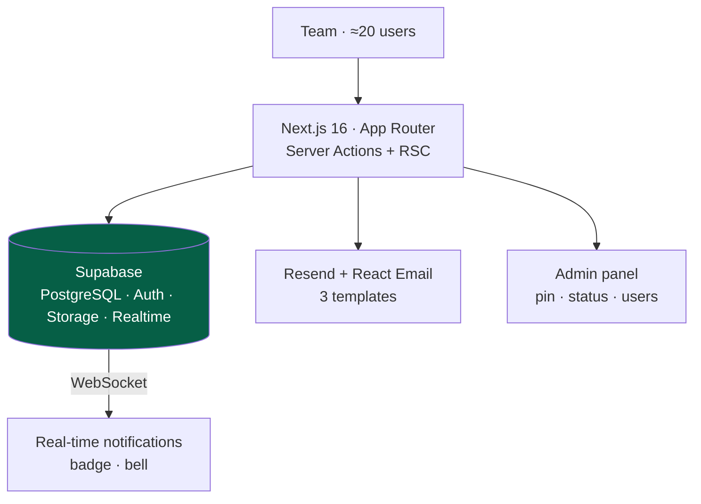

<a href="logitasks.es.md">🇪🇸 Versión en español</a>

# LogiTasks

> Internal web tool for the team to propose, **vote on and prioritize** improvement requests. The technical lead sees clearly what to build first based on the team's votes. In production for internal use.

---

## Context & problem

When a single person carries all of a company's development, the bottleneck is **deciding what to do first**. Requests arrived through scattered channels (messages, emails, hallway conversations) with no way to prioritize them objectively.

LogiTasks centralizes that flow: anyone on the team proposes an improvement, **the team votes on it**, and prioritization emerges from data rather than from whoever insists the loudest.

---

## Solution & architecture

Each request has a title, description and up to 3 photos; the team votes (1–5 or a negative vote), comments, links related requests and receives **real-time notifications** (in-app via Supabase Realtime + email via Resend). The admin pins priority requests, changes their status (`Pending → In Progress → Done`) and manages users.

---

## Stack & technical decisions

| Technology | Decision | Why |
|---|---|---|
| **Supabase (Realtime + RLS)** | WebSocket subscriptions for badges, RLS on every table | Instant notifications with row-level data isolation |
| **Zod v4 `discriminatedUnion`** | Votes modeled as a discriminated union (1–5 *xor* negative) | Mutual exclusivity guaranteed at validation level, not just in the UI |
| **TanStack Query (optimistic mutations)** | The voting UI updates instantly with rollback on error | Voting needs immediate feedback to feel fluid |
| **Server Actions + `revalidatePath`** | Mutations without an explicit REST API, validated server-side | Less boilerplate, shared Zod validation |
| **Fire-and-forget notifications** | An email failure never blocks the Server Action | The user's action never fails because of an email problem |
| **Link anti-duplication** | `CHECK (petition_a_id < petition_b_id)` + unique index | Prevents linking A→B and B→A separately, enforced at database level |

---

## Solved technical challenges

- **Real-time + email combined:** a `createNotification()` helper fires the in-app notification and the email in parallel, with per-user opt-in.
- **Objective prioritization** from vote aggregates, with a unique `(user_id, petition_id)` index preventing double votes.
- **Multi-app coexistence on one Supabase instance:** table renames (`votes → petition_votes`) and migration consolidation to avoid collisions with another ecosystem app, keeping isolation through RLS.
- **Fuzzy search** with PostgreSQL's `pg_trgm` extension (no Elasticsearch).

---

## Outcome & impact

- **In production** for the internal team (~20 users), deployed on **Vercel**.
- **Metrics:** 8 core tables · 15 migrations · 11 development phases completed (100%) · modern Next.js 16 + React 19 stack.
- **Immutable comments** (no `updated_at`) as a simple audit decision.

---

## Skills demonstrated

`Next.js 16` · `React 19` · `Supabase (Realtime, RLS, Auth, Storage)` · `TanStack Query` · `Zod v4` · `Resend + React Email` · `PostgreSQL (pg_trgm)` · `Server Actions` · `Vercel`
