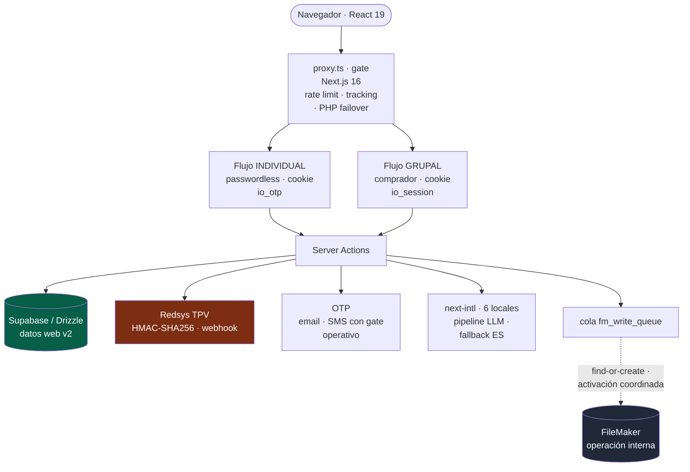
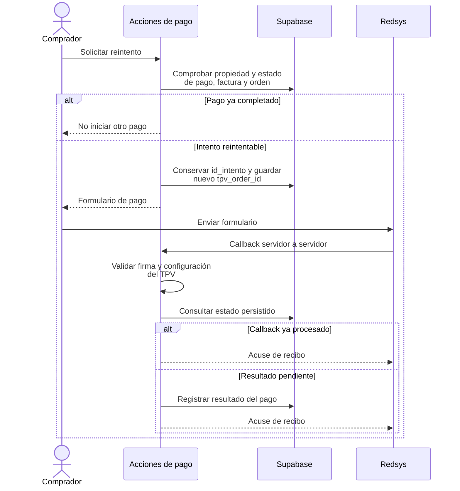

<a href="online-registration.md">🇬🇧 English version</a>

# Registro Online v2

> Rediseño de una plataforma multi-tenant de registro y pagos: autenticación individual y de comprador grupal, con una cola de integración aditiva hacia FileMaker.

| | Alcance de este caso |
|---|---|
| **Mi contribución** | Descubrimiento del negocio, arquitectura e implementación del modelo web v2, autenticación, inscripción, pagos e integración con el legado. |
| **Entregado** | M1–M3: modelo de datos y autenticación dual, flujo individual y flujo grupal básico sin patrocinador. |
| **Estado de la versión** | Registros de entrega hasta el **29 de mayo de 2026**: núcleo implementado y verificado por fase, con activación FileMaker/SMS y revisión de traducciones delimitadas como validaciones operativas. |

---

## Contexto y problema

La plataforma da servicio a varias organizaciones cliente a la vez, cada una con su propia marca, sus tarifas y su serie de facturación. La plataforma de inscripción **v1** era un sistema PHP heredado: un formulario único, acoplado a FileMaker, difícil de evolucionar y sin separación entre tipos de comprador.

El **v2** nace para resolver tres problemas reales:

1. **Dos públicos muy distintos** comparten el mismo ciclo de inscripción: el **profesional individual** que se autoinscribe, y el **comprador grupal** (una empresa o agencia) que inscribe a varias personas y necesita una única factura.
2. **FileMaker no se puede tocar a la ligera.** Es la verdad operativa del equipo interno y la base es compartida entre desarrollo y producción. Cualquier escritura tenía que ser **aditiva y reversible**, nunca destructiva.
3. **Migración sin big-bang.** El v1 PHP debía seguir vivo para los ciclos en curso mientras el v2 se desplegaba tenant a tenant.

---

## Discovery: entender FileMaker antes de reemplazarlo

El v2 no empezó por el código, sino por **entender cómo trabaja realmente el equipo**. El v1 PHP operaba alrededor de FileMaker con flujos y reglas tácitas que solo existían en la cabeza de quienes lo usaban a diario. Reemplazarlo a ciegas habría roto la operación del negocio.

El proceso de descubrimiento incluyó:

- **Sesiones de trabajo grabadas con el equipo interno** (abril 2026) para observar, paso a paso, cómo inscriben, facturan y gestionan registros en FileMaker — capturando los **casos límite y las reglas tácitas** que ningún documento recogía. Las grabaciones se transcribieron y se convirtieron en requisitos.
- **Ingeniería inversa del FileMaker existente** — análisis del esquema real y de los *scripts* de negocio (`*_FindOrCreate.xml`) para replicar su lógica sin romper la base compartida dev+prod.
- **Recogida de requisitos de dirección** — qué quería la empresa de la nueva web: facturación única patrocinada para compradores corporativos, *data sharing* controlado con terceros (GDPR Art. 14), reasignación de plazas y un plazo de salida a producción de **~mes y medio**.
- **Investigación de arquitectura previa al rediseño** — análisis de identidad, seguimiento y relación entre usuario y evento, y un **PRD v2.1** para acordar el modelo y el alcance de las entregas.
- **Requisitos de privacidad, facturación y mensajería** — registro del *Sender ID* de SMS ante la **CNMC**, tratamiento de facturas rectificativas y minimización de datos. Se incorporaron al modelo y a los gates de activación de mensajería.

Observar, transcribir y acordar requisitos con dirección permitió ordenar la transición sin exigir sustituir el sistema operativo del equipo de una sola vez.

---

## Solución y arquitectura

El rediseño separa las responsabilidades: **Supabase (PostgreSQL) es la fuente de los datos web nuevos**, y una cola prepara las escrituras **aditivas y diferidas** hacia FileMaker. Los handlers restringen operaciones y parámetros, sin borrado ni *merge* automático en FileMaker. La activación real de la cola se coordina con el operador mediante smoke test, flag y monitorización.

*Componentes del núcleo M1–M3 descrito en mayo de 2026. La conexión discontinua distingue la integración implementada de su activación operativa; el mapa no representa todo el roadmap como ya entregado.*

### Los dos flujos (el núcleo del v2)

**1. Individual — passwordless.** La persona se identifica por **DNI** y verifica con **OTP** (email vía Resend por defecto; SMS vía Twilio Verify como alternativa sujeta a su gate operativo). Tras verificar, una cookie `io_otp` (`iron-session`, 1 h *sliding* + tope absoluto de 24 h, *scoped* a `id_persona/id_evento/id_asociacion`) habilita un wizard de 4 pasos (datos → tarifas filtradas por perfil → facturación → pago Redsys) y la inscripción **multi-persona** sin repetir OTP.

**2. Grupal — comprador.** Quien inscribe a varias personas crea una cuenta (usuario + contraseña, o acceso alternativo por OTP-email), y desde un *dashboard* "Mis Inscripciones" añade N inscritos por DNI o nombre. **"Pagar todo"** emite **1 factura con N líneas**, donde cada `LineaFactura.id_persona` es la persona correspondiente. Incluye **reasignación de plaza** dentro de un plazo configurable (cambia la persona asignada, registra `audit_log`, regenera el justificante y notifica a saliente y entrante) sin factura rectificativa.

Los dos flujos usan **contratos de privacidad opuestos a propósito**: el individual oculta los datos hasta un OTP correcto (anti-suplantación); el grupal muestra solo nombre/apellidos/DNI en la búsqueda — **nunca empresa ni NIF** — porque el comprador ya está autenticado.

---

## Stack y decisiones técnicas

| Tecnología | Decisión | Por qué |
|---|---|---|
| **Next.js 16 + `proxy.ts`** | Usar el nuevo `proxy.ts` (no `middleware.ts`) como gate | Next 16 introdujo *breaking changes*; el gate aplica rate limit, *failover* a PHP legacy y *tracking* de funnel, dejando la auth a nivel de página |
| **Supabase + Drizzle ORM** | Supabase como fuente de verdad; FileMaker aditivo | Permite evolucionar el modelo web sin bloquear al equipo interno que sigue en FileMaker |
| **Cola `fm_write_queue`** | *Handlers* con operaciones y parámetros permitidos, sin borrado ni auto-merge | Reduce la superficie de escritura sobre la base compartida; el *find-or-create* controla la repetición de trabajos |
| **`iron-session` dual** | Dos cookies ortogonales: `io_otp` (individual) e `io_session` (grupal/v1) | Cada flujo tiene su identidad y ciclo de vida; mismo secreto, distinto `cookieName` |
| **Redsys + `id_intento`** | Un reintento conserva el intento y regenera el `tpv_order_id` | Separa el intento de pago del envío al gateway; las comprobaciones de propiedad y estado protegen el acceso entre tenants |
| **next-intl + LLM** | 6 catálogos con paridad estructural, traducción asistida y fallback a español | Permite ampliar idiomas y recuperar traducciones fallidas; la calidad del texto requiere revisión por idioma |
| **Bcrypt + pepper** | Solo para `auth_accounts` (grupal), no para el individual | El flujo individual es passwordless; el pepper separado no rompe el *dual-write* con PHP |

---

## Retos técnicos resueltos

- **Reintentos de pago con identidad estable.** El reintento reusa `id_intento` e incrementa el contador **solo si** se acepta el *hand-off* al gateway, evitando consumir intentos por un fallo previo al envío. La relación `Pago → Factura → Orden` se comprueba junto a la identidad del comprador.
- **Frontera de escritura FileMaker.** Los handlers de creación usan *find-or-create* y un filtro limita los parámetros que recibe cada script. Un flag centraliza el modo simulado frente al real para coordinar la activación.
- **Reasignación dentro de plazo.** El cálculo parsea fechas de FileMaker en JS en lugar de aplicar `MIN` SQL a `MM/DD/YYYY`; combina control de cuenta, auditoría esperada en el camino crítico y errores de email aislados de la actualización.
- **Multi-tenancy real** por rutas `/<eventId>/<assocId>/` con tema visual por tenant, serie de factura por organización y `Persona` única por `(documento, id_asociacion)`.

### Reintento y callback de pago

*Secuencia simplificada de los caminos de reintento y webhook implementados. Distingue el identificador estable del intento del identificador de cada envío al gateway; las pruebas con mocks y el smoke del TPV son comprobaciones distintas.*

---

## Resultado e impacto

- **Núcleo M1–M3 implementado y verificado por fase.** Los registros de mayo de 2026 describen autenticación dual, flujo individual y comprador grupal básico. El cierre de M2 incorporó las correcciones del acceso OTP y la conexión de sus pantallas.
- **Validaciones operativas delimitadas.** Los últimos registros separan el código de la activación y smoke de FileMaker, la puesta en producción de SMS y la revisión de textos no españoles. Esos checkpoints no se presentan como concluidos por el mero cierre de una fase.
- **Pruebas con fecha y resultado.** La verificación de M3 del **29 de mayo de 2026** registró **881 casos aprobados, 2 omitidos y 1 fallo heredado**. Es un resultado histórico de esa versión, no una ejecución actual ni una suite completamente verde.
- **Siguientes entregas del roadmap:** facturación con patrocinador, *outbox* entre bases de datos, reporting y acabado de UX. No forman parte del cierre M1–M3.

**Límite de la versión:** los informes de mayo conservaban errores de tipado y deuda de pruebas heredadas. La numeración de factura tenía un índice parcial para detectar colisiones, con una secuencia por asociación prevista como mejora. Estas restricciones acotan la entrega sin ocultar el trabajo ya completado. La estrategia de pruebas se amplía en [TESTING](../TESTING.es.md).

---

## Competencias demostradas

`Next.js 16` · `React 19 Server Actions` · `Drizzle ORM` · `PostgreSQL` · `Supabase` · `Redsys (TPV)` · `iron-session` · `OTP (Twilio/Resend)` · `FileMaker Data API` · `colas idempotentes` · `i18n LLM` · `rate limiting (Upstash)` · `multi-tenant` · `auditoría` · `Vitest` · `product discovery` · `requirements engineering` · `ingeniería inversa de legacy` · `gestión de stakeholders` · `requisitos de privacidad y facturación`
