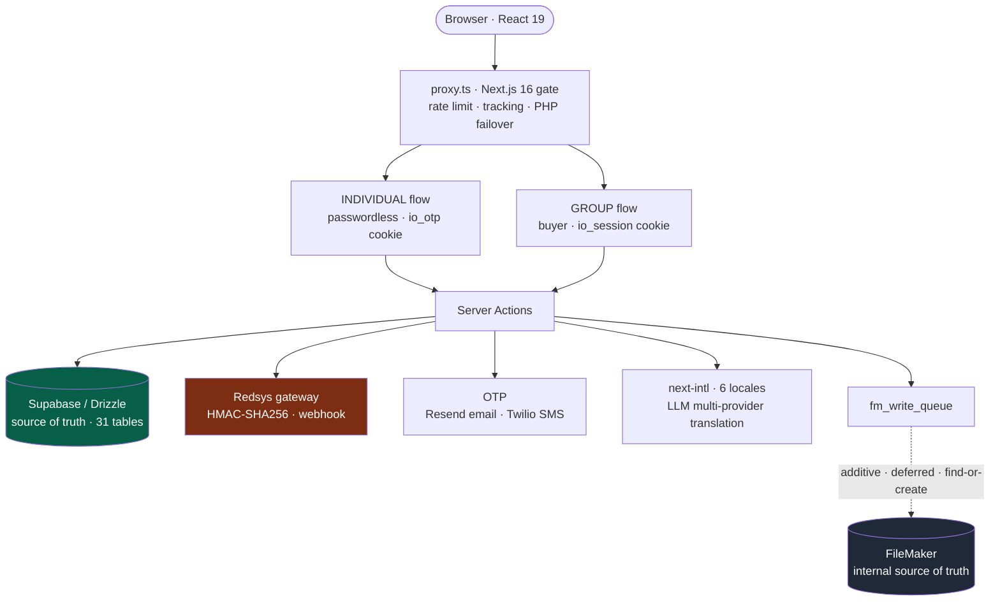

<a href="online-registration.es.md">🇪🇸 Versión en español</a>

# Online Registration v2

> Multi-tenant online registration and payment platform, with two distinct registration flows and **additive, non-destructive** synchronization to a shared FileMaker database.

---

## Context & problem

The platform serves several client organizations at once, each with its own branding, fee structure and invoice series. The **v1** registration platform was a legacy PHP system: a single form, tightly coupled to FileMaker, hard to evolve and with no separation between buyer types.

**v2** was born to solve three real problems:

1. **Two very different audiences** share the same registration cycle: the **individual professional** who signs themselves up, and the **group buyer** (a company or agency) who registers several people and needs a single invoice.
2. **FileMaker can't be touched lightly.** It is the internal team's operational source of truth and the database is shared between development and production. Any write had to be **additive and reversible**, never destructive.
3. **No big-bang migration.** The PHP v1 had to stay alive for in-flight cycles while v2 rolled out tenant by tenant.

---

## Discovery: understanding FileMaker before replacing it

v2 didn't start with code — it started by **understanding how the team actually works**. The PHP v1 operated around FileMaker with tacit flows and rules that existed only in the heads of its daily users. Replacing it blindly would have broken business operations.

The discovery process included:

- **Recorded working sessions with the internal team** (April 2026) to observe, step by step, how they register, invoice and manage records in FileMaker — capturing the **edge cases and tacit rules** no document recorded. The recordings were transcribed and turned into requirements.
- **Reverse engineering the existing FileMaker** — analysis of the real schema and the business scripts (`*_FindOrCreate.xml`) to replicate their logic without breaking the shared dev+prod database.
- **Requirements gathering from management** — what the company wanted from the new registration site: single sponsored invoicing for corporate buyers, controlled data sharing with third parties (GDPR Art. 14), seat reassignment, and a **~six-week** path to production.
- **Architecture research before code** — analysis notes (`auth-tracking-architecture-analysis`, `event-user-architecture-research`) and a formal **PRD v2.1** before writing a single line, to converge on a system that was **robust and fast to take to production**.
- **Regulatory compliance as a first-class requirement** — SMS Sender ID registration with the **CNMC** (Spanish telecom regulator), **AEAT**-compliant corrective invoicing, and GDPR.

> Observing, transcribing, modeling and agreeing with management **before** building is what allowed the redesign to move fast without taking down business operations. That's product work, not just programming.

---

## Solution & architecture

The redesign flips the source of truth: **Supabase (PostgreSQL) becomes the truth for all new web data**, and FileMaker is synchronized **additively and deferred** through a write queue. Nothing is ever deleted or auto-merged in FileMaker.

### The two flows (the core of v2)

**1. Individual — passwordless.** The person identifies with their **national ID** and verifies via **OTP** (email through Resend by default; SMS through Twilio Verify as fallback). After verification, an `io_otp` cookie (`iron-session`, 1 h sliding + 24 h absolute cap, scoped to `id_persona/id_evento/id_asociacion`) unlocks a 4-step wizard (details → profile-filtered fees → billing → Redsys payment) and **multi-person** registration without repeating the OTP.

**2. Group — buyer.** Whoever registers several people creates an account (username + password, or an alternative email-OTP login) and, from a "My Registrations" dashboard, adds N registrants by ID or name. **"Pay everything"** issues **1 invoice with N line items**, each `LineaFactura.id_persona` pointing to the corresponding person. It includes **seat reassignment** within a configurable window (swaps the assigned person, records to `audit_log`, regenerates the receipt and notifies both parties) without a corrective invoice.

The two flows use **deliberately opposite privacy contracts**: the individual flow hides all data until a successful OTP (anti-impersonation); the group flow shows only name/surname/ID in search — **never company or tax ID** — because the buyer is already authenticated.

---

## Stack & technical decisions

| Technology | Decision | Why |
|---|---|---|
| **Next.js 16 + `proxy.ts`** | Use the new `proxy.ts` (not `middleware.ts`) as the gate | Next 16 introduced breaking changes; the gate applies rate limiting, legacy-PHP failover and funnel tracking, leaving auth at page level |
| **Supabase + Drizzle ORM** | Supabase as source of truth; FileMaker additive | Lets the web data model evolve without blocking the internal team still on FileMaker |
| **`fm_write_queue`** | Handlers only `create`/`update`, **zero `delete`**, idempotent find-or-create | Makes it impossible by construction for the web app to corrupt the shared dev+prod database |
| **Dual `iron-session`** | Two orthogonal cookies: `io_otp` (individual) and `io_session` (group/v1) | Each flow has its own identity and lifecycle; same secret, different `cookieName` |
| **Redsys + `id_intento`** | Idempotency: a retry reuses the same attempt and regenerates the `tpv_order_id` | Prevents duplicate payment rows after a gateway failure; ownership chain blocks cross-tenant tampering |
| **next-intl + LLM** | 6 locales with automated multi-provider translation and self-healing cache | 614-key parity across es/en/fr/de/it/pt with no manual translation |
| **Bcrypt + pepper** | Only for `auth_accounts` (group flow), not the individual one | The individual flow is passwordless; the separate pepper keeps the PHP dual-write intact |

---

## Solved technical challenges

- **Textbook payment idempotency.** A retry reuses `id_intento` and increments the counter **only if** the gateway hand-off succeeded (a fix that prevents prematurely locking the user out). The `Payment → Invoice → Order` chain is validated with inner joins to block cross-tenant manipulation.
- **A FileMaker queue that is additive by construction.** Every handler is find-or-create and applies a boundary filter: only the fields the FileMaker script reads travel in the parameter. A kill switch (`FM_QUEUE_STUB`) centralizes stub vs. real mode.
- **Fail-open reassignment.** The deadline computation parses FileMaker dates in JS (never a SQL `MIN` over `MM/DD/YYYY`), with a cross-account guard, a critically-awaited `audit_log`, and isolated emails that can never take down the transaction.
- **Real multi-tenancy** via `/<eventId>/<assocId>/` routes with per-tenant theming, per-organization invoice series, and `Persona` uniqueness per `(document, association)`.

---

## Outcome & impact

- **The critical flows are finished and work end-to-end.** The hard parts of the product — dual auth, idempotent payments, safe FileMaker sync, multi-tenancy, i18n — are closed and verified.
- **Honest roadmap status:** of v2's 7 milestones, the **first 3 (M1–M3) are closed** with their `VERIFICATION.md`; the rest (sponsored company invoicing, cross-DB outbox, compliance/reporting, UX polish) are **planned but pending**. The project sits at ~56% of the total roadmap, with the core operational.
- **Code metrics:** 31 Drizzle tables · 31 SQL migrations · 56 Server Actions · 125 test files (881 tests) · 6 locales · 709 commits.

> **Technical transparency note:** conscious debt remains (unresolved `typecheck` errors, one legacy test suite that doesn't compile, and invoice numbering mitigated with a partial index while waiting for a per-association sequence). It is documented in the project's `VERIFICATION.md` and `STATE.md` files, not hidden — that's part of the methodology's discipline.

---

## Skills demonstrated

`Next.js 16` · `React 19 Server Actions` · `Drizzle ORM` · `PostgreSQL` · `Supabase` · `Redsys (payment gateway)` · `iron-session` · `OTP (Twilio/Resend)` · `FileMaker Data API` · `idempotent queues` · `LLM i18n` · `rate limiting (Upstash)` · `multi-tenant` · `audit/compliance` · `Vitest` · `product discovery` · `requirements engineering` · `legacy reverse engineering` · `stakeholder management` · `compliance (GDPR/CNMC/AEAT)`
