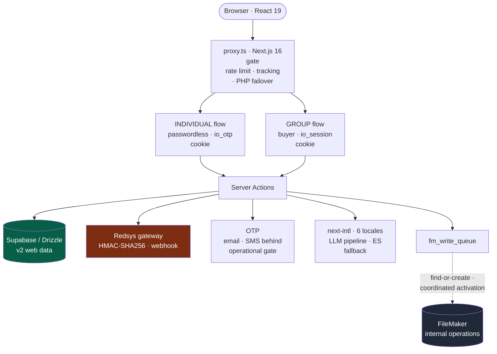
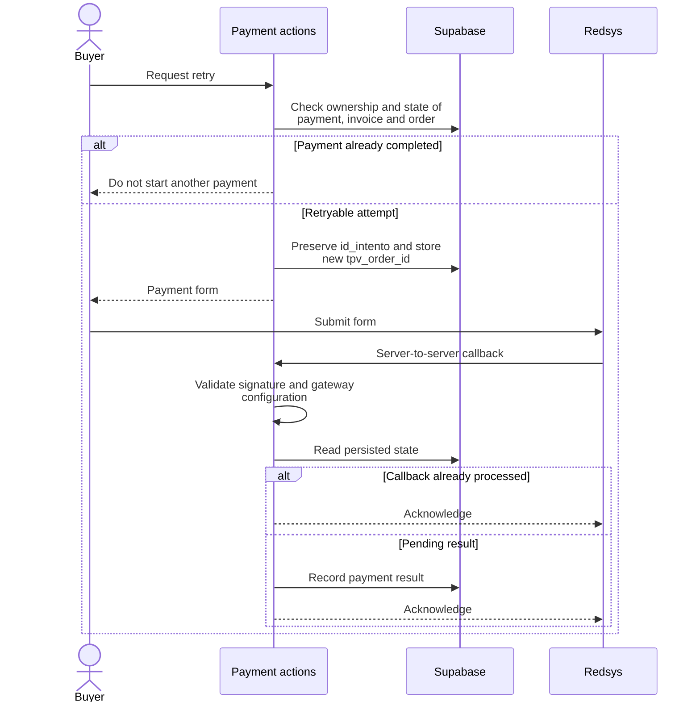

<a href="online-registration.es.md">🇪🇸 Versión en español</a>

# Online Registration v2

> Redesign of a multi-tenant registration and payment platform: individual and group-buyer authentication, with an additive integration queue for FileMaker.

| | Scope of this case |
|---|---|
| **My contribution** | Business discovery, architecture and implementation of the v2 web data model, authentication, registration, payments and legacy integration. |
| **Delivered** | M1–M3: data model and dual authentication, individual flow and basic group flow without a sponsor. |
| **Version status** | Delivery records through **29 May 2026**: core implemented and verified by phase, with FileMaker/SMS activation and translation review tracked as operational checks. |

---

## Context & problem

The platform serves several client organizations at once, each with its own branding, fee structure and invoice series. The **v1** registration platform was a legacy PHP system: a single form, tightly coupled to FileMaker, hard to evolve and with no separation between buyer types.

**v2** was born to solve three real problems:

1. **Two very different audiences** share the same registration cycle: the **individual professional** who signs themselves up, and the **group buyer** (a company or agency) who registers several people and needs a single invoice.
2. **FileMaker can't be touched lightly.** It is the internal team's operational source of truth and the database is shared between development and production. Any write had to be **additive and reversible**, never destructive.
3. **No big-bang migration.** The PHP v1 had to stay alive for in-flight cycles while v2 rolled out tenant by tenant.

---

## Discovery: understanding FileMaker before replacing it

v2 didn't start with code — it started by **understanding how the team actually works**. The PHP v1 operated around FileMaker with tacit flows and rules that existed only in the heads of its daily users. Replacing it blindly would have broken business operations.

The discovery process included:

- **Recorded working sessions with the internal team** (April 2026) to observe, step by step, how they register, invoice and manage records in FileMaker — capturing the **edge cases and tacit rules** no document recorded. The recordings were transcribed and turned into requirements.
- **Reverse engineering the existing FileMaker** — analysis of the real schema and the business scripts (`*_FindOrCreate.xml`) to replicate their logic without breaking the shared dev+prod database.
- **Requirements gathering from management** — what the company wanted from the new registration site: single sponsored invoicing for corporate buyers, controlled data sharing with third parties (GDPR Art. 14), seat reassignment, and a **~six-week** path to production.
- **Architecture research before the redesign** — analysis of identity, tracking and the user/event relationship, followed by a **PRD v2.1** to agree the model and delivery scope.
- **Privacy, invoicing and messaging requirements** — SMS Sender ID registration with the **CNMC** (Spanish telecom regulator), corrective-invoice handling and data minimization. These informed the data model and messaging activation gates.

Observing, transcribing and agreeing requirements with management made it possible to organize the transition without replacing the team's operational system in one step.

---

## Solution & architecture

The redesign separates responsibilities: **Supabase (PostgreSQL) holds new web data**, while a queue prepares **additive, deferred** writes to FileMaker. Handlers restrict operations and parameters, with no automatic deletion or merging in FileMaker. Live queue activation is coordinated with the operator through a smoke test, feature flag and monitoring.

*Components of the M1–M3 core described in May 2026. The dashed connection distinguishes implemented integration from operational activation; the map does not present the entire roadmap as delivered.*

### The two flows (the core of v2)

**1. Individual — passwordless.** The person identifies with their **national ID** and verifies via **OTP** (email through Resend by default; SMS through Twilio Verify as an alternative behind its operational gate). After verification, an `io_otp` cookie (`iron-session`, 1 h sliding + 24 h absolute cap, scoped to `id_persona/id_evento/id_asociacion`) unlocks a 4-step wizard (details → profile-filtered fees → billing → Redsys payment) and **multi-person** registration without repeating the OTP.

**2. Group — buyer.** Whoever registers several people creates an account (username + password, or an alternative email-OTP login) and, from a "My Registrations" dashboard, adds N registrants by ID or name. **"Pay everything"** issues **1 invoice with N line items**, each `LineaFactura.id_persona` pointing to the corresponding person. It includes **seat reassignment** within a configurable window (swaps the assigned person, records to `audit_log`, regenerates the receipt and notifies both parties) without a corrective invoice.

The two flows use **deliberately opposite privacy contracts**: the individual flow hides all data until a successful OTP (anti-impersonation); the group flow shows only name/surname/ID in search — **never company or tax ID** — because the buyer is already authenticated.

---

## Stack & technical decisions

| Technology | Decision | Why |
|---|---|---|
| **Next.js 16 + `proxy.ts`** | Use the new `proxy.ts` (not `middleware.ts`) as the gate | Next 16 introduced breaking changes; the gate applies rate limiting, legacy-PHP failover and funnel tracking, leaving auth at page level |
| **Supabase + Drizzle ORM** | Supabase as source of truth; FileMaker additive | Lets the web data model evolve without blocking the internal team still on FileMaker |
| **`fm_write_queue`** | Handlers allow only defined operations and parameters, with no deletion or auto-merge | Limits writes to the shared database; find-or-create controls repeated jobs |
| **Dual `iron-session`** | Two orthogonal cookies: `io_otp` (individual) and `io_session` (group/v1) | Each flow has its own identity and lifecycle; same secret, different `cookieName` |
| **Redsys + `id_intento`** | A retry preserves the attempt and regenerates the `tpv_order_id` | Separates the payment attempt from the gateway submission; ownership and state checks protect access across tenants |
| **next-intl + LLM** | 6 catalogs with structural parity, assisted translation and Spanish fallback | Supports new languages and recovery from translation failures; text quality requires review per language |
| **Bcrypt + pepper** | Only for `auth_accounts` (group flow), not the individual one | The individual flow is passwordless; the separate pepper keeps the PHP dual-write intact |

---

## Solved technical challenges

- **Payment retries with a stable identity.** A retry reuses `id_intento` and increments the counter **only if** the gateway hand-off is accepted, avoiding consumed attempts when submission cannot be prepared. The `Payment → Invoice → Order` relationship is checked alongside the buyer's identity.
- **A FileMaker write boundary.** Creation handlers use find-or-create and a filter limits the parameters received by each script. A flag centralizes simulated versus live mode to coordinate activation.
- **Reassignment within a deadline.** The computation parses FileMaker dates in JS rather than applying SQL `MIN` to `MM/DD/YYYY`; it combines account checks, awaited auditing on the critical path and email errors isolated from the update.
- **Real multi-tenancy** via `/<eventId>/<assocId>/` routes with per-tenant theming, per-organization invoice series, and `Persona` uniqueness per `(document, association)`.

### Payment retry and callback

*Simplified sequence of the implemented retry and webhook paths. It separates the stable attempt identifier from each gateway submission identifier; mocked tests and a gateway smoke test are different checks.*

---

## Outcome & impact

- **M1–M3 core implemented and verified by phase.** The May 2026 records cover dual authentication, the individual flow and the basic group buyer. M2 closed with corrections to OTP access and the connections between its screens.
- **Defined operational checks.** The latest records separate code delivery from FileMaker activation and smoke testing, SMS production enablement and review of non-Spanish text. Closing a phase does not mark those checkpoints complete.
- **Dated test results.** The M3 verification of **29 May 2026** recorded **881 passing cases, 2 skipped and 1 pre-existing failure**. This is a historical result for that version, rather than a current run or an entirely green suite.
- **Next roadmap deliveries:** sponsored invoicing, a cross-database outbox, reporting and UX finishing. These are outside the M1–M3 closure.

**Version limit:** the May reports retained type-checking errors and legacy test debt. Invoice numbering used a partial index to detect collisions, with a per-association sequence planned as an improvement. These constraints bound the delivery while preserving the completed scope. The test strategy is expanded in [TESTING](../TESTING.md).

---

## Skills demonstrated

`Next.js 16` · `React 19 Server Actions` · `Drizzle ORM` · `PostgreSQL` · `Supabase` · `Redsys (payment gateway)` · `iron-session` · `OTP (Twilio/Resend)` · `FileMaker Data API` · `idempotent queues` · `LLM i18n` · `rate limiting (Upstash)` · `multi-tenant` · `auditing` · `Vitest` · `product discovery` · `requirements engineering` · `legacy reverse engineering` · `stakeholder management` · `privacy and invoicing requirements`
