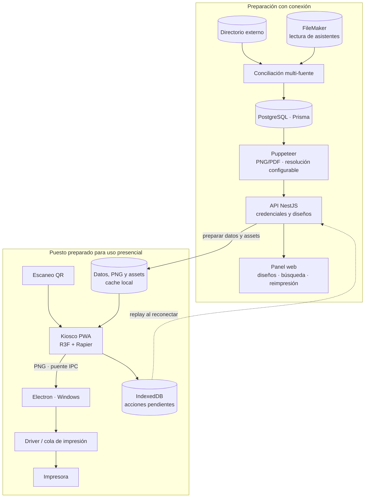
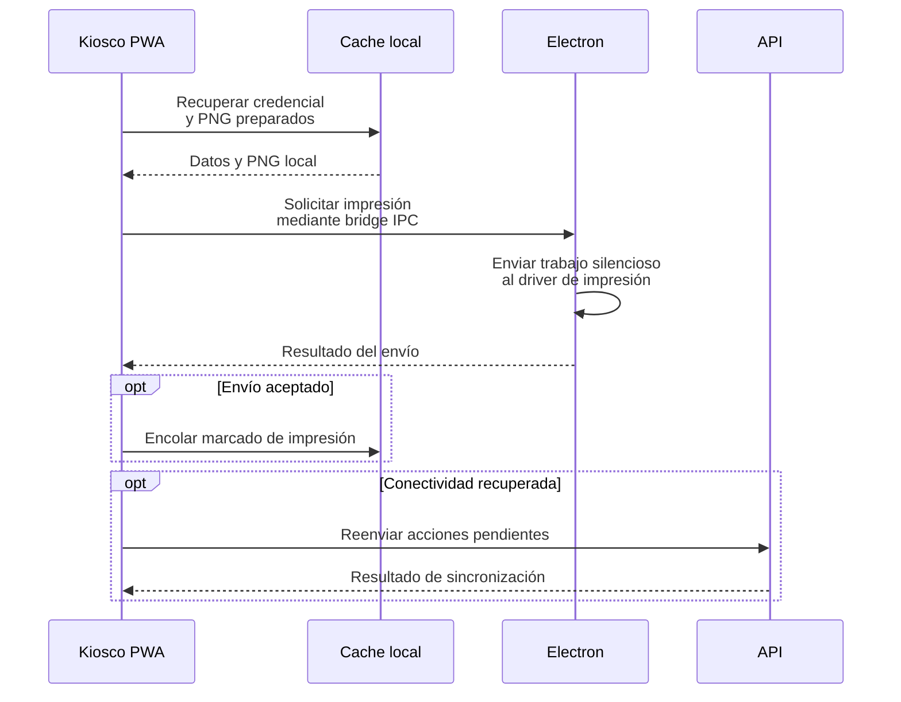

<a href="printflow.md">🇬🇧 English version</a>

# PrintFlow

> Sistema de credenciales con generación de tarjetas, **kiosco 3D** y conexión con impresión física. Combina una web de gestión, un cliente Windows y operación con material preparado para trabajar sin red.

| | Alcance de este caso |
|---|---|
| **Mi contribución** | Arquitectura e implementación full-stack, integración de fuentes, experiencia de kiosco y conexión con impresión de escritorio. |
| **Entregado** | Generación y conciliación de credenciales, editor de diseños, kiosco, cliente Electron e infraestructura de preparación offline y sincronización. |
| **Estado de la versión** | Uso presencial documentado el **12 de mayo de 2026**, seguido de mejoras v1.1 hasta el **29 de mayo de 2026**. La extensión de vídeo configurable mantenía un checkpoint de validación offline específico. |

---

## Contexto y problema

En una recepción presencial, entregar las credenciales puede convertirse en un cuello de botella: las personas llegan a la vez y necesitan una tarjeta física. La búsqueda y preparación manual añaden pasos y oportunidades de error.

Además, los datos personales viven en **dos fuentes distintas** según el tenant — una API de directorio externa y la base FileMaker interna — y cada una usa convenciones de campo diferentes (p. ej. qué columna contiene el DNI/pasaporte). El sistema tenía que **unificar ambas fuentes** y funcionar **aunque se cayera internet** en el emplazamiento.

---

## Solución y arquitectura

Una persona escanea su QR, el kiosco recupera su credencial, muestra la experiencia de bienvenida y solicita la impresión desde el cliente de escritorio. El diseño reduce la intervención manual y permite usar las tarjetas ya preparadas si se pierde la conexión.

*Ruta conceptual de preparación y operación de la versión descrita en mayo de 2026. Offline utiliza datos y material precargados; el camino de impresión pasa por el cliente y el driver del puesto.*

El **kiosco** organiza escaneo, transición, bienvenida, vista de la credencial y solicitud de impresión como una máquina de estados. **React Three Fiber + Rapier** renderiza la tarjeta colgando de un cordón con física. La preparación descarga los PNG ya generados y los assets del diseño; la PWA los conserva con Serwist y almacenamiento local. IndexedDB mantiene una cola de acciones para sincronizar el estado cuando vuelve la conexión.

### De la credencial local al trabajo de impresión

*Camino simplificado de una credencial ya preparada. El resultado del bridge/driver describe el envío del trabajo; la salida del papel requiere comprobación operativa de la impresora.*

---

## Stack y decisiones técnicas

| Tecnología | Decisión | Por qué |
|---|---|---|
| **Puppeteer 24** | *Singleton* de navegador con recuperación y lotes de concurrencia configurable (default 1) | El entorno elegido tenía un presupuesto de 1 GB de RAM; reutilizar Chromium evita lanzar un navegador por tarjeta |
| **Resolución configurable** | Renderizar HTML → PNG/PDF con factor de escala según el diseño | Ajusta calidad y consumo de recursos a la salida de impresión |
| **FileMaker solo lectura + multi-tenant** | Campo DNI configurable por diseño (`fmDniFieldName`) | Cada tenant usa un campo distinto; se cambia sin tocar código |
| **Conciliación directorio externo ↔ FileMaker** | 3 índices (`byEmail`, `byQrtoken`, `byInscripcion`) sobre el mismo *mapping* | El origen del dato del QR varía según configuración; recomputar no resetea tarjetas ya generadas |
| **Serwist 9 (PWA)** | Precarga de datos/PNG/assets y cola en IndexedDB | Permite operar con material preparado durante una caída de red y reconciliar acciones después |
| **App de escritorio Windows** | Electron y empaquetado portable/NSIS con pipeline GitHub Actions | Un host nativo conecta la web con la impresión silenciosa del puesto |

---

## Retos técnicos resueltos

- ***Self-heal* de almacenamiento.** El disco efímero del despliegue podía perder los archivos generados. Si una petición no encuentra el material, **se regenera bajo demanda** y se vuelve a cachear.
- **Generación por lotes con progreso y cancelación.** Un `Map` de progreso, un endpoint de consulta y una señal de cancelación comprobada por los workers permiten seguir el lote y detenerlo sin depender de un tiempo estimado fijo.
- **Validación sin dependencias.** Lectura de dimensiones de imagen leyendo cabeceras PNG/JPEG (rechaza fondos < 600 px) y *sniffing* de *magic bytes* en *uploads* de vídeo (MP4/WebM) para no fiarse del `Content-Type`.
- **Sincronización de estado offline.** Para credenciales preparadas, el kiosco usa el PNG local y encola el marcado tras el retorno satisfactorio del envío a impresión. El replay deduplica acciones y las concilia al reconectar.

---

## Personalización sin código y app de escritorio

Dos piezas convierten PrintFlow en una herramienta que **el equipo opera de forma autónoma**, sin tocar código:

### Editor visual de diseños

Desde `/panel/designs` el equipo crea y edita cada modelo de tarjeta:

- **Origen de datos por diseño** — selecciona la base FileMaker (`fm-database-select`) y el campo de documento (DNI/pasaporte) de cada tenant.
- **Maquetación física** — colores, fondos, títulos y textos de la tarjeta, posicionados en milímetros para ajustar el diseño al soporte.
- **Editor del kiosco** (`kiosk-editor`, por diseño) — configura colores, fondo, títulos y textos, además de la transición 3D o vídeo. El vídeo sustituye la transición; se conservan la bienvenida y la vista final de la credencial. La configuración se guarda por diseño y se carga al abrir o refrescar el kiosco.

### Experiencia 3D del kiosco

La animación combina varias librerías y componentes propios:

- **`badge-lanyard-3d`** — la tarjeta cuelga de un cordón con **física real** (React Three Fiber + Rapier).
- **`ripple-grid`** — fondo animado por *shader*.
- **`scan-transition-3d`** — transición 3D al escanear el QR.
- **`scene-3d-fallback`** — degradación elegante si el hardware del emplazamiento no dispone de WebGL.

### App de escritorio — impresión silenciosa

El cliente **Electron para Windows** ejecuta el kiosco a pantalla completa. La web transforma el PNG en un payload para el bridge; el proceso principal de Electron envía el trabajo **sin los diálogos del navegador**. La selección usa la impresora predeterminada y dispone de alternativas si no la encuentra.

Se empaqueta con **`electron-builder`** como **portable o instalador NSIS**. La URL de la web y el modo kiosco son configurables, lo que permite preparar el puesto sin modificar la aplicación web.

---

## Resultado e impacto

- **Uso presencial documentado el 12 de mayo de 2026**, con generación de credenciales, conciliación de fuentes, kiosco e impresión física. El feedback posterior se convirtió en un backlog de mejoras operativas.
- **v1.1 cerró mejoras hasta el 29 de mayo de 2026:** textos y búsqueda configurables, mejoras del editor y transición de kiosco seleccionable por diseño. El último registro mantenía pendiente la validación E2E del nuevo vídeo offline y del cambio de modo sin redespliegue.
- **Separación de responsabilidades:** API NestJS con generación Chromium, web Next.js y cliente Electron para el puesto de impresión. El módulo de credenciales declara 41 rutas HTTP, además de los healthchecks, y 3 modelos Prisma en la versión descrita.

**Límite operativo:** trabajar sin red exige preparar previamente datos, PNG y assets; no genera credenciales nuevas contra FileMaker durante la caída. El despliegue descrito separa Vercel para la web, Railway para la API y PostgreSQL gestionado. La preparación del puesto, el driver y la impresora forman parte de la entrega operativa.

---

## Competencias demostradas

`NestJS 11` · `Next.js 16` · `Puppeteer` · `React Three Fiber + Rapier` · `PWA / Serwist` · `IndexedDB offline` · `Prisma` · `PostgreSQL` · `FileMaker Data API` · `API de directorio externa` · `Docker + Railway` · `GitHub Actions (desktop release)` · `impresión física` · `Electron (app de escritorio)` · `electron-builder (instalador Windows)` · `editor visual no-code` · `shaders / GLSL`
