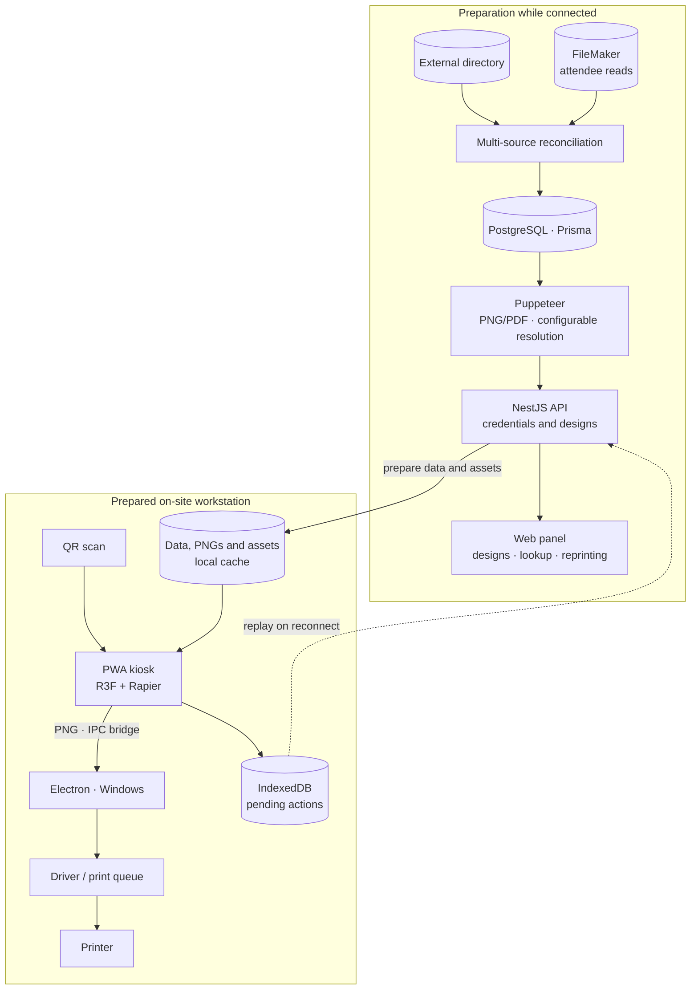
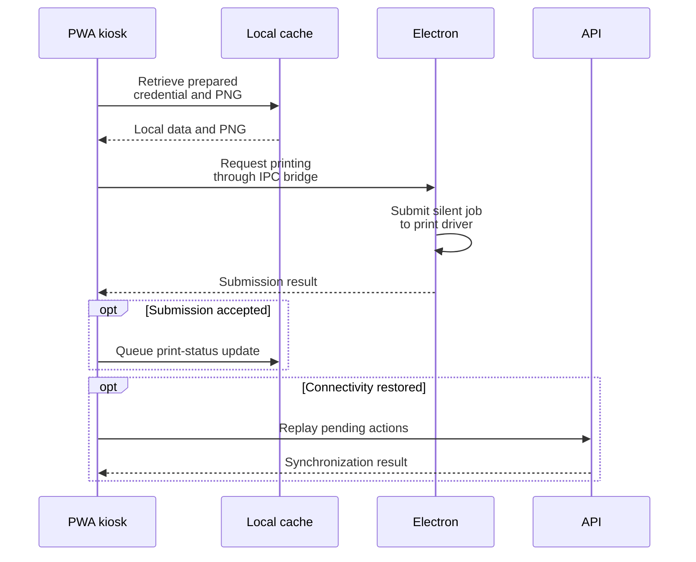

<a href="printflow.es.md">🇪🇸 Versión en español</a>

# PrintFlow

> Credential system with card generation, a **3D kiosk** and a connection to physical printing. It combines a management web app, a Windows client and prepared local material for operation without a network.

| | Scope of this case |
|---|---|
| **My contribution** | Full-stack architecture and implementation, source integration, kiosk experience and desktop printing integration. |
| **Delivered** | Credential generation and reconciliation, design editor, kiosk, Electron client, offline preparation and synchronization infrastructure. |
| **Version status** | On-site use documented on **12 May 2026**, followed by v1.1 improvements through **29 May 2026**. Configurable video retained a specific offline validation checkpoint. |

---

## Context & problem

At an on-site reception, handing out credentials can become a bottleneck: people arrive together and need a physical card. Manual lookup and preparation add steps and opportunities for error.

On top of that, personal data lives in **two different sources** depending on the tenant — an external directory API and the internal FileMaker database — and each one uses different field conventions (e.g. which column holds the ID/passport). The system had to **unify both sources** and keep working **even if the site's internet went down**.

---

## Solution & architecture

A person scans their QR, the kiosk retrieves the credential, displays the welcome experience and requests printing through the desktop client. The design reduces manual intervention and lets prepared cards remain usable if connectivity is lost.

*Conceptual preparation and operation path for the version described in May 2026. Offline operation uses preloaded data and material; the printing path goes through the workstation's client and driver.*

The **kiosk** organizes scanning, transition, welcome, credential preview and print requests as a state machine. **React Three Fiber + Rapier** renders the card hanging from a lanyard with physics. Preparation downloads already-generated PNGs and design assets; the PWA retains them with Serwist and local storage. IndexedDB keeps an action queue to synchronize state when connectivity returns.

### From a local credential to a print job

*Simplified path for an already-prepared credential. The bridge/driver result describes job submission; physical paper output requires an operational printer check.*

---

## Stack & technical decisions

| Technology | Decision | Why |
|---|---|---|
| **Puppeteer 24** | Browser singleton with recovery and configurable batch concurrency (default 1) | The chosen environment had a 1 GB RAM budget; reusing Chromium avoids launching a browser per card |
| **Configurable resolution** | Render HTML → PNG/PDF with a scale factor per design | Balances print quality and resource use for the output format |
| **Read-only FileMaker + multi-tenant** | Per-design configurable ID field (`fmDniFieldName`) | Every tenant uses a different field; it changes without touching code |
| **External directory ↔ FileMaker reconciliation** | 3 indexes (`byEmail`, `byQrtoken`, `byInscripcion`) over the same mapping | The QR data source varies by configuration; recomputing never resets already-generated cards |
| **Serwist 9 (PWA)** | Preloaded data/PNGs/assets and an IndexedDB queue | Supports prepared material during an outage and reconciles actions afterward |
| **Windows desktop app** | Electron and portable/NSIS packaging with a GitHub Actions pipeline | A native host connects the web app to silent printing on the workstation |

---

## Solved technical challenges

- **Storage self-healing.** The deployment's ephemeral disk could lose generated files. Missing material is **regenerated on demand** and cached again.
- **Batch generation with progress and cancellation.** A progress `Map`, a polling endpoint and a cancellation signal checked by workers let operators follow and stop a batch without relying on a fixed time estimate.
- **Dependency-free validation.** Image dimensions are read straight from PNG/JPEG headers (backgrounds under 600 px are rejected) and video uploads are magic-byte sniffed (MP4/WebM) instead of trusting `Content-Type`.
- **Offline state synchronization.** For prepared credentials, the kiosk uses the local PNG and queues a status update after successful print submission returns. Replay deduplicates actions and reconciles them on reconnect.

---

## No-code customization and the desktop app

Two pieces turn PrintFlow into a tool **the team operates autonomously**, without touching code:

### Visual design editor

From `/panel/designs` the team creates and edits every card model:

- **Per-design data source** — selects the FileMaker database (`fm-database-select`) and the document field (ID/passport) for each tenant.
- **Physical layout** — colors, backgrounds, titles and card text, positioned in millimeters to fit the output medium.
- **Kiosk editor** (`kiosk-editor`, per design) — configures colors, background, titles and text, plus the 3D or video transition. Video replaces the transition while preserving the welcome and final credential view. Configuration is stored per design and loaded when the kiosk opens or refreshes.

### The kiosk's 3D experience

The animation combines several libraries and custom components:

- **`badge-lanyard-3d`** — the card hangs from a lanyard with **real physics** (React Three Fiber + Rapier).
- **`ripple-grid`** — shader-animated background.
- **`scan-transition-3d`** — 3D transition on QR scan.
- **`scene-3d-fallback`** — graceful degradation when the on-site hardware lacks WebGL.

### Desktop app — silent printing

The **Electron client for Windows** runs the kiosk full-screen. The web app converts the PNG to a bridge payload; Electron's main process submits the job **without browser dialogs**. Printer selection uses the default printer, with alternatives when it cannot find one.

It is packaged with **`electron-builder`** as a **portable app or NSIS installer**. The web URL and kiosk mode are configurable, allowing workstation preparation without changes to the web application.

---

## Outcome & impact

- **On-site use documented on 12 May 2026**, covering credential generation, source reconciliation, the kiosk and physical printing. Subsequent feedback became a backlog of operational improvements.
- **v1.1 closed improvements through 29 May 2026:** configurable text and lookup, editor improvements and a per-design kiosk transition. The latest record retained E2E validation of the new offline video and mode changes without redeployment as a checkpoint.
- **Separated responsibilities:** NestJS API with Chromium generation, Next.js web app and an Electron client for the print workstation. The credential module declares 41 HTTP routes, in addition to healthchecks, and 3 Prisma models in the described version.

**Operational limit:** working offline requires preparing data, PNGs and assets beforehand; it does not generate new credentials against FileMaker during the outage. The described deployment separates Vercel for the web app, Railway for the API and managed PostgreSQL. Workstation preparation, the driver and the printer are part of operational delivery.

---

## Skills demonstrated

`NestJS 11` · `Next.js 16` · `Puppeteer` · `React Three Fiber + Rapier` · `PWA / Serwist` · `offline IndexedDB` · `Prisma` · `PostgreSQL` · `FileMaker Data API` · `external directory API` · `Docker + Railway` · `GitHub Actions (desktop release)` · `physical printing` · `Electron (desktop app)` · `electron-builder (Windows installer)` · `no-code visual editor` · `shaders / GLSL`
