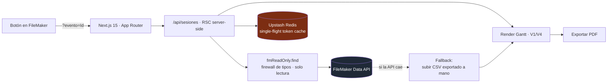

# Programa-Web

> Generador del programa de un congreso: lee las sesiones directamente de **FileMaker** (en modo **estrictamente solo lectura**) y renderiza un esquema/**Gantt** visual exportable a **PDF**, con un *fallback* resiliente si la API cae.

---

## Contexto y problema

El programa de un congreso (sesiones, ponencias, salas, horarios) vive en FileMaker, que el equipo interno mantiene. Necesitaban generar el **documento visual del programa** — un Gantt limpio, paginado, listo para imprimir — **sin sacar los datos de FileMaker** ni arriesgarse a modificarlos por accidente.

La restricción central: la integración debía ser **incapaz de escribir** en FileMaker, y el sistema debía seguir funcionando aunque la Data API estuviera caída el día del congreso.

---

## Solución y arquitectura

Un trabajador pulsa un botón **dentro de FileMaker**, que abre esta app con el `?evento=<Id>` en la URL. La app resuelve las sesiones contra la FileMaker Data API en modo solo lectura, las cachea y renderiza el Gantt exportable a PDF.

---

## Stack y decisiones técnicas

| Tecnología | Decisión | Por qué |
|---|---|---|
| **FileMaker Data API solo lectura** | *Firewall* de tipos: el cliente solo expone operaciones de lectura | Hace **imposible** escribir en la base compartida, por diseño y no por convención |
| **Upstash Redis** | *Single-flight token cache* + degradación elegante si Redis no está | El token de la Data API se reutiliza sin condiciones de carrera; si falla la cache, la app sigue |
| **Fallback CSV** | Subida manual del CSV exportado por FileMaker | El día del evento el Gantt se genera aunque la Data API esté caída |
| **Next.js 15 RSC** | La llamada a FileMaker ocurre en *Server Component* | Credenciales y lógica nunca llegan al navegador |
| **TypeScript estricto + Vitest** | Tipado estricto y suite de tests con *mocks* de FileMaker | Confianza para integrar con un sistema legacy crítico |

---

## Retos técnicos resueltos

- **Integración segura con un sistema legacy crítico** — el patrón de *firewall* de solo lectura garantiza que un bug nunca pueda corromper la base operativa.
- **Resiliencia para el día del evento** — doble camino (API en vivo + *fallback* CSV) y degradación elegante de la cache: el programa **siempre** se puede generar.
- **Render Gantt paginado a PDF** — coordinación entre el esquema de sesiones y un layout imprimible.
- **CORS *whitelist* + rate limiting** sobre el *endpoint* que FileMaker invoca.

---

## Resultado e impacto

- **En producción**, integrado en el flujo real del equipo (botón nativo en FileMaker → PDF del programa).
- **Métricas:** 57 tests Vitest (en verde) con *mocks* de FileMaker · TypeScript estricto · despliegue en **Vercel** · cache en Upstash Redis.
- Documentación de diseño completa (spec + plan de implementación) siguiendo la metodología de desarrollo del ecosistema.

---

## Competencias demostradas

`Next.js 15 (RSC)` · `FileMaker Data API` · `Upstash Redis` · `generación de PDF` · `diseño resiliente (fallback)` · `TypeScript estricto` · `Vitest` · `Vercel`
