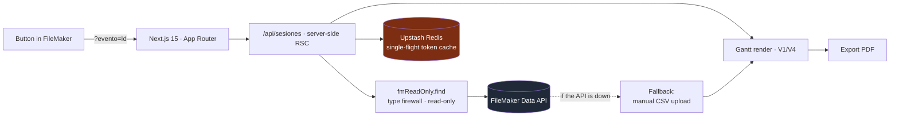

<a href="programa-web.es.md">🇪🇸 Versión en español</a>

# Programa-Web

> Congress program generator: it reads sessions straight from **FileMaker** (in **strictly read-only** mode) and renders a visual **Gantt** schedule exportable to **PDF**, with a resilient fallback if the API goes down.

---

## Context & problem

A congress program (sessions, talks, rooms, schedules) lives in FileMaker, maintained by the internal team. They needed to generate the **visual program document** — a clean, paginated, print-ready Gantt — **without moving the data out of FileMaker** and with zero risk of accidentally modifying it.

The central constraint: the integration had to be **incapable of writing** to FileMaker, and the system had to keep working even if the Data API was down on congress day.

---

## Solution & architecture

A staff member presses a button **inside FileMaker**, which opens this app with `?evento=<Id>` in the URL. The app resolves the sessions against the FileMaker Data API in read-only mode, caches them and renders the PDF-exportable Gantt.

---

## Stack & technical decisions

| Technology | Decision | Why |
|---|---|---|
| **Read-only FileMaker Data API** | Type firewall: the client only exposes read operations | Makes writing to the shared database **impossible by design**, not by convention |
| **Upstash Redis** | Single-flight token cache + graceful degradation if Redis is missing | The Data API token is reused with no race conditions; if the cache fails, the app keeps going |
| **CSV fallback** | Manual upload of FileMaker's CSV export | On event day the Gantt gets generated even with the Data API down |
| **Next.js 15 RSC** | The FileMaker call happens in a Server Component | Credentials and logic never reach the browser |
| **Strict TypeScript + Vitest** | Strict typing and a test suite with FileMaker mocks | Confidence when integrating against a critical legacy system |

---

## Solved technical challenges

- **Safe integration with a critical legacy system** — the read-only firewall pattern guarantees a bug can never corrupt the operational database.
- **Event-day resilience** — dual path (live API + CSV fallback) and graceful cache degradation: the program can **always** be generated.
- **Paginated Gantt-to-PDF rendering** — coordinating the session schema with a print-ready layout.
- **CORS whitelist + rate limiting** on the endpoint FileMaker invokes.

---

## Outcome & impact

- **In production**, embedded in the team's real workflow (native FileMaker button → program PDF).
- **Metrics:** 57 Vitest tests (green) with FileMaker mocks · strict TypeScript · deployed on **Vercel** · Upstash Redis cache.
- Complete design documentation (spec + implementation plan) following the ecosystem's development methodology.

---

## Skills demonstrated

`Next.js 15 (RSC)` · `FileMaker Data API` · `Upstash Redis` · `PDF generation` · `resilient design (fallback)` · `strict TypeScript` · `Vitest` · `Vercel`
