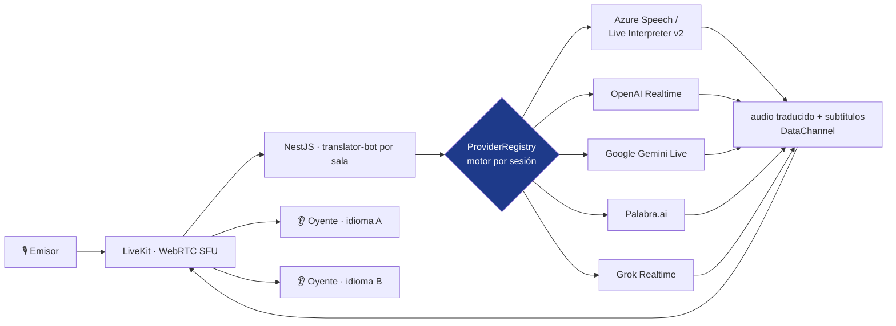

<a href="realtime-translation.md">🇬🇧 English version</a>

# Realtime Translation

> Sistema de **traducción de voz simultánea** para sesiones en directo: quien habla emite y 20+ oyentes reciben la traducción en su idioma en tiempo real. Arquitectura **multi-proveedor de IA** con conmutación transparente entre 7 motores de traducción.

---

## Contexto y problema

La interpretación simultánea humana es cara y no escala a varios idiomas a la vez. Este sistema explora hacerlo con IA: **1 emisor → N oyentes**, cada uno eligiendo su idioma, con latencia baja y calidad suficiente para una sesión técnica.

Como el mercado de IA de voz en tiempo real se mueve muy rápido (Azure, OpenAI, Google, Palabra, Grok… cada uno con compromisos distintos de latencia, calidad y coste), la decisión clave fue **no casarse con un proveedor** sino construir una arquitectura donde el motor de traducción es **intercambiable por sesión**.

---

## Solución y arquitectura

El frontend (Next.js 14) tiene modo **emisor** y modo **oyente**. El backend (NestJS) genera los tokens de LiveKit y las credenciales de proveedor **server-side** (ninguna *API key* llega al navegador), y un `ProviderRegistryService` basado en un *registry* enruta cada sesión al motor elegido vía `POST /api/translation/start { provider }`. La validación de DTOs con **Zod** es compartida entre frontend y backend (*type-safe* de extremo a extremo).

---

## Stack y decisiones técnicas

| Tecnología | Decisión | Por qué |
|---|---|---|
| **Provider registry (DI NestJS)** | Inyectar un *array* de proveedores vía *token*; *lookup* por mapa | Añadir un motor = crear un módulo y registrarlo; cero `if/else` en el *controller* |
| **Tokens server-side** | El backend emite tokens LiveKit + credenciales de proveedor; rate-limited | Las *API keys* nunca se exponen en el cliente |
| **Zod compartido** (`@repo/schemas`) | Enums `Language` / `TranslationProvider` y DTOs comunes | Validación idéntica en ambos lados, *type safety* completo |
| **Bot único por sala** (`translator-bot-{roomId}`) | Identidad fija de *bot* por sala | Evita doble *bot* y conflictos de síntesis; una sala = máx. 1 traductor activo |
| **Ref-counting de idiomas** | Contador por idioma + 30 s de gracia antes del *teardown* | Reconexión rápida sin reiniciar la sesión; optimiza coste |
| **Subtítulos por DataChannel** | JSON `{ text, isFinal }` en el tópico `translation:{lang}` | Subtítulos parciales y finales sincronizados con el audio |

---

## Estado de los proveedores

La arquitectura permite enchufar motores, pero no todos están al mismo nivel de madurez. Estado real:

| Proveedor | Tipo | Estado |
|---|---|---|
| **Palabra.ai** | *speech-to-speech* generativo | ✅ Acabado y probado |
| **OpenAI Realtime** | audio-a-audio generativo | ✅ Acabado y probado |
| **Azure Speech / Live Interpreter v2** | determinista + *Personal Voice* zero-shot | ✅ Integrado y probado |
| Google Gemini Live · Google Cloud · Grok Realtime | varios | 🟡 Integrados, en validación |

---

## Retos técnicos resueltos

- **Conmutación de proveedor sin reescribir el flujo** — la misma sesión puede usar Azure determinista u OpenAI Realtime generativo según necesidad.
- **Robustez frente a modelos LLM impredecibles** — *watchdog* de 8 s, renovación proactiva de sesión (OpenAI ~60 min, Gemini ~15 min), validación de salida y deduplicación anti-repetición con TTL contra alucinaciones.
- **Latencia bajo carga** — un `AdaptivePlayoutController` ajusta dinámicamente la velocidad de síntesis según la cola para mantener el *lag* acotado con 20+ oyentes.
- ***Voice cloning* zero-shot** — integración de Azure Live Interpreter v2 con *Personal Voice* y cadena de *fallback* (Personal Voice → Neural HD → Neural estándar).
- **Política de autoplay y reconexión** del navegador gestionadas en el cliente (gesto de usuario obligatorio, *reconnect with backoff*).

---

## Resultado e impacto

- **PoC v1.0 entregado** (estabilidad LLM + observabilidad de latencia P50/P95), con una v1.1 en progreso centrada en alcanzar paridad de calidad de un proveedor premium con una alternativa ~10× más barata.
- **Métricas:** 7 proveedores de IA conmutables · 14 idiomas en el esquema (6 validados para *voice*) · ~21.700 LoC de API · 45 archivos de test · modelos para salas, sesiones, perfiles de voz y grabaciones.
- Sirvió como **banco de pruebas** del dominio de traducción en tiempo real que después se materializa, en su versión de producción orientada a salas y técnicos, en [AudioNow](audionow.es.md).

> Los dos proyectos son esfuerzos hermanos dentro del mismo dominio (traducción de voz en directo) con bases de código independientes: este explora la conmutación entre motores; AudioNow lleva el caso de uso a producción con foco en operación de salas.

---

## Competencias demostradas

`LiveKit` · `OpenAI Realtime API` · `Azure Speech / Live Interpreter v2` · `Google Gemini Live` · `Palabra.ai` · `NestJS (DI, registry pattern)` · `Zod (type-safe full-stack)` · `Next.js 14` · `Prisma` · `robustez de sistemas LLM` · `arquitectura intercambiable`