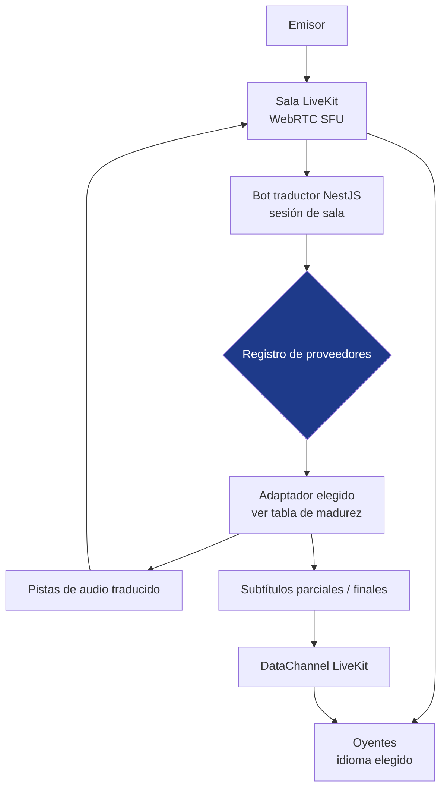

<a href="realtime-translation.md">🇬🇧 English version</a>

# Realtime Translation

> PoC de traducción de voz simultánea: el audio de un emisor se traduce para oyentes en distintos idiomas, mediante adaptadores de proveedor tras un contrato de sesión compartido.

## Mi contribución y alcance entregado

| Aspecto | Alcance |
|---|---|
| Mi contribución | Arquitectura e integración de adaptadores de proveedor, contratos compartidos, orquestación de sesiones y controles de audio/latencia |
| Versión descrita | Entrega v1.0 registrada el 9 de marzo de 2026; evolución v1.1 representada por el snapshot de código del 2 de mayo de 2026 |
| Alcance entregado | PoC con siete adaptadores registrados, controles del ciclo de proveedores y playout adaptativo |
| Alcance de validación | Comprobaciones automatizadas y registros por fase; la evaluación real/perceptual y los requisitos de acceso de cada proveedor seguían siendo trabajo separado |

## Contexto y problema

Los servicios de voz con IA diferían en formato de audio, ciclo de sesión, estabilidad de salida, latencia y coste. El proyecto exploró traducir de **un emisor a varios oyentes**, conservando la posibilidad de comparar motores sin rediseñar la experiencia del oyente.

La decisión central fue un **registro de proveedores** con un contrato compartido. Ese contrato permitía ampliar la integración; cada adaptador seguía necesitando sus propias comprobaciones de compatibilidad, acceso operativo y evaluación.

## Solución y arquitectura

Un frontend Next.js ofrecía los modos emisor y oyente. El backend NestJS gestionaba el acceso LiveKit y la orquestación de proveedores; los esquemas **Zod** compartidos definían los contratos de idiomas, proveedores y peticiones.

**Alcance del diagrama:** enrutamiento lógico de la PoC. El registro selecciona un adaptador; la tabla de madurez posterior delimita los adaptadores disponibles. Las pistas de audio y los mensajes de subtítulos tienen rutas de entrega separadas.

## Madurez de los adaptadores en esta versión

Los siete identificadores registrados comprendían **dos modos Azure** y adaptadores para OpenAI, Gemini, Google Cloud, Grok y Palabra. El registro describe un punto de integración, no siete motores comerciales con igual validación.

| Adaptador | Alcance de integración | Límite de validación |
|---|---|---|
| **Azure Speech** | Flujo determinista de voz/traducción/síntesis tras el contrato compartido | Las comprobaciones reales específicas del proveedor seguían separadas del registro |
| **Azure Live Interpreter v2** | Integración Personal Voice, cadena de fallback y persistencia de perfiles de voz | Personal Voice requería Microsoft Limited Access; reutilizar perfiles en síntesis quedó diferido |
| **OpenAI Realtime** | Adaptador de audio generativo registrado en la capa de sesiones | Las comprobaciones automatizadas/de sesión no acreditaban equivalencia general en sesiones reales o calidad perceptual |
| **Palabra.ai** | Adaptador speech-to-speech tras el mismo contrato | La validación corresponde a esta PoC, separada del uso operativo de AudioNow |
| **Google Gemini Live** | Adaptador de audio en directo registrado | La validación específica del proveedor seguía formando parte de la exploración |
| **Google Cloud** | Adaptador de servicios de voz registrado | La validación específica del proveedor seguía formando parte de la exploración |
| **Grok Realtime** | Adaptador realtime registrado | La validación específica del proveedor seguía formando parte de la exploración |

El esquema modelaba **14 idiomas**. Había seis destinos configurados para la estrategia de voz Azure; esa configuración no acreditaba validación perceptual de seis voces reales.

## Decisiones técnicas y costes

| Decisión | Implementación y motivo | Coste o límite |
|---|---|---|
| **Registro mediante inyección de dependencias NestJS** | Registrar adaptadores y resolverlos por identificador de proveedor | Saca la selección de proveedor de las ramas del controlador; la compatibilidad de cada adaptador sigue necesitando pruebas |
| **Credenciales gestionadas en servidor** | Emitir el acceso a sesión desde backend y mantener allí los secretos de servicio de larga duración | Exige controles explícitos de vigencia de tokens/sesiones y límites de peticiones |
| **Contratos Zod compartidos** | Validar las mismas estructuras de idioma/proveedor/petición en frontend y backend | Reduce divergencias del contrato, dejando los errores específicos al adaptador |
| **Identidad de sala y recuentos por idioma** | Usar una identidad estable del traductor y un plazo de gracia antes de cerrar un idioma | Reduce reinicios al reconectar; contadores, limpieza y arranques duplicados necesitan coordinación |
| **Playout adaptativo** | Ajustar el tempo de síntesis según la profundidad de cola | Atiende el retraso acumulado; calidad y latencia requieren evaluación en sesiones reales |
| **Subtítulos por DataChannel** | Enviar mensajes de texto parciales/finales separados de las pistas de audio | Evita acoplar la representación del subtítulo al contenido de audio |
| **Fallback de Personal Voice** | Personal Voice → Neural HD → Neural estándar | Mantiene una vía alternativa mientras las capacidades avanzadas dependen de acceso al servicio y evaluación |

## Entrega y evolución

### v1.0 — PoC entregada

La auditoría de entrega del **9 de marzo de 2026** registró el registro de proveedores, el trabajo de estabilidad, la orquestación de sesiones, el playout adaptativo y la **observabilidad de lag/tempo**. Watchdogs, renovación de sesiones del proveedor, validación de salida y deduplicación de repeticiones atendían fallos específicos del audio generativo.

La reproducción en el navegador también necesitaba un gesto inicial del usuario y comportamiento de reconexión. Estas restricciones formaban parte del flujo de escucha, sin asumir que toda conexión nueva reproduciría automáticamente.

### v1.1 — instrumentación y capacidades de voz con acceso condicionado

En el snapshot de código del **2 de mayo de 2026**, el proyecto había añadido instrumentación de errores y primer audio. El registro de verificación del **29 de abril** describía medidas P50/P95 de Azure en una ventana móvil por idioma, desde un evento de voz reconocida hasta el primer audio traducido.

Ese intervalo mide una parte del flujo de traducción. El intercalado de eventos Azure introducía un límite conocido de atribución; la latencia de micrófono a oído y la comparación entre motores requieren su propia medida.

La integración Personal Voice y su fallback estaban implementados, con el ejercicio de la capacidad avanzada sujeto a **Microsoft Limited Access**. La persistencia de perfiles de voz tenía verificación con mocks; reutilizarlos mediante SSML quedó diferido a v1.2.

## Resultado y límites

El resultado fue una PoC entregada y un marco de integración en evolución para comparar motores de voz. Una entrada en el registro, una comprobación automatizada y una evaluación de escucha responden a preguntas distintas sobre un adaptador.

La calidad perceptual, el comportamiento en sesiones con proveedores reales y el coste efectivo seguían siendo tareas de comparación para la evolución v1.1.

Este proyecto y [AudioNow](audionow.es.md) tenían bases de código independientes. Realtime Translation exploraba la extensibilidad de motores; AudioNow abordaba la operación de salas alrededor de una ruta de traducción de referencia.

El aprendizaje fue mantener un contrato compartido de orquestación y registrar las necesidades de audio, condiciones de acceso y límites de evaluación de cada proveedor. El alcance de las pruebas se resume en [Pruebas](../TESTING.es.md).

## Competencias demostradas

`LiveKit / WebRTC` · `inyección de dependencias NestJS` · `registro de proveedores` · `contratos Zod compartidos` · `Next.js` · `integración de servicios de voz` · `OpenAI Realtime` · `integración Azure Speech / Personal Voice` · `playout adaptativo` · `ciclo de sesiones` · `instrumentación de latencia`

[Volver a los casos de estudio](README.es.md)
