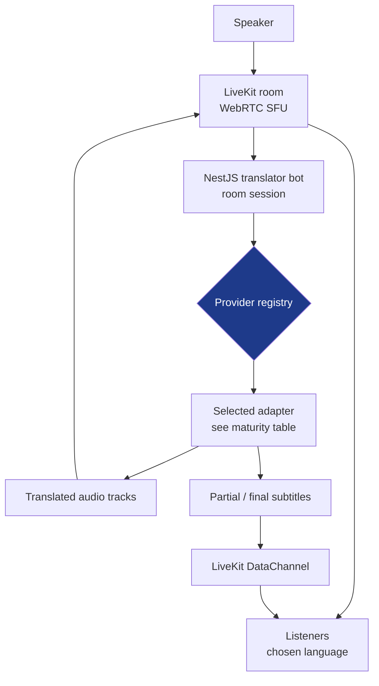

<a href="realtime-translation.es.md">🇪🇸 Versión en español</a>

# Realtime Translation

> A simultaneous voice-translation PoC: one speaker's audio is translated for listeners in different languages, using provider adapters behind a shared session contract.

## My contribution and delivery scope

| Aspect | Scope |
|---|---|
| My contribution | Architecture and integration of provider adapters, shared contracts, session orchestration and audio/latency controls |
| Version described | v1.0 delivery recorded on 9 March 2026; v1.1 evolution represented by the source snapshot of 2 May 2026 |
| Delivered scope | PoC with seven registered adapters, provider lifecycle controls and adaptive playout |
| Validation scope | Automated checks and phase records; provider-specific live/perceptual evaluation and access gates remained separate work |

## Context & problem

AI speech services differed in audio format, session lifecycle, output stability, latency and cost. The project explored translating **one speaker to multiple listeners** while retaining the ability to compare engines without redesigning the listener experience.

The central decision was a **provider registry** with a shared contract. That contract made integration extensible; each adapter still needed its own compatibility checks, operational access and evaluation.

## Solution & architecture

A Next.js frontend provided speaker and listener modes. The NestJS backend managed LiveKit access and provider orchestration; shared **Zod** schemas defined language, provider and request contracts.

**Diagram scope:** logical routing of the PoC. The registry selects an adapter; the maturity table below qualifies the available adapters. Audio tracks and subtitle messages use separate delivery paths.

## Adapter maturity in this snapshot

The seven registered IDs comprised **two Azure modes** and adapters for OpenAI, Gemini, Google Cloud, Grok and Palabra. Registration describes an integration point, not seven equally validated commercial engines.

| Adapter | Integration scope | Validation boundary |
|---|---|---|
| **Azure Speech** | Deterministic speech/translation/synthesis path behind the shared contract | Provider-specific live checks remained distinct from registry wiring |
| **Azure Live Interpreter v2** | Personal Voice integration, fallback chain and voice-profile persistence | Personal Voice required Microsoft Limited Access; profile reuse in synthesis was deferred |
| **OpenAI Realtime** | Generative audio adapter registered with the session layer | Automated/session checks did not establish general live-session or perceptual equivalence |
| **Palabra.ai** | Speech-to-speech adapter behind the same contract | Validation here belongs to this PoC, separately from AudioNow's operational use |
| **Google Gemini Live** | Registered live-audio adapter | Provider-specific validation remained part of the exploration |
| **Google Cloud** | Registered speech-service adapter | Provider-specific validation remained part of the exploration |
| **Grok Realtime** | Registered realtime adapter | Provider-specific validation remained part of the exploration |

The language schema modeled **14 languages**. Six destinations were configured for the Azure voice strategy; their configuration did not establish perceptual validation of six live voices.

## Technical decisions and trade-offs

| Decision | Implementation and reason | Trade-off |
|---|---|---|
| **Registry through NestJS dependency injection** | Register adapters and look them up by provider ID | Keeps provider selection out of controller branches; adapter compatibility still needs testing |
| **Server-side credential handling** | Issue session access from the backend and keep long-lived service secrets there | Requires explicit token/session lifetime and rate-limit controls |
| **Shared Zod contracts** | Validate the same language/provider/request shapes in frontend and backend | Reduces contract drift while leaving provider-specific errors to the adapter |
| **Room identity and language reference counts** | Use a stable translator identity and a grace period before language teardown | Reduces reconnect churn; counters, cleanup and duplicate starts need coordination |
| **Adaptive playout** | Adjust synthesis tempo using queue depth | Addresses accumulated lag; quality and latency need assessment in real sessions |
| **Subtitles over DataChannel** | Send partial/final text messages separately from audio tracks | Avoids coupling subtitle rendering to the audio payload |
| **Personal Voice fallback** | Personal Voice → Neural HD → standard Neural | Preserves a fallback path while advanced capabilities depend on service access and evaluation |

## Delivery and evolution

### v1.0 — PoC delivered

The delivery audit of **9 March 2026** recorded the registry, provider-stability work, session orchestration, adaptive playout and **lag/tempo observability**. Watchdogs, provider-session renewal, output validation and repetition deduplication addressed failures specific to generative audio.

Browser playback also needed an initial user gesture and reconnection behavior. These browser constraints were part of the listening flow rather than an assumption that every new connection would autoplay.

### v1.1 — instrumentation and gated voice capabilities

By the source snapshot of **2 May 2026**, the project had added error-rate and first-audio instrumentation. The verification record of **29 April** described Azure P50/P95 measurements over a rolling window per language, from a recognized-speech event to the first translated audio.

That interval measures part of the translation pipeline. Interleaved Azure events introduced a known attribution limit; microphone-to-ear latency and comparisons across engines require their own measurement.

Personal Voice integration and fallback were implemented, with exercise of the advanced voice capability subject to **Microsoft Limited Access**. Voice-profile persistence had mock-based verification; reusing stored profiles through SSML was deferred to v1.2.

## Outcome and limits

The result was a delivered PoC and an evolving integration framework for comparing speech engines. A registry entry, an automated check and a listening evaluation answer different questions about an adapter.

Perceptual quality, behavior in sessions with real providers and effective cost remained comparison tasks for the v1.1 evolution.

This project and [AudioNow](audionow.md) had independent codebases. Realtime Translation explored engine extensibility; AudioNow addressed room operations around a reference translation route.

The lesson was to keep a shared orchestration contract while recording each provider's audio requirements, access conditions and evaluation limits. Testing scope is summarized in [Testing](../TESTING.md).

## Skills demonstrated

`LiveKit / WebRTC` · `NestJS dependency injection` · `provider registry` · `shared Zod contracts` · `Next.js` · `speech-service integration` · `OpenAI Realtime` · `Azure Speech / Personal Voice integration` · `adaptive playout` · `session lifecycle` · `latency instrumentation`

[Back to case studies](README.md)
