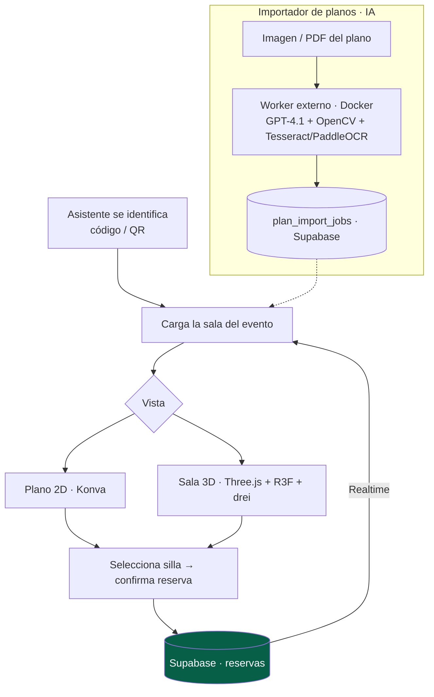

# Sala de Cenas

> Plano interactivo **2D/3D** para la reserva de mesas en cenas de congreso: el asistente se identifica, ve la sala en tiempo real y elige su sitio. **Proyecto de mentoría** — desarrollado por un becario bajo mi dirección técnica.

---

## Contexto y problema

Las cenas de gala de un congreso necesitan gestión de aforo y asignación de mesas. La idea: un plano **visual e interactivo** donde el asistente vea las mesas y sillas, su estado en tiempo real (libre / ocupada / seleccionada / asignada a él), y confirme su reserva — tanto desde su móvil como en un kiosco presencial con escáner QR.

**Mi rol fue de mentor técnico, no de autor del código.** Tuve a mi cargo a un becario y este proyecto fue su vehículo de aprendizaje. Mi aportación consistió en:

- Enseñarle a **trabajar con asistencia de IA** (Claude Code) de forma disciplinada.
- Introducirle a las **librerías 3D/2D** del ecosistema (Three.js, React Three Fiber, drei, Konva) que yo ya usaba en BadgeFlow.
- Definir la arquitectura de partida (Next.js + Supabase + Realtime) y revisar su evolución.

---

## Solución y arquitectura

El proyecto arrancó como un plano 2D con `react-konva` y Supabase Realtime, y **evolucionó muy por encima de su alcance inicial** bajo mentoría: editor de salas en 3D, importador de planos con visión por IA, y flujo presencial con QR.

---

## Stack y decisiones técnicas

| Tecnología | Decisión | Por qué |
|---|---|---|
| **Supabase Realtime** | Estado de las sillas sincronizado por WebSocket | Varias personas reservando a la vez ven los cambios al instante |
| **Konva (2D) + Three.js/R3F (3D)** | Doble vista: plano 2D y sala 3D conmutables | Aprendizaje progresivo de 2D a 3D; mejor experiencia en kiosco presencial |
| **Importador de planos con IA** | GPT-4.1 como capa principal de visión, con *fallback* determinista (OpenCV + Tesseract/PaddleOCR) | Convertir una imagen/PDF de plano en mesas y sillas estructuradas, con red de seguridad si la IA falla |
| **Worker externo en Docker** | El OCR pesado y los procesos largos viven fuera de Vercel | Vercel no encaja con OCR pesado / Python / *filesystem* temporal; el worker consume una cola en Supabase |
| **Flujo presencial con QR** | Escáner QR dedicado + controles táctiles/joystick para kiosco | Reserva en el propio evento, no solo desde el móvil del asistente |

---

## Retos técnicos resueltos (por el becario, con mentoría)

- **De 2D a 3D**: pasar de un plano `react-konva` a un editor de salas en 3D con Three.js, picking preciso de sillas y controles táctiles para móvil.
- **Importación de planos con visión por IA** con arquitectura de *fallback*: si `OPENAI_API_KEY` está presente, GPT-4.1 interpreta el plano; si no o si falla, cae a un importador determinista con OpenCV/OCR.
- **Separación frontend (Vercel) / worker (Docker)** para procesos largos, comunicados por una tabla de *jobs* en Supabase.
- **Flujo presencial vs. móvil** diferenciados, con *fullscreen*, orientación y *overlays* guiados.

---

## Resultado e impacto

- **Valor para mí como mentor:** demuestra capacidad de **liderazgo técnico** — definir una arquitectura, transferir conocimiento (IA + 3D) a alguien junior, y acompañar un proyecto que superó con creces su alcance inicial.
- **Resultado del becario:** un sistema que evolucionó de un plano 2D básico a una plataforma con editor 3D, importación de planos por IA y flujo presencial con QR.
- **Métricas:** Next.js 14 · 9 migraciones Supabase · RLS · pipeline de importación con IA + worker en Docker · desplegable en Vercel + worker en Render/Railway/Fly.

> Incluyo este proyecto no como código propio, sino como evidencia de **mentoría y dirección técnica** — una faceta tan relevante como la construcción individual en el resto del ecosistema.

---

## Competencias demostradas

`Mentoría / liderazgo técnico` · `Three.js + R3F + drei` · `Konva` · `Supabase Realtime` · `integración de IA (GPT-4.1 visión)` · `OpenCV / Tesseract / PaddleOCR` · `workers en Docker` · `arquitectura con fallback` · `transferencia de conocimiento`
