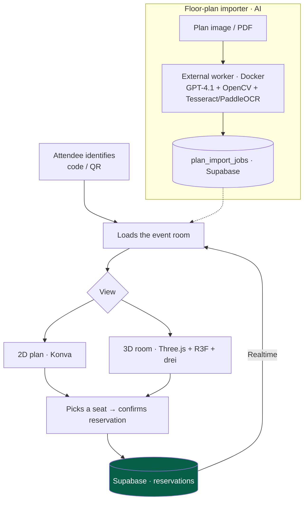

<a href="sala-cenas.es.md">🇪🇸 Versión en español</a>

# Dinner Room

> Interactive **2D/3D floor plan** for gala-dinner table reservations: attendees identify themselves, see the room in real time and pick their seat. **A mentorship project** — developed by an intern under my technical direction.

---

## Context & problem

Congress gala dinners need capacity management and table assignment. The idea: a **visual, interactive floor plan** where attendees see tables and chairs, their real-time state (free / taken / selected / assigned to them), and confirm their reservation — from their phone or at an on-site kiosk with a QR scanner.

**My role was technical mentor, not code author.** I was responsible for an intern, and this project was their learning vehicle. My contribution consisted of:

- Teaching them to **work with AI assistance** (Claude Code) in a disciplined way.
- Introducing them to the **3D/2D libraries** of the ecosystem (Three.js, React Three Fiber, drei, Konva) that I was already using in BadgeFlow.
- Defining the starting architecture (Next.js + Supabase + Realtime) and reviewing its evolution.

---

## Solution & architecture

The project started as a 2D floor plan with `react-konva` and Supabase Realtime, and **evolved far beyond its initial scope** under mentorship: a 3D room editor, an AI-vision floor-plan importer, and an on-site QR flow.

---

## Stack & technical decisions

| Technology | Decision | Why |
|---|---|---|
| **Supabase Realtime** | Seat state synchronized over WebSocket | Several people reserving at once see changes instantly |
| **Konva (2D) + Three.js/R3F (3D)** | Dual switchable views: 2D plan and 3D room | Progressive 2D-to-3D learning curve; better experience at the on-site kiosk |
| **AI floor-plan importer** | GPT-4.1 as the primary vision layer, with a deterministic fallback (OpenCV + Tesseract/PaddleOCR) | Turns a plan image/PDF into structured tables and chairs, with a safety net if the AI fails |
| **External Docker worker** | Heavy OCR and long-running jobs live outside Vercel | Vercel doesn't fit heavy OCR / Python / temp filesystems; the worker consumes a Supabase job queue |
| **On-site QR flow** | Dedicated QR scanner + touch/joystick kiosk controls | Reservation at the event itself, not only from the attendee's phone |

---

## Solved technical challenges (by the intern, under mentorship)

- **From 2D to 3D**: going from a `react-konva` plan to a 3D room editor with Three.js, precise chair picking and mobile touch controls.
- **AI-vision floor-plan import** with a fallback architecture: with `OPENAI_API_KEY` present, GPT-4.1 interprets the plan; without it, or on failure, it falls back to a deterministic OpenCV/OCR importer.
- **Frontend (Vercel) / worker (Docker) split** for long-running jobs, communicating through a Supabase jobs table.
- **On-site vs. mobile flows** differentiated, with fullscreen, orientation handling and guided overlays.

---

## Outcome & impact

- **Value for me as a mentor:** it demonstrates **technical leadership** — defining an architecture, transferring knowledge (AI + 3D) to a junior, and guiding a project that far exceeded its initial scope.
- **The intern's outcome:** a system that evolved from a basic 2D plan into a platform with a 3D editor, AI floor-plan import and an on-site QR flow.
- **Metrics:** Next.js 14 · 9 Supabase migrations · RLS · AI import pipeline + Docker worker · deployable on Vercel + worker on Render/Railway/Fly.

> I include this project not as my own code, but as evidence of **mentorship and technical direction** — a facet as relevant as solo building across the rest of the ecosystem.

---

## Skills demonstrated

`Mentorship / technical leadership` · `Three.js + R3F + drei` · `Konva` · `Supabase Realtime` · `AI integration (GPT-4.1 vision)` · `OpenCV / Tesseract / PaddleOCR` · `Docker workers` · `fallback architecture` · `knowledge transfer`
