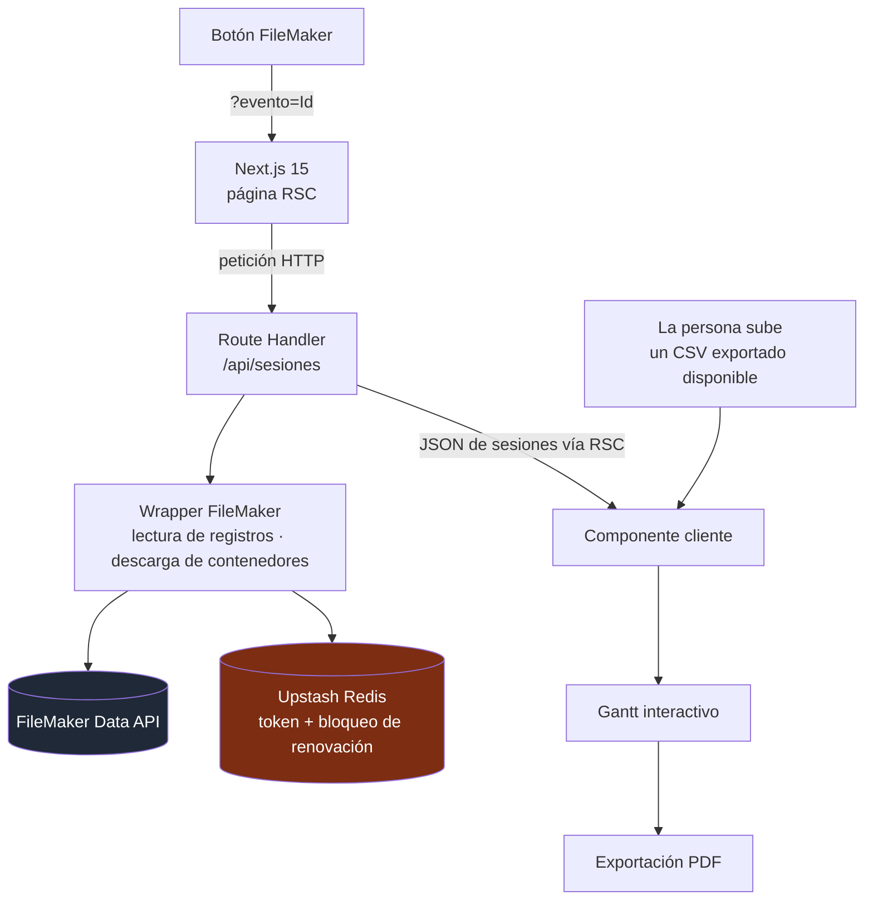

<a href="schedule-builder.md">🇬🇧 English version</a>

# Schedule Builder

> Generador de agenda que mantiene **FileMaker como fuente canónica**, lee sesiones mediante un cliente de aplicación restringido y produce un **Gantt/PDF** paginado. La carga manual de CSV ofrece una alternativa cuando la integración en vivo no está disponible.

## Mi contribución y alcance entregado

- **Mi contribución:** implementación de la integración FileMaker, normalización de sesiones, recorrido de datos entre servidor y cliente y flujo de Gantt a PDF.
- **Alcance entregado:** apertura desde un botón de FileMaker, consulta de sesiones en servidor, token compartido mediante Redis, carga manual de CSV y exportación PDF.
- **Estado histórico — 26 de mayo de 2026:** había un despliegue Vercel documentado y un flujo FileMaker→PDF verificado de extremo a extremo. Quedaban comprobaciones de algunos campos reales y de paridad de datos.

---

## Contexto y problema

El equipo interno mantenía sesiones, salas y franjas horarias en FileMaker. Necesitaba una **agenda visual lista para imprimir** sin crear un segundo sistema de edición de esos datos.

La integración debía limitar las escrituras accidentales desde la aplicación y conservar una alternativa para generar el documento el día del evento. De ahí surgieron dos entradas de datos que alimentan el mismo modelo de agenda: la Data API y un CSV exportado que aporta una persona.

---

## Solución y arquitectura

Un botón dentro de FileMaker abre la app con `?evento=<Id>`. Un Server Component de Next.js consulta `/api/sesiones`; ese **Route Handler** llama al wrapper FileMaker y normaliza la respuesta. El navegador recibe los datos de sesiones para el Gantt interactivo y la exportación PDF. Redis guarda el **token de la Data API y el bloqueo de renovación**.

*Recorridos de datos implementados. La entrada alternativa CSV requiere un archivo válido y una intervención del usuario.*

---

## Stack y decisiones técnicas

| Tecnología | Decisión | Por qué |
|---|---|---|
| **Wrapper FileMaker restringido** | Exponer lectura de registros y descarga de contenedores, sin métodos de escritura de registros ni scripts | Reduce la superficie de escrituras accidentales desde la aplicación; los privilegios de la cuenta del servidor son un control separado |
| **Upstash Redis** | Compartir el token y serializar renovaciones mediante un bloqueo single-flight | Limita los inicios de sesión concurrentes entre instancias; admite renovación directa cuando Redis no está configurado |
| **Fallback CSV manual** | Interpretar en el navegador un archivo previamente exportado desde FileMaker | Permite generar el documento sin la API en vivo cuando hay un archivo válido disponible |
| **Next.js RSC + Route Handler** | Obtener los datos iniciales en servidor y mantener la interacción en un componente cliente | Conserva las credenciales FileMaker en servidor y permite interacción y exportación en navegador |
| **TypeScript estricto + Vitest** | Compartir tipos de sesión y probar los mapeos con mocks de FileMaker | Hace explícitas las reglas de normalización de ambas entradas |

---

## Retos técnicos abordados

- **Integración legacy con menor superficie de escritura:** la aplicación importa un wrapper limitado a operaciones de lectura.
- **Dos entradas y un modelo de agenda:** registros API y filas CSV alimentan el mismo flujo de renderizado, con normalización de fechas, horas y texto.
- **Coordinación del token:** una caché compartida y un bloqueo de renovación reducen la creación duplicada de sesiones. Una caída del Redis configurado puede interrumpir la consulta en vivo; el CSV manual sigue siendo una alternativa separada.
- **Salida PDF paginada:** coordinación del layout de sesiones y el tratamiento del texto con un documento imprimible.
- **Controles del endpoint:** allowlist CORS y limitación de peticiones sobre la ruta API.

---

## Resultado y validación

El **registro de verificación del 26 de mayo de 2026 informó de 58 pruebas Vitest aprobadas**, con comportamientos de integración simulados, y una comprobación TypeScript satisfactoria. Otro registro de aceptación documentó una exportación real FileMaker → API → Gantt → PDF para un evento. La variante de sesiones con patrocinador se revisó mediante código, sin probarla visualmente en esa ejecución de aceptación.

La herramienta entregada conectó el flujo existente de FileMaker con una agenda imprimible, conservando una entrada manual. La confirmación de algunos campos reales y la paridad completa de visualización API/CSV quedaron fuera de esa comprobación cerrada. Los registros describen la versión entregada en mayo de 2026.

---

## Competencias demostradas

`Next.js 15 (RSC + Route Handlers)` · `FileMaker Data API` · `Upstash Redis` · `generación de PDF` · `normalización de datos` · `diseño de fallback manual` · `TypeScript estricto` · `Vitest` · `Vercel`
