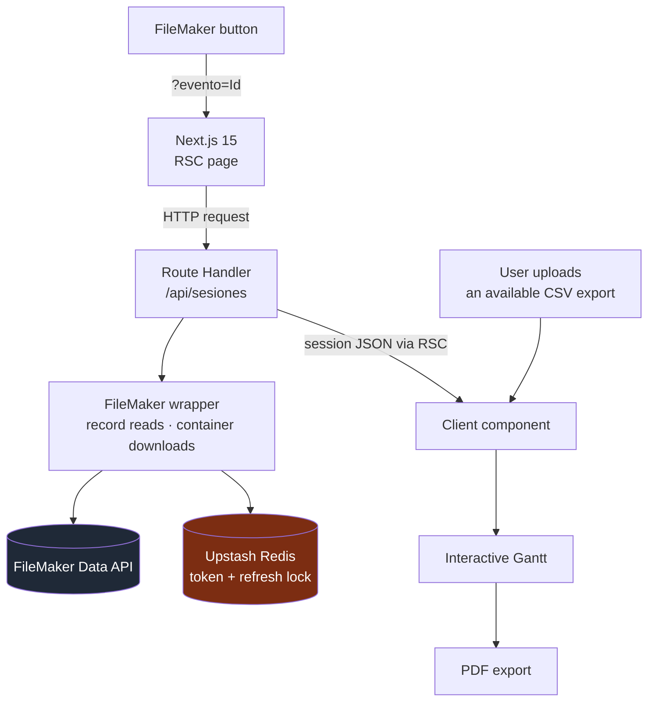

<a href="schedule-builder.es.md">🇪🇸 Versión en español</a>

# Schedule Builder

> A schedule generator that keeps **FileMaker as the source of truth**, reads sessions through a restricted application client and produces a paginated **Gantt/PDF**. A manual CSV path provides an alternative when the live integration is unavailable.

## My contribution & delivered scope

- **My contribution:** implementation of the FileMaker integration, session normalization, server/client data flow and Gantt-to-PDF workflow.
- **Delivered scope:** launch from a FileMaker button, server-side session retrieval, token sharing through Redis, manual CSV upload and PDF export.
- **Historical stage — 26 May 2026:** Vercel deployment was documented and one FileMaker-to-PDF flow had been verified end to end. Some live-field mapping and data-parity checks remained pending.

---

## Context & problem

The internal team maintained sessions, rooms and time slots in FileMaker. They needed a **print-ready visual schedule** without creating a second system for editing that data.

The integration needed to limit accidental writes from the application and preserve an alternative way to generate the document on an event day. That led to two data inputs feeding the same schedule model: the Data API and an exported CSV supplied by a person.

---

## Solution & architecture

A button inside FileMaker opens the app with `?evento=<Id>`. A Next.js Server Component requests `/api/sesiones`; that **Route Handler** calls the FileMaker wrapper and normalizes the response. The browser receives session data for the interactive Gantt and PDF export. Redis stores the **Data API token and refresh lock**.

*Implemented data paths. The alternative CSV input requires a valid export and user intervention.*

---

## Stack & technical decisions

| Technology | Decision | Why |
|---|---|---|
| **Restricted FileMaker wrapper** | Expose record reads and container downloads, without record-write or script methods | Reduces the application surface for accidental writes; server account privileges remain a separate control |
| **Upstash Redis** | Share the token and serialize refreshes with a single-flight lock | Limits concurrent logins across server instances; direct refresh is supported when Redis is not configured |
| **Manual CSV fallback** | Parse an existing FileMaker export in the browser | Allows document generation without the live API when a valid export is available |
| **Next.js RSC + Route Handler** | Fetch initial data on the server; keep interactive rendering in a client component | Keeps FileMaker credentials server-side while supporting browser interaction and export |
| **Strict TypeScript + Vitest** | Share session types and test mappings with FileMaker mocks | Makes normalization rules explicit across both inputs |

---

## Technical challenges addressed

- **Legacy integration with a smaller write surface:** the application imports a wrapper limited to read operations.
- **Two inputs, one schedule model:** API records and CSV rows feed the same rendering workflow, with date, time and text normalization.
- **Token coordination:** a shared token cache and refresh lock reduce duplicate session creation. A failure of a configured Redis instance can still interrupt the live path; the manual CSV route remains a separate option.
- **Paginated PDF output:** session layout and text handling are coordinated with a printable document.
- **Endpoint controls:** CORS allowlisting and rate limiting are applied to the API route.

---

## Outcome & validation

The **26 May 2026 verification record reported 58 passing Vitest tests**, including mocked integration behavior, and a successful TypeScript check. A separate acceptance record documented a real FileMaker → API → Gantt → PDF export for one event. The sponsored-session variant was reviewed in code rather than visually exercised in that acceptance run.

The delivered tool connected FileMaker's existing workflow to a printable schedule while retaining a manual input path. Live confirmation of some field mappings and full API/CSV display parity remained outside that completed check. These records describe the version delivered in May 2026.

---

## Skills demonstrated

`Next.js 15 (RSC + Route Handlers)` · `FileMaker Data API` · `Upstash Redis` · `PDF generation` · `data normalization` · `manual fallback design` · `strict TypeScript` · `Vitest` · `Vercel`
