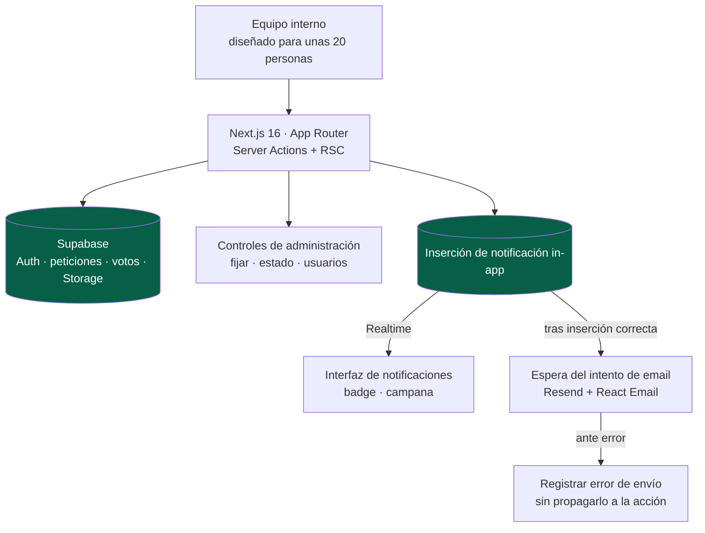

<a href="taskboard.md">🇬🇧 English version</a>

# TaskBoard

> Herramienta interna para proponer, **votar y priorizar** peticiones de mejora. Reúne solicitudes, discusión y cambios de estado en un flujo diseñado para un equipo de unas veinte personas.

## Mi contribución y alcance entregado

- **Mi contribución:** implementación del flujo de peticiones y votación, permisos, notificaciones e integración con un entorno Supabase compartido.
- **Alcance entregado:** peticiones con fotos, tipos de voto mutuamente excluyentes, comentarios, enlaces entre peticiones, búsqueda, controles de administración y notificaciones in-app; después se implementó un espejo por email.
- **Estado histórico — 13 de mayo de 2026:** la aplicación interna tenía un despliegue Vercel documentado. La última nota de envío de email dejaba la migración de base de datos y su activación en producción como pasos manuales de puesta en servicio.

---

## Contexto y problema

Las peticiones de mejora llegaban por mensajes, correos y conversaciones informales. Eso dificultaba conservar el contexto, comparar la demanda y explicar qué solicitud debía atenderse después.

TaskBoard ofrece al equipo un lugar para **proponer, votar y debatir**. Los agregados de votos orientan la priorización, mientras un administrador puede fijar una petición y moverla por `Pendiente → En Progreso → Hecha`. La escala prevista era la de un equipo interno.

---

## Solución y arquitectura

Las Server Actions de Next.js validan los cambios y los persisten en Supabase. Crear una notificación comienza insertando el registro in-app; tras una inserción correcta, el helper **espera un intento de envío por email**. Con varios destinatarios, los intentos se procesan en serie. Realtime entrega las actualizaciones de base de datos a la interfaz de notificaciones de forma independiente del correo.

*Flujo de notificaciones implementado. Los intentos de email se esperan y se procesan en serie; la última nota de envío aún requería activación en producción.*

Cada petición contiene título, descripción y hasta tres fotos. Los usuarios pueden votar en positivo (1–5) o en negativo, comentar y vincular peticiones relacionadas. El administrador gestiona estados, peticiones fijadas y usuarios.

---

## Stack y decisiones técnicas

| Tecnología | Decisión | Por qué |
|---|---|---|
| **Supabase Realtime + RLS** | Suscribirse a cambios de notificaciones y aplicar políticas por fila | Combina actualizaciones en vivo con reglas de acceso en base de datos |
| **Uniones discriminadas Zod v4** | Modelar un voto positivo (1–5) o negativo, nunca ambos | Aplica la exclusión mutua en la validación además de en la interfaz |
| **TanStack Query** | Actualizaciones optimistas del voto con rollback ante error | Proporciona respuesta inmediata y conserva un mecanismo de recuperación |
| **Server Actions + revalidación** | Validar mutaciones en servidor y refrescar las vistas pertinentes | Mantiene el recorrido de mutación dentro de la aplicación Next.js |
| **Aislamiento de errores del email** | Esperar los intentos de correo y capturar y registrar sus fallos | Un error de entrega no se devuelve como fallo de la petición guardada; esperar el envío sí añade latencia |
| **Antiduplicado de enlaces** | Restricción de par ordenado e índice único | Impide representar A→B y B→A como dos enlaces distintos |

---

## Retos técnicos abordados

- **Integridad del voto:** la validación separa votos positivos y negativos, y un par usuario/petición único impide votos duplicados.
- **Integración de base compartida:** renombrado de tablas y consolidación de migraciones para convivir con otra aplicación conservando las políticas de acceso.
- **Preferencias de notificación:** el espejo por email utiliza tres plantillas React Email. La preferencia está activada por defecto y cada usuario puede desactivarla. El sistema intenta el envío y registra los errores, sin una cola persistente de reintentos.
- **Búsqueda sin un servicio separado:** `pg_trgm` de PostgreSQL permite buscar peticiones por similitud.
- **Historial de comentarios:** la aplicación modela los comentarios como entradas inmutables en lugar de mensajes editables.

---

## Resultado y validación

El alcance entregado cubre el recorrido **petición → voto → discusión → estado** del equipo y su integración con autenticación e infraestructura de datos compartidas. Las restricciones de base de datos, la validación en servidor y las actualizaciones optimistas atienden distintas partes del flujo: integridad, autorización y respuesta inmediata.

La **verificación de email del 13 de mayo de 2026 registró 15 pruebas con mocks aprobadas** para plantillas, desactivación individual, integración del helper y gestión de errores. La migración y la puesta en servicio en producción seguían siendo tareas manuales posteriores en ese registro. El equipo de unas veinte personas describe el público previsto de esta versión.

---

## Competencias demostradas

`Next.js 16` · `React 19` · `Supabase (Realtime, RLS, Auth, Storage)` · `TanStack Query` · `Zod v4` · `Resend + React Email` · `PostgreSQL (pg_trgm)` · `Server Actions` · `integración de base compartida` · `Vercel`
