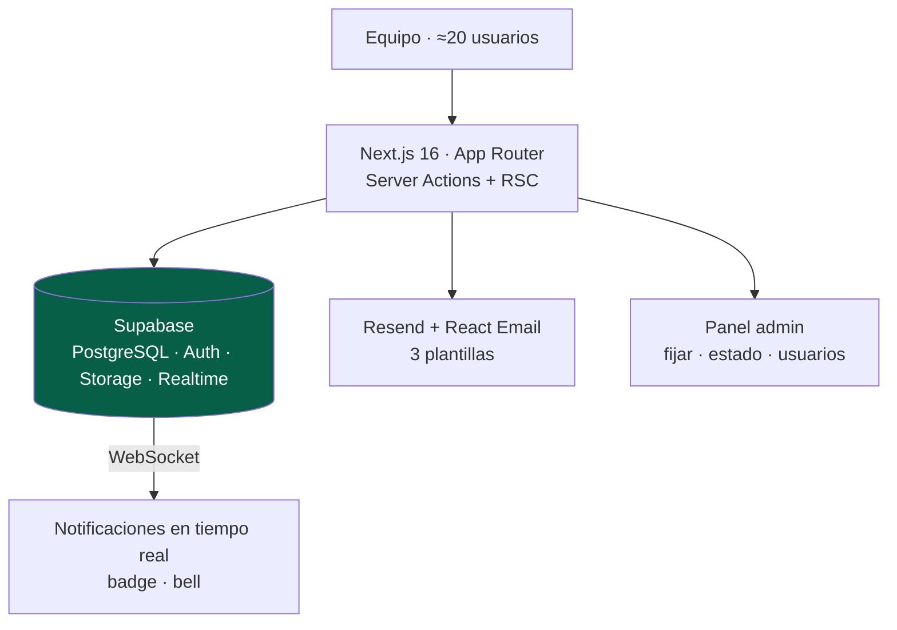

<a href="taskboard.md">🇬🇧 English version</a>

# TaskBoard

> Herramienta web interna para que el equipo proponga, **vote y priorice** peticiones de mejora. El responsable técnico ve claramente qué construir primero según las votaciones del equipo. En producción para uso interno.

---

## Contexto y problema

Cuando una sola persona lleva todo el desarrollo de una empresa, el cuello de botella es **decidir qué hacer primero**. Las peticiones llegaban por canales dispersos (mensajes, correos, conversaciones de pasillo) sin forma de priorizarlas objetivamente.

TaskBoard centraliza ese flujo: cualquiera del equipo propone una mejora, **el equipo la vota**, y la priorización emerge de los datos en lugar de la persona que más insiste.

---

## Solución y arquitectura

Cada petición tiene título, descripción y hasta 3 fotos; el equipo vota (1–5 o voto negativo), comenta, vincula peticiones relacionadas y recibe **notificaciones en tiempo real** (in-app vía Supabase Realtime + email vía Resend). El admin fija peticiones prioritarias, cambia su estado (`Pendiente → En Progreso → Hecha`) y gestiona usuarios.

---

## Stack y decisiones técnicas

| Tecnología | Decisión | Por qué |
|---|---|---|
| **Supabase (Realtime + RLS)** | Suscripciones WebSocket para *badges* y RLS en todas las tablas | Notificaciones instantáneas con aislamiento de datos a nivel de fila |
| **Zod v4 `discriminatedUnion`** | Voto modelado como unión discriminada (1–5 *xor* negativo) | Mutua exclusividad garantizada en la validación, no solo en la UI |
| **TanStack Query (mutaciones optimistas)** | UI de votación actualiza al instante con *rollback* ante error | La votación necesita *feedback* inmediato para sentirse fluida |
| **Server Actions + `revalidatePath`** | Mutaciones sin API REST explícita, validadas en servidor | Menos *boilerplate*, validación Zod compartida |
| **Notificaciones *fire-and-forget*** | El fallo de un email no bloquea la *Server Action* | La acción del usuario nunca se cae por un problema de correo |
| **Anti-duplicado de enlaces** | `CHECK (petition_a_id < petition_b_id)` + índice único | Impide vincular A→B y B→A por separado a nivel de base de datos |

---

## Retos técnicos resueltos

- **Tiempo real + email** combinados: un *helper* `createNotification()` dispara la notificación in-app y el correo en paralelo, con opt-in por usuario.
- **Priorización objetiva** a partir de agregados de votos, con índice único `(user_id, petition_id)` que impide el doble voto.
- **Convivencia multi-app en un mismo Supabase**: renombrado de tablas (`votes → petition_votes`) y consolidación de migraciones para evitar colisiones con otra aplicación del ecosistema, manteniendo el aislamiento por RLS.
- **Búsqueda *fuzzy*** con la extensión `pg_trgm` de PostgreSQL (sin Elasticsearch).

---

## Resultado e impacto

- **En producción** para el equipo interno (~20 usuarios), desplegado en **Vercel**.
- **Métricas:** 8 tablas core · 15 migraciones · 11 fases de desarrollo completadas (100 %) · *stack* moderno Next.js 16 + React 19.
- Comentarios **inmutables** (sin `updated_at`) como decisión de auditoría simple.

---

## Competencias demostradas

`Next.js 16` · `React 19` · `Supabase (Realtime, RLS, Auth, Storage)` · `TanStack Query` · `Zod v4` · `Resend + React Email` · `PostgreSQL (pg_trgm)` · `Server Actions` · `Vercel`