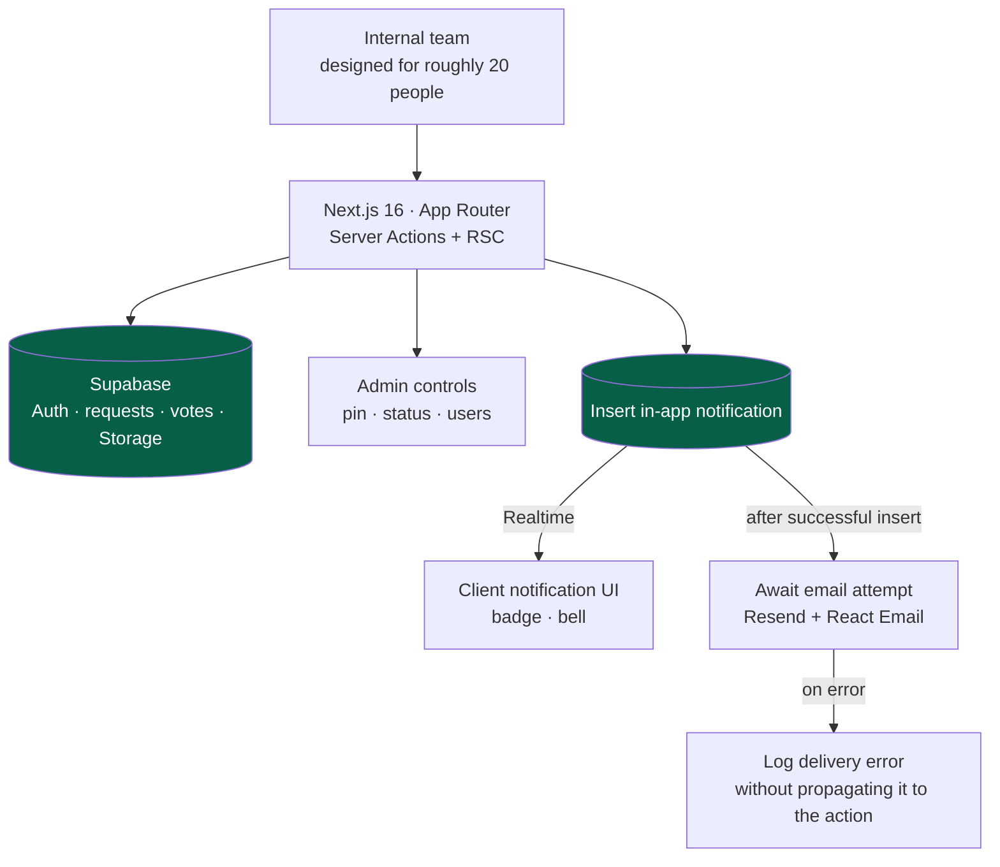

<a href="taskboard.es.md">🇪🇸 Versión en español</a>

# TaskBoard

> An internal tool for proposing, **voting on and prioritizing** improvement requests. It brings requests, discussion and status changes into one workflow, designed for a team of roughly twenty people.

## My contribution & delivered scope

- **My contribution:** implementation of the request and voting workflow, permissions, notifications and integration with a shared Supabase environment.
- **Delivered scope:** requests with photos, mutually exclusive vote types, comments, linked requests, search, admin controls and in-app notifications; an email mirror was subsequently implemented.
- **Historical stage — 13 May 2026:** the internal application had a documented Vercel deployment. The latest email-delivery note left its database migration and production activation as manual cutover steps.

---

## Context & problem

Improvement requests arrived through messages, emails and informal conversations. That made it difficult to retain the context, compare demand and explain which request should come next.

TaskBoard gives the team one place to **propose, vote and discuss**. Vote aggregates inform prioritization, while an administrator can pin a request and move it through `Pending → In Progress → Done`. The intended scale was an internal team.

---

## Solution & architecture

Next.js Server Actions validate changes and persist them in Supabase. Notification creation first inserts an in-app record; after a successful insert, the helper **awaits an email attempt**. For multiple recipients, those attempts run in series. Realtime delivers database updates to the notification UI independently of the email path.

*Implemented notification flow. Email attempts are sequential and awaited; the latest delivery note still required production activation.*

Each request includes a title, description and up to three photos. Users can vote positively (1–5) or negatively, comment and link related requests. The admin manages status, pinned items and users.

---

## Stack & technical decisions

| Technology | Decision | Why |
|---|---|---|
| **Supabase Realtime + RLS** | Subscribe to notification changes and enforce row-level policies | Combines live UI updates with database-level access rules |
| **Zod v4 discriminated unions** | Model a vote as positive (1–5) or negative, never both | Enforces mutual exclusivity in validation as well as the UI |
| **TanStack Query** | Optimistic vote updates with rollback on error | Gives immediate feedback while retaining a recovery path |
| **Server Actions + revalidation** | Validate mutations server-side and refresh the relevant views | Keeps the mutation flow within the Next.js application |
| **Email error isolation** | Await email attempts but catch and log their failures | A delivery error is not returned as a failure of the saved request; waiting for delivery still adds latency |
| **Link anti-duplication** | Sorted-pair constraint and a unique index | Prevents representing A→B and B→A as two separate links |

---

## Technical challenges addressed

- **Vote integrity:** validation separates positive and negative votes, and a unique user/request pair prevents duplicate votes.
- **Shared database integration:** table renaming and migration consolidation allow coexistence with another application while retaining access policies.
- **Notification preferences:** the email mirror uses three React Email templates. The preference is enabled by default and users can opt out. Delivery is best effort, with errors logged and no persistent retry queue.
- **Search without a separate search service:** PostgreSQL's `pg_trgm` supports fuzzy request search.
- **Comment history:** the application models comments as immutable entries rather than editable messages.

---

## Outcome & validation

The delivered scope covers the team's **request → vote → discussion → status** workflow and its integration with shared authentication and data infrastructure. Database constraints, server validation and optimistic updates address different parts of that workflow: integrity, authorization and immediate feedback.

The **13 May 2026 email verification recorded 15 passing mocked tests** for templates, opt-out behavior, helper integration and failure handling. The migration and production cutover remained manual follow-up work in that record. The roughly twenty-person team describes the intended audience of this version.

---

## Skills demonstrated

`Next.js 16` · `React 19` · `Supabase (Realtime, RLS, Auth, Storage)` · `TanStack Query` · `Zod v4` · `Resend + React Email` · `PostgreSQL (pg_trgm)` · `Server Actions` · `shared database integration` · `Vercel`
